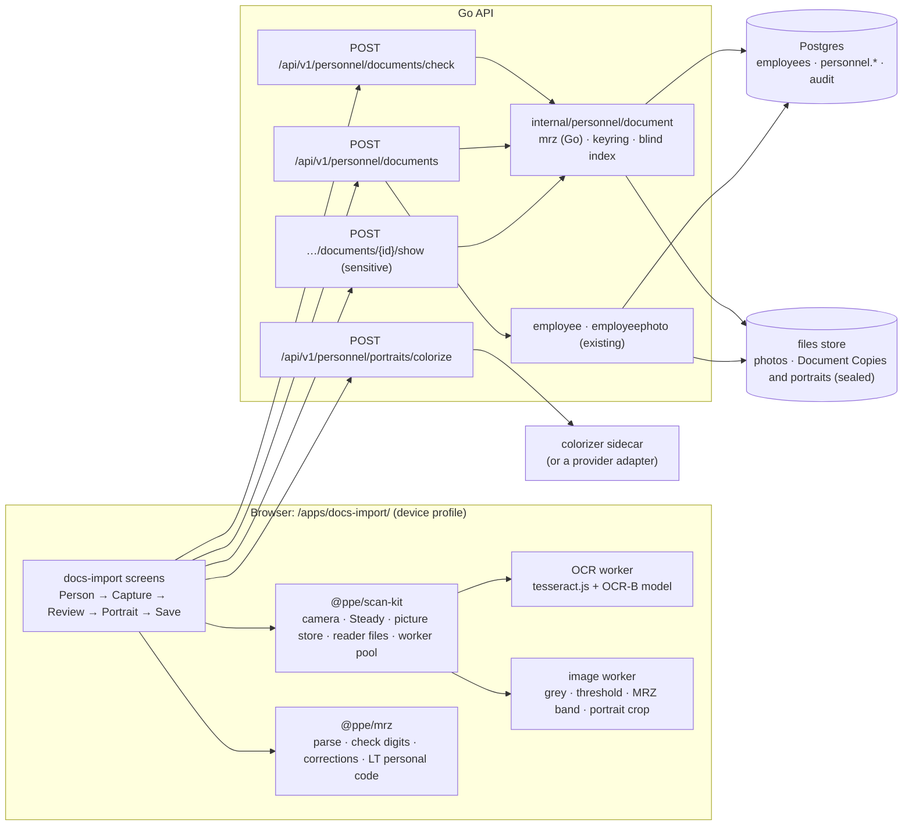

# docs-import: requirements and plan

- **Date:** 2026-11-05
- **Status:** proposal, **revision 4** (2026-11-05: **D1 decided**: a Personnel files context,
  and a switch on the scan's review step, **Add to Employee Record**, set per document (section 3,
  FR-19, new D11); **D2 decided**: keep every field the document
  gives, and keep the document's images as **Document Copies**, sealed per person; sections 3, 4,
  5.5, 5.6, 9 and 11 follow it; **D3 decided**: as long as Lithuanian law and the GDPR permit,
  which is 3 years after employment ends, and the app records when it ends (section 3, FR-20)).
  Revision 3 (the same day): phase 1, the reading spike, is done and its
  numbers are in; the verdict is **go**, see [Phase 1 results](#phase-1-results-revision-3-the-go--no-go-gate).
  Revision 2 (the same day, after the Scan SIMs fixes were built and deployed) is
  [section 0](#0-review-after-the-scan-sims-fixes-revision-2).
  It becomes ADR 0007 (Personnel files: identity documents) and a spec
  `docs/specs/personnel-service.md` once the [open decisions](#11-open-decisions) are made.
- **Builds on:** [Scan SIMs review](sim-scan-review.md), [ADR 0001](../architecture/adr/0001-modular-monolith-with-bounded-contexts.md)
  and the [context map](../architecture/context-map.md) (People, Personnel files),
  [ADR 0005](../architecture/adr/0005-sim-codes-and-scan-sims-trial.md) (sealed values, the device
  profile), [ADR 0006](../architecture/adr/0006-app-launcher.md) (published apps)

## 0. Review after the Scan SIMs fixes (revision 2)

The first revision was written before the Scan SIMs review's six steps were built (commits
`74d5214`…`749f304`, deployed 2026-11-05). Building them settled several things this plan had only
assumed, and showed two mistakes in it. What changed:

| # | Finding | Change to the plan |
| --- | --- | --- |
| R1 | **Crypto-shredding was overstated.** Revision 1 said destroying a person's key row "makes every copy unreadable, including copies in backups". It does not: the row is in every backup taken before, sealed by the same master key, so a backup still opens it. A restore would even bring the person's data back | Erasure is complete once the last backup holding the key has expired (`DBBACKUP_KEEP_DAYS`, 14 days), and shredding is a **rule a daily job applies**, not a one-off action, so it applies again after a restore (section 3, PR-8, D10) |
| R2 | **The keyring now exists.** `sealbox.Keyring` (key ids on rows, previous keys only open) and the re-seal pattern (`api -reseal-sim-codes`: counts only, nothing audited, a row changed meanwhile left as set) are built and tested | Phase 0 no longer adds a keyring. The master key follows the SIM codes key's settings exactly; rotating it re-seals only the per-person keys, which is cheap (sections 3, 5.7) |
| R3 | **Live OCR is slower than the plan assumed.** Barcode decoding measured 10–16 ms a frame on a Mac; Tesseract on a back is roughly a second on a phone (not measured), and the plan asked for "≥ 3 live attempts a second" | NFR-4 now asks for ≥ 1 attempt a second, reading only the MRZ band (a narrow crop), with the number fixed in phase 1. A still photo stays the main path; live scanning is a convenience (5.2). **Phase 1:** a live attempt (the guide's strip of a 1280 px frame) takes about 160 ms on an M3 Max, most of it OCR; about 0.5 s estimated on a mid-range phone, to be measured there |
| R4 | **The worker pattern is proven.** `barcode.worker.ts` with a typed protocol file, pixels transferred, a fallback to the page's thread, and an e2e check that the worker really runs (`page.workers()`), under the device policy behind Caddy | Image work and OCR follow the same pattern, with the same e2e check (NFR-3, 5.2, section 8) |
| R5 | **F1 was fixed without a router guard**: Scan stays mounted, hidden, while the other tab is open. No leave guard exists in `@ppe/app-shell` | docs-import keeps its steps (Person → Capture → Review → Portrait → Save) as one screen's state, not routes, plus `beforeunload`; no router guard is needed (PR-1) |
| R6 | **The picture store and list reducer exist, but in the app** (`apps/sim-scan/src/routes/scan/`), not in a package | Phase 0 moves `PictureStore`/`usePictureStore` and the "released pictures" reducer pattern into `@ppe/scan-kit` (section 6) |
| R7 | **`make new-app` has no profile option**; its template is `standard` | Phase 3 sets `"profile": "device"` in `public/ppe-app.json` by hand and copies Scan SIMs' `csp.test.ts` (or `new-app` gains `--profile device`) |
| R8 | **Reader files are downloaded again for every version.** Each published version's files live under `/apps/files/device/<slug>/<version>/`, so `readers/` (about 7 MB for Scan SIMs, likely similar for an OCR-B model) is a new URL after every deploy, and two apps never share it | A risk to measure now that there will be two such apps; a shared, content-addressed readers path is the fix if it matters (section 9) |
| R9 | **Concurrent writes need a decision each.** Step 5 showed two Scan SIMs batches racing for numbers; the fix was a retry because numbers were the batch's own | docs-import numbers nothing, so it retries nothing: two people saving the same document at once is refused by a unique index and answered as "already on file" with the other's id (5.6) |
| R10 | **e2e and Postgres tests share one database and one set of ports across every session and worktree.** Runs emptied each other's database three times on 2026-11-05 | A lock in the e2e and `test-db` set-up (refuse to start while another run holds it) before docs-import adds its own long e2e steps (section 8). *Done 2026-11-05: `cmd/testlock` (see CLAUDE.md, Testing)* |
| R11 | **"Stable follows deploys" is off for published apps**, so a deploy puts a new build on Preview only; Scan SIMs' fixes reached users only after someone pressed Make Stable | Phase 6 names that step; the trial is judged on Preview and Beta first anyway |
| R12 | **The publish pipe could fail a deploy** on tar's padding (fixed in `b4fdc42`), and a local Caddy e2e served a stale build (fixed in `9ab5ee8`) | Nothing to change; docs-import inherits both fixes |

Unchanged: the MRZ-and-check-digits approach, the data split (Personnel files), the AI rules
(luminance lock, labels, consent), and the open decisions D1–D8.

## Phase 1 results (revision 3): the go / no-go gate

**Verdict: go**, with two changes to the rules below. A browser reads the MRZ well enough: with
DoubangoTelecom's MRZ model (BSD-3-Clause), 140 of 144 synthetic specimen photos (97.2 %) were
read with every check digit passing, all 135 that were not both small and blurred, and **no wrong
value was accepted in a field a check digit covers**, in Chromium and WebKit alike. A photo takes
about 0.2 s to read on the Mac; the first use downloads 5.3 MB (about 2.8 MB on the wire). The
two changes: **every reading is accepted only when two reads agree** (live: two frames, as
planned; a photo: read twice, which the plan did not ask for), and **the names, document code
and sex, which no check digit covers, are checked by the person** on the review screen. Phones and
the team's own documents were not measured yet (no phone was at hand and no documents were
offered); both are needed before the trial (phase 6), and neither blocks phase 2.

### What was built

| Piece | Where | What it is |
| --- | --- | --- |
| `@ppe/mrz` | `web/packages/mrz` | the parser: TD1/TD2/TD3, check digits, FR-5's corrections, century rules, the Lithuanian personal code, `fold()` and `nameMatch()`, `readMrz()` from OCR text. Pure TypeScript, no DOM; 64 tests |
| shared vectors | `testdata/mrz/vectors.json` | 30 cases (ICAO's three specimens, a long document number, corrections taken and refused, dates, codes), 8 read-from-text cases, LT codes, fold and name cases, for the Go parser of phase 2 too (NFR-7) |
| specimens | `web/e2e/fixtures/documents` (`specimens.ts`, `make.ts`) | a TD3 passport page and TD1 ID card fronts and backs at ICAO sizes, made-up people, OCR-B (`ocrb10.otf`, CTAN *ocr-b-outline*: "freely use, modify, and/or distribute"), every page marked SPECIMEN; three with planted misreads (an `O` for a `0` in a number, an `I` for a `1` in a date, a `9` for a `4` in an expiry date) |
| reading spike | `web/spikes/mrz` (throwaway, never in the image) | a bare page; the image work (grey, Sauvola, skew, the MRZ band, the cut-out at 32 px a character) in plain TypeScript in a worker (`image.worker.ts`, the `barcode.worker.ts` pattern, 9 tests); `createTextReader()`, the factory §6 asks for; scripts that make the test set, measure, simulate, and train a model |

### The test set

The specimens drawn as phone photos (2000 × 1500, seeded): on a table, turned up to 10°, tilted
up to 14°, blurred up to 2.2 px, lit unevenly, with glare, dimmed, noisy, JPEG at 55–90 %, the
document filling 40–90 % of the width. 144 photos should read (6 documents × 24), 24 carry the
planted error no reader may accept, 6 are card fronts (no MRZ). Live: 36 frames of 1280 × 720
with the document in the guide, of which only the guide's lower 40 % is read (30 pairs of
consecutive frames for the two-frame rule).

### Models

| Model | Licence | Size (gz) | Photos read, every digit passing | Wrong accepted, one read (of them in checked fields) | Two agreeing reads: read / wrong | Live frames: one (wrong) / Steady pairs (wrong) |
| --- | --- | --- | --- | --- | --- | --- |
| **DoubangoTelecom `mrz`** (tesseractMRZ, `tessdata_fast`, commit `0f039b6`) | **BSD-3-Clause** | 1.31 MB | **140 / 144 (97.2 %)** | **0 (0)** | 140 / 0 | 33 / 36 (3, names); 26 / 30 (0) |
| Shreeshrii `ocrb_int` (tessdata_ocrb, `9135a9e`) | none stated: not shippable | 1.31 MB | 134 / 144 (93.1 %) | 2 (1) | 130 / 0 | 29 / 36 (3); 21 / 30 (0) |
| Tesseract `eng` (best_int, as Scan SIMs) | Apache-2.0 | 2.95 MB | 0 / 72 (fillers read as `L` and `C`) | 6 (0: names, before the names rule below) | – | 0 |
| ours, `ppe_ocrb` (`eng` fine-tuned with tesstrain on 8 000 synthetic OCR-B lines) | Apache-2.0 + the font's | 1.34 MB | 120 / 144 (83.3 %; WebKit 86.1 %) | 17 (0: names and document code) | 105 / 2 (names) | 24 / 36 (6); 16 / 30 (0; WebKit 1) |

Every model refused all 24 planted errors and found no MRZ on the 6 fronts. WebKit gave the same
counts as Chromium for `mrz`, and within four photos for the others. The `eng` row was measured on the first,
72-photo set; it is not a candidate.

**Chosen: DoubangoTelecom `mrz`.** It reads best, it is the smallest, and its licence lets us ship
it (keep the licence text beside it in `readers/`). Two cautions: its training data is "~7 000
images from Google image, augmented with few synthetic data" (its README), so its provenance is
weaker than its licence; and it was last changed in January 2020. `ppe_ocrb` is the fallback
with a clean provenance (our lines, our font, Apache-2.0 `eng`) and is reproducible from
`web/spikes/mrz/train`; but this first run (6 000 iterations on 8 000 drawn lines, 25 minutes in Docker, 0.02 % character error on its own lines) reads the photos far worse, misreading names above all, and is not a candidate. Training it on bands cut from photos by the reader itself, rather than on drawn lines, is the next step should the Doubango model ever have to go.

### Time and size (NFR-4)

Measured on an Apple M3 Max (macOS 27), Playwright's Chromium 153 and WebKit 26.6, model `mrz`,
medians:

| Step | Photo (2000 px) | Live attempt (1280 px frame, the guide's strip) |
| --- | --- | --- |
| decode and scale | 8 ms | – |
| image worker: grey 13, Sauvola 8, skew 11, band 5, cut-out 4 (with the transfer) | 48 ms (WebKit 56) | 22 ms |
| OCR of the band (tesseract.js 7, `PSM.SINGLE_BLOCK`, MRZ whitelist, no dictionaries) | 140 ms | ≈ 135 ms |
| parse and correct | 0.2 ms | 0.2 ms |
| **one read** | **≈ 200 ms (Chromium 196, WebKit 207)** | **≈ 160 ms (Chromium 156, WebKit 160)** |
| the second read (another threshold) | + 186 ms: **≈ 380 ms** | the next frame |
| first-use download | `worker.min.js` 0.11 MB, `tesseract-core-relaxedsimd-lstm.wasm.js` 3.91 MB, `mrz.traineddata.gz` 1.31 MB: **5.33 MB**, about **2.8 MB on the wire** (Caddy compresses the core and worker: 1.46 MB + 0.03 MB) | the same |
| model load (download from localhost and start) | 120–150 ms | |

Not measured on a phone. DevTools' CPU slowdown was tried as a stand-in and does not work: it
slows only the page's main thread, and both the image work and the OCR run in workers (4× made
140 ms of OCR 143 ms). Estimated from single-thread speed, a mid-range Android phone is about 3×
slower than this Mac: a photo read twice about 1.2 s plus decoding a 12 MP photo, within NFR-4's
2 s; a live attempt about 0.5 s, so about 2 attempts a second, above NFR-4's 1. **Run the
specimen photos** on the spike's page (`pnpm dev --host`, then the phone's browser) replaces
these estimates with measurements; do it on an iPhone and a mid-range Android before the trial.

### Accuracy (NFR-5), and what check digits cannot see

With the chosen model the measured wrong-value rate is 0 for every field a check digit covers,
with one read and with two (the Shreeshrii model let one through on one read, which the second
read caught). But the spike showed that the plan's "the check digits guarantee this" is too
strong, in three ways, each now a rule:

1. **Some misreads are invisible to check digits.** Characters whose values differ by 10 or 20
   give the same digit in any place: `K`/`<`, `G`/`6`, `L`/`1`, `U`/`0`, `A`/`<`. And the composite
   digit weighs the **document number** exactly as the number's own digit does (the number starts
   the composite, at a multiple of three), so two misreads in the number that balance its digit
   pass the composite too. A live frame showed this: `C4H7K2M95` read as `C4M7K2R95` (+5 at
   weight 1, +35 at weight 7) passed every digit. Dates are safe: their place in the composite
   gives them other weights, so the composite is a second, independent check.
2. **FR-5's search spends the number's one check digit.** Trying 64 combinations of look-alikes
   in a number finds a reading that passes about one time in ten even when it is wrong, and the
   composite cannot object (point 1). Usually several pass and the parser takes none (the ICAO
   specimen's `L898902C3` read as `L8989O2C3` has three); when exactly one passes, it is taken but
   marked `needsSecondRead`. The same mark goes on a fitting that moved the number's characters
   (a stray mark before the line). On random misreads (`pnpm simulate`, 40 000 lines a row) one
   read accepts 0.03 % to 3 % wrong lines, as the misread rate rises; **two independent reads that
   must agree accept none** at every rate.
3. **Names, document code and sex have no check digit at all.** With a poor model (`eng`), fillers
   read as `L` gave names like `JONAS LLLLLLLL` that passed every check; with the chosen model,
   single live frames gave `JORAS` and `JOMAS`. The parser now refuses names with a letter three
   times running, `<<<` between parts, or a filler first (`names_unreadable`), and with the
   chosen model the two-read rule caught every misread name in the set. With `ppe_ocrb`, two
   photos gave the same wrong name in both reads: only the person can confirm a name, by typing
   it as printed (FR-7, `nameMatch`).

### What this changes in the plan

| Where | Change |
| --- | --- |
| FR-4 | A **photo is read twice** (two thresholds of the same band) and accepted only when both readings are the same lines; live keeps two equal frames in a row. In the set this cost no correct reads (140 either way) and about 190 ms |
| FR-5 | A correction in a **number's field** (letters and digits both allowed) rests on that field's one check digit: it is taken only when it is the one passing combination, and then needs the second read; corrections where the layout allows only digits or only letters (dates, check digits, names, state codes) are certain. Corrected fields stay shown |
| FR-7 | The review screen says which fields **no check digit covers** (names, document code, sex, and nationality, which only the state list checks) and the person confirms the names by typing them as printed; a `names_unreadable` reading is never offered |
| NFR-4 | Numbers fixed for this Mac (one read ≈ 0.2 s, two ≈ 0.4 s; live attempt ≈ 0.16 s; first use 5.3 MB, 2.8 MB on the wire); the phone numbers to be measured with the spike's page before the trial |
| NFR-5 | "0 % accepted with a wrong value" holds **for the fields check digits cover, under the two-read rule**, measured on the set and by the simulation; it is not a guarantee of the check digits alone. Names are the person's check. ≥ 98 % of good photos: 97.2 % on a deliberately harsh set, 100 % (135 / 135) without the small-and-blurred photos; the capture guidance ("fill the frame, hold still") and live mode are the answer to those |
| §5.2 step 4 | The model is DoubangoTelecom's `mrz`, `PSM.SINGLE_BLOCK`, the MRZ whitelist, every dictionary off (they are load-time settings in tesseract.js, `createWorker`'s fourth argument) |
| §5.2 step 5 | `readMrz` fits lines in tiers: fillers in or out of runs and a stray mark at either end first, any one character only if that finds nothing; each tier taken only when one fitting alone passes every digit |
| §5.2 steps 2–3 | The band finder looks for 2 or 3 rows of an MRZ's length; a pair of TD1 length is a TD1 that lost its top row, which is given back. Margins round the cut-out under a character, as wider ones took in the card's edge as a stray character |
| R3 | Measured: OCR of the band about 140 ms on the Mac in both browsers, the image work 20–50 ms; a live attempt about 160 ms |
| D9 | Input: the browser failed only small and blurred photos (4 of 144), which a server would read no better from the same pixels; **a server-side reader is not needed for v1** |
| §6 | `src/image.ts` and its worker move to `@ppe/scan-kit`'s image module unchanged; `createTextReader()` is as `src/ocr.ts` |
| §8 | The shared vectors and the specimens exist; e2e (phase 3) can use `fixtures/documents/*.jpg` as they are |
| §9 | New risk: check digits' blind spots (above), mitigated by the two-read rule and the person's check of names |

## 1. Goal

A phone-first published app, **Import Documents** (slug `docs-import`), that:

1. reads a **passport or identity card** with the phone's camera or from a photo;
2. takes the person's data from it **without AI**, using the machine-readable zone (MRZ) and its
   check digits, the same way Scan SIMs uses the barcode and Luhn;
3. saves the data to the person (today's `employees`, the future People context), and keeps
   the document's identifiers sealed in **Personnel files**;
4. crops the portrait from the document and, **optionally and with AI**, produces a colour
   photo of the person, saved as one of their photos and clearly marked as AI-made.

It should use the same technologies as Scan SIMs, and the reading kit should be shared rather
than copied.

### What "without AI" means here

| Step | Technique | AI? |
| --- | --- | --- |
| Find and read the MRZ | Image thresholding plus Tesseract LSTM OCR with an OCR-B model and a strict character list | Classic OCR, the same engine as Scan SIMs. No generative or cloud AI |
| Check what was read | ICAO 9303 check digits (7-3-1), the Lithuanian personal code checksum, date logic | No: deterministic |
| Correct misreads | Swap look-alike characters (O↔0, I↔1, B↔8, S↔5, Z↔2, K↔<) only where a check digit then passes | No: deterministic |
| Find the portrait | Its position relative to the MRZ (ICAO layouts), and the user can adjust the crop | No (an ML face detector is an optional later step) |
| **Colour the portrait** | An image colourisation model | **Yes**, opt-in and clearly labelled (section 6) |

## 2. What the documents give us

### 2.1 The MRZ (ICAO Doc 9303)

| Format | Used on | Lines × characters | Where |
| --- | --- | --- | --- |
| **TD3** | passports | 2 × 44 | bottom of the data page, with the portrait on the same page |
| **TD1** | ID cards and EU residence permits (ID-1 card size) | 3 × 30 | the back. The portrait is on the **front**, so it takes two photos, like a SIM carrier |
| TD2 | older ID cards, some visas | 2 × 36 | rare; supported by the same parser |

Fields in every format: document type, issuing state, **surname and given names**,
**document number** (with check digit), **nationality**, **date of birth** (with check digit),
**sex**, **date of expiry** (with check digit), optional data (often the **personal number**),
and a composite check digit over the line(s).

The check digit uses weights 7, 3, 1 repeating, with `<` = 0 and `A`–`Z` = 10–35. Each check
digit protects its field, and the composite digit protects all of them. This is the
counterpart of Luhn in Scan SIMs: a read that passes every digit is almost certainly right.

### 2.2 What the MRZ does *not* give

- **Diacritics and the national spelling of names.** The MRZ is in Latin capitals and
  transliterated: `ŽUKAUSKAITĖ` is `ZUKAUSKAITE`, and Cyrillic names are transliterated. Long
  names are cut short.
- **Date of issue, issuing authority, place of birth.** These are printed in the visual
  inspection zone (VIZ) only.
- **Full century of dates.** `YYMMDD` needs a rule: birth dates are in the past, and expiry
  dates are within about 10–20 years.

So the names on the person must be the **printed** names (with diacritics). The app gets
them in one of two ways: (a) the user types the diacritics on the review screen, guided by the
MRZ form, or (b) later, OCR of the VIZ name lines. The VIZ result is accepted **only if
removing its diacritics gives exactly the MRZ name** (section 5.3). That keeps step (b)
deterministic.

### 2.3 The chip (NFC)

Passports and EU ID cards have a chip with the data and a colour portrait (DG2), signed by the
issuing state. **A web app cannot read it.** Web NFC (Chrome on Android only) reads NDEF tags,
not the ISO 14443 / BAC / PACE exchange a document chip needs, and iOS has no Web NFC. Reading
the chip would need a native app. It is out of scope, but worth remembering: a native reader
would give a real colour portrait without any AI.

### 2.4 Lithuanian personal code (asmens kodas)

`G YYMMDD NNN K`, 11 digits. `G` gives the century and sex (3/4 for 1900s male/female, 5/6 for
2000s). `K` is a check digit: weights 1–9,1 mod 11, and if the result is 10, weights 3–9,1,2,3,
and if that is 10 again, 0. When the document carries the code (Lithuanian documents put it in
the MRZ's optional data, to confirm on specimens), it must match the MRZ's birth date and sex.
That is a third independent check.

## 3. Where the data goes

The request was "save it into the person table". Today that table is `employees`, which holds
names, a code, language, sizes and photos. The architecture already decides where identity
documents belong (context map, ADR 0001):

> **Personnel files** — identity documents and ID numbers… **special care**. Nothing depends
> on Personnel files… Other contexts may learn *that* a document exists and is valid
> ("ID document valid until 2029-04"), never its number or file.

The plan follows that split:

| Data | Goes to | Stored as | Why |
| --- | --- | --- | --- |
| First and last name (printed form, with diacritics) | `employees` (People) | plain, audited as today (`employee.updated`) | Everyone needs names |
| Date of birth, nationality, sex | the sealed document always; `employees` (People), new nullable columns, when the scan's **Add to Employee Record** is on (D1) | plain on `employees` | Ordinary personal data, used for checks and reports. Kept (D2) |
| Document kind, issuing state, **expiry date**, **date of issue** | `personnel.identity_documents` | plain | Needed for "valid until" and expiry reminders without opening anything. The date of issue is not in the MRZ: typed in the review, or read from the printed page later (FR-16) |
| **Document number, personal code**, the MRZ text, **place of birth**, **issuing authority** | `personnel.identity_documents` | **sealed** (sealbox), plus a **blind index** of the number and the code for lookups | Special care. Never in plain text in the database, backups, events or logs. Place of birth and authority are not in the MRZ either: typed, optional (D2) |
| Portrait **as cropped from the document** | files store, `personnel/…` | encrypted with the person's data key | Kept (D2), as the source of the photos made from it; retention as the document's (D3) |
| **Document Copies**: the photos of the document as read (a passport's data page; an ID card's front and back) | files store, `personnel/…`, one object per side | JPEG at most 2400 px long, without metadata, **encrypted with the person's data key** | Kept (D2). A copy of an ID: the DPIA records why it is kept and on what legal basis (PR-10), and showing one is audited like the number (FR-14) |
| Colour photo (AI) | `employee_photos` (existing), use `profile` | as other photos, plus `ai_generated = true` | Shown as the avatar. Labelled as AI-made everywhere it appears |

**Document Copies and the law.** Lithuanian practice (the State Data Protection Inspectorate)
treats copying ID documents as excessive unless a purpose needs it. D2 keeps them anyway, so
the DPIA (PR-10) names the purpose (for example proof of identity and right to work, checked
again at an inspection) and the legal basis before go-live, and the employee is told. The
technical side keeps the risk small: sealed per person, never sent to the AI (PR-9), shown only
with `personnel.documents.read` and a recent sign-in, audited, and destroyed with the person's
key (below).

**Add to Employee Record (D1), chosen per document.** Personnel files owns every identity
field. Whether a scanned document's data also goes onto the employee record is chosen **each
time a document is scanned**: the review step has a switch, **Add to Employee Record**, off by
default, and Save records the choice with the document (`on_employee_record`, in
`personnel.document_recorded`).

- **Off:** the document is filed in Personnel files only. The employee record is not changed
  beyond what a new employee needs (names); the employee page shows FR-15's "valid until" line.
  Date of birth, nationality and sex stay in the sealed document.
- **On:** FR-8's comparison offers date of birth, nationality and sex for the `employees`
  columns, and the employee page's **Identity** section shows that document's fields (FR-19),
  read from Personnel files' API, never copied.

The sealed fields (the number, personal code, place of birth, authority) and the Document Copies
are not written into `employees` in plain text even when the switch is on: there they would be
in every list query, export and backup, and out of reach of crypto-shredding. The section shows
them through Show Document's rules (`personnel.documents.read`, a recent sign-in, audited).
Which fields the section shows, and to whom, is D11. Someone with `personnel.documents.manage`
may change a document's choice later on the employee page (audited, `personnel.document_updated`).
The employee page reading Personnel files is an exception the context map must record ("other
contexts learn only *that* a document exists" holds for other contexts' code), in ADR 0007.

**Blind index.** `HMAC-SHA256(API_PERSONNEL_INDEX_KEY, normalised value)` of the document
number and the personal code. It answers "is this person or document already on file?"
without decrypting anything. The index key is separate from the sealing key. It is not
rotated like the sealing key: a new index key means computing every index again from the
opened values, so it gets a command of its own only if it is ever needed.

**Per-person keys (envelope encryption).** The context map promises documents "encrypted with
keys Personnel files can destroy". Each employee gets a data key (32 random bytes, a
`sealbox.Box`) that is sealed by the master keyring (`API_PERSONNEL_KEY`, a `sealbox.Keyring`
exactly as the SIM codes key is, with `…_KEY_ID` and `…_PREVIOUS_KEYS`), bound to the employee
(`"ppe.personnel.subject_key.v1|" + employee id`), and kept in `personnel.subject_keys`. Their
document fields, portrait and Document Copies are sealed with that data key. The files store
keeps every version of every object (bucket versioning, `docs/backups.md`), so deleting an
object would not remove it; the data key is what makes the copies unreadable. Changing the master key re-seals
only these small rows (`api -reseal-personnel-keys`, the SIM codes command's pattern), never
the documents.

**Erasure (crypto-shredding), as it really works.** Deleting a person's `subject_keys` row makes
their documents unreadable in the live database at once. It does **not** reach backups taken
before: they hold the row, sealed by a master key the API still has. So erasure is complete
when the last such backup has expired (`DBBACKUP_KEEP_DAYS`, 14 days today), and the DPIA and
any answer to an erasure request say so. Because a restore would bring the row back, shredding
is a **rule** (`employment ended + retention`, D3) that a daily job applies, idempotently, not
an action taken once: after a restore the job shreds again what the rule says is gone. A
stronger form, keys kept outside the database and its backups, is possible later and not
planned (D10).

**Retention (D3): as long as Lithuanian law and the GDPR permit.**

- The GDPR keeps personal data no longer than its purpose needs (Article 5(1)(e)), and where a
  law sets a period, that period is the measure.
- Lithuania's index of retention periods for internal administration documents (the Chief
  Archivist's, in force since 2024-10-01, binding on private companies too) keeps an employee's
  **personal file 3 years after employment ends** (10 years before it). Identity documents,
  their Document Copies and the portrait are part of that file, so they are kept **while the
  person is employed and 3 years after**, then shredded.
- The longer terms do not extend it: the Accounting Act's 10 years cover accounting documents,
  and the index's 50 years cover employment contracts in force, personnel orders and one payroll
  calculation document. Payroll and accounting keep those, with the personal code in them; an
  ID copy is none of them.
- **A setting, not code**: `API_PERSONNEL_RETENTION_MONTHS` (36), since the law has changed
  before (50, 10, now 3 years). The DPIA (PR-10) quotes the act's current text from e-tar.lt.
- **When employment ended** is not recorded anywhere today (`employees` has no such date). Personnel
  files records it: `subjects.employment_ended_on`, set by **Mark Employment Ended** on the
  employee page (FR-20); deleting an employee sets it to that day if it is empty; clearing it
  (the person is back) is allowed and audited. When an HR context exists (ADR 0001), it owns the
  date and Personnel files reads it.
- A **superseded** document is part of the same file and goes with it. A person without an end
  date keeps their documents, as everyone employed does; so the end date matters, and FR-20 makes
  it one step.
- **Before it goes**: 30 days ahead, the Overview lists the people whose documents will be
  shredded, for `personnel.documents.manage`. A **legal hold** (an inspection, a dispute) is a
  date and a reason on the subject that the job respects, set and cleared with an audit event.

## 4. Requirements

Priorities: **M** must (v1), **S** should (v1 if possible), **C** could (later).

### 4.1 Functional

| ID | Pri | Requirement |
| --- | --- | --- |
| FR-1 | M | The user chooses the person: search existing employees (name or code), or **New employee from document** (D6) |
| FR-2 | M | Capture with the **live camera**, with a guide frame shaped like the document (ID-1 card 85.6 × 54 mm, passport page 125 × 88 mm) and an MRZ band near its bottom, or with **Take Photo** (`capture="environment"`) or **Choose Photo** |
| FR-3 | M | Supports TD3 passports and TD1 ID cards and residence permits. TD2 is parsed but not tested in v1. A TD1 card needs its back (MRZ) and front (portrait). The side is detected (MRZ found = back), and the photos are paired in either order, as `pairPhotos` does |
| FR-4 | M | The MRZ is read in the browser. A live reading is accepted once **every check digit passes** and the same result has been read in **two frames in a row** (`Steady`). A photo is read **twice**, with two thresholds of the same band, and accepted only when both give the same lines (phase 1: check digits cannot see every misread) |
| FR-5 | M | **Deterministic correction:** inside fields that must be digits or letters, look-alikes are swapped and every combination is tried, up to a small limit (≤ 64 per field). A correction is taken only if it makes that field's check digit **and** the composite check digit pass, and no other combination does. In a document or personal number the composite adds nothing (phase 1), so such a correction also needs the second read (`needsSecondRead`). The fields that were corrected are shown |
| FR-6 | M | Cross-checks: dates are valid (birth in the past, expiry after birth); the personal code's checksum, birth date and sex agree with the MRZ when there is a code; an **expired** document is a warning, not a stop |
| FR-7 | M | The **review screen** shows the MRZ lines in a monospaced, editable field, with each field underlined in place. The parsed fields are below, with marks: problem (stops Save) or note. Editing the MRZ re-parses it. Names are a separate field, pre-filled from the MRZ, where the user types the diacritics (`Ž`, `Ė`, …). Their diacritic-free form must equal the MRZ name, or a note says that it does not. Below them, optional fields the MRZ does not hold: **date of issue**, **place of birth** and **issuing authority** (D2), typed, or later filled from the printed page (FR-16) |
| FR-8 | M | The review compares the result with the chosen person's current data and shows only the differences (name, birth date…). The user chooses, field by field, to take the document's value or keep the current one. Birth date, nationality and sex are offered only with **Add to Employee Record** on (FR-19) |
| FR-9 | M | The **check** call (server) reports: problems, a document already on file (same number), **another employee** with the same personal code or document number (blind index), and, for a new employee, possible duplicates by name and birth date |
| FR-10 | M | **Save** is all or none, in one transaction: employee created or updated, identity document recorded (an earlier document of the same kind is marked superseded, its copies kept with it until its retention ends), its **Document Copies** and portrait stored, events. Nothing is written before Save |
| FR-11 | M | **Portrait crop:** the portrait is found from its position relative to the MRZ (TD3: left of the data page above the MRZ; TD1: left of the front). The user can move and resize the crop box (touch and keyboard). Output is about 600 × 800 px JPEG |
| FR-12 | S | **AI colour photo:** Make Colour Photo (AI) sends the cropped portrait to the API, which returns a colour version. Before and after are shown side by side. The user may Use it, Try Again or Discard. It is saved as an employee photo with `ai_generated`, the use `profile`, and the default if the person has none. It is never offered without the Settings switch (D4) and the person's consent being recorded (PR-6) |
| FR-13 | S | Save the plain (grey) portrait as a photo instead, without AI |
| FR-14 | S | **Show Document** for someone with `personnel.documents.read`: the number, the personal code, the sealed fields and the Document Copies. Needs a recent sign-in, is audited, `no-store`, and hides again after 60 s or when the tab is hidden (the pattern from Show PIN and PUK) |
| FR-15 | S | The employee page in the staff app shows "ID card · LTU · valid until 2029-04-12" (never the number) and the AI label on AI photos |
| FR-16 | C | VIZ OCR of the name lines (Lithuanian and Russian data), accepted only when it folds to the MRZ name (section 5.3). Also the date of issue, place of birth and issuing authority (D2 keeps them), pre-filling FR-7's fields for the user to confirm |
| FR-19 | M | The review step has a switch, **Add to Employee Record** (D1), off by default, set per document and saved with it. On: FR-8 offers birth date, nationality and sex, and the employee page's **Identity** section shows the document's D11 fields, read through Personnel files' API, the number and personal code behind Show Document. Off: the document is filed only, and the page shows FR-15's line. `personnel.documents.manage` may change it later on the employee page, audited |
| FR-20 | M | **Mark Employment Ended** on the employee page (`personnel.documents.manage`): the date retention runs from (D3), audited (`personnel.employment_ended`, and `personnel.employment_end_cleared` when undone). Deleting an employee sets it if empty. The Overview lists, 30 days ahead, whose documents will be shredded, and a legal hold (date and reason, audited) stops it |
| FR-17 | C | Expiry reminders (Overview item 60 days before), once the outbox and jobs exist |
| FR-18 | C | A native companion to read the chip (DG1, and DG2 for a real colour portrait) |

### 4.2 Non-functional

| ID | Pri | Requirement |
| --- | --- | --- |
| NFR-1 | M | **Same stack as Scan SIMs:** React 19, TypeScript, Vite, Tailwind, `@ppe/ui`, `@ppe/app-shell`, `@ppe/launcher` (`SignedIn`, `AppFrame`), `@ppe/i18n`, published with the **device** profile. No new CSP directive: colouring goes through the API, so `connect-src 'self'` is enough |
| NFR-2 | M | Readers come from the app's own files (`readers/`), loaded on first use. No CDN |
| NFR-3 | M | Image work (thresholding, band finding) and OCR run **in workers**, as Scan SIMs' barcode reader now does (`barcode.worker.ts`: a protocol file, pixels transferred, a fallback to the page's thread). The camera preview stays smooth; the e2e step checks the workers run (`page.workers()`) |
| NFR-4 | M | Speed on a mid-range Android phone: first MRZ read ≤ 2 s from a photo (read twice, FR-4); live, ≥ 1 attempt a second on the MRZ band alone; first-use download ≤ 6 MB. A photo is the main path; live scanning is a convenience. **Phase 1** (M3 Max, Chromium 153 and WebKit 26.6): a photo read once ≈ 0.2 s, twice ≈ 0.4 s; a live attempt ≈ 0.16 s; first use 5.33 MB (≈ 2.8 MB on the wire). Estimated on a mid-range phone at about 3× slower: ≈ 1.2 s and ≈ 2 attempts a second; **still to be measured on two phones** with the spike's page |
| NFR-5 | M | Accuracy on the test set: ≥ 98 % of good photos read with every check digit passing, **0 %** accepted with a wrong value in a field a check digit covers, under FR-4's two-read rule (the check digits alone do not guarantee it, phase 1). **Phase 1:** 97.2 % (140 / 144) of a deliberately harsh specimen set, 100 % (135 / 135) without the photos both small and blurred; 0 wrong values; the names, document code and sex are under no check digit and are the person's to confirm (FR-7) |
| NFR-6 | M | EN / LT / RU from typed dictionaries; mobile first; 44 px touch targets; no sideways scroll at the e2e widths; WCAG 2.1 AA (status texts announced, crop box usable with the keyboard) |
| NFR-7 | M | Server rules mirrored: the Go API re-parses the MRZ and re-checks every digit and the personal code. A shared test-vector file (`testdata/mrz/*.json`) is read by both the TS and Go test suites, so the two parsers cannot drift apart |
| NFR-8 | S | Telemetry without personal data: counts of reads, check-digit failures, corrections and time to read, per version, for App Launcher's Trials page |

### 4.3 Privacy, security and legal

| ID | Pri | Requirement |
| --- | --- | --- |
| PR-1 | M | Images, MRZ text and fields live **only in the screen's memory** until Save sends them, never in any browser storage, in a `PictureStore` that revokes blob URLs when a picture is let go, after Save and when the screen goes. The steps (Person → Capture → Review → Portrait → Save) are one screen's state, not routes, so moving between them never unmounts the work (as Scan SIMs keeps Scan mounted); leaving the page asks first (`beforeunload`) |
| PR-2 | M | No read value ever goes into an `Error`, a log line, an audit event or System's error list. A Go test runs a scan through the service and asserts that the number and personal code appear in no event or log (as the SIM codes tests do) |
| PR-3 | M | The document number, personal code, MRZ text, place of birth, issuing authority, the portrait and the Document Copies are sealed per person (section 3). Plain columns hold only kind, issuing state, dates of issue and expiry. A Document Copy is re-encoded in the browser before Save (at most 2400 px, JPEG): the camera's metadata, location included, never leaves the phone |
| PR-4 | M | New permissions (D7): `personnel.documents.manage` (scan and save, which may create or change the employee: there is no employee permission to require, as any signed-in user may add and edit employees today), `personnel.documents.read` (show the number; recent sign-in), and `personnel.portraits.colorize` (use AI colouring). Listed in `permissions.ts`, `routes_test.go` and the built-in roles |
| PR-5 | M | Audit events: `personnel.document_recorded` (with how many copies), `personnel.document_superseded`, `personnel.document_updated` (Add to Employee Record changed), `personnel.document_shown`, `personnel.document_removed` (kind, issuing state, expiry, never the number), and `employee.photo_added` with `ai_generated: true`. Reads of the number are audited (the context map's "read events" for Personnel files) |
| PR-6 | M | **AI colouring needs a recorded legal basis.** The default is the person's consent, recorded with the photo (who, when, how), and the person may refuse. If they refuse, only the grey portrait or a fresh camera photo is used |
| PR-7 | M | **Label AI images.** "AI-coloured" is shown on the photo in every app. The JPEG carries a metadata note, and the record has `ai_generated`. An AI photo is never used where a true likeness is required (ID badges: the `id_badge` use is refused for an AI photo). The EU AI Act's transparency duties for generated or manipulated images apply from 2 August 2026, so confirm the exact form with the DPO |
| PR-8 | M | Retention: identity documents, their Document Copies and portraits are kept while the person is employed and **3 years after** (D3: Lithuania's personal-file period, `API_PERSONNEL_RETENTION_MONTHS`), unless a legal hold says longer. When it ends, a daily job deletes the person's data key (section 3): unreadable at once in the database, and everywhere once the last older backup has expired (14 days today). The job applies the rule, so it shreds again after a restore. The soft-delete-forever default does not apply to Personnel files |
| PR-9 | S | If an external AI provider is chosen (D4): a processor agreement, EU processing, no training on our data, no retention by the provider. Only the cropped portrait is sent, never the document or a Document Copy |
| PR-10 | S | A DPIA for the whole feature before go-live (identity data and photos of employees) |

## 5. Architecture

### 5.1 Overview



### 5.2 Reading pipeline (browser, no AI)

1. **Frame and crop.** The guide frame matches the chosen document (the user picks Passport or
   ID card, or it is guessed from the first MRZ found). `guideCrop` (from Scan SIMs) maps it
   onto the video.
2. **Find the MRZ band** (image worker): grey scale, then a horizontal projection profile of
   dark pixels. The MRZ is the bottom-most group of 2 or 3 evenly spaced text rows with the
   tell-tale `<` runs. For photos this runs over the whole image. In live mode the band's
   expected place inside the guide is tried first.
3. **Prepare it:** straighten (the angle comes from the baseline of the rows, within ±10°),
   scale so characters are ~32 px tall, and apply Sauvola adaptive threshold (OCR-B on
   guilloche backgrounds needs a local threshold, not a global one). All of this is plain
   TypeScript on `ImageData`, with no OpenCV, which would add ~8 MB.
4. **OCR** (OCR worker): tesseract.js with an **OCR-B model**, `PSM.SINGLE_BLOCK`, whitelist
   `ABCDEFGHIJKLMNOPQRSTUVWXYZ0123456789<`, every dictionary off. Phase 1 chose DoubangoTelecom's
   `mrz` (BSD-3-Clause, 1.31 MB); see [Phase 1 results](#phase-1-results-revision-3-the-go--no-go-gate).
5. **Normalise lines:** pick the 2 or 3 lines of the expected length and pad or trim the `<`s.
   Common misreads such as `«`, `K` inside filler runs, and spaces are fixed before parsing.
6. **Parse and correct** (`@ppe/mrz`, pure): format by line count and length, then fields,
   check digits and FR-5's corrections.
7. **Accept:** every check digit passes, the result is the same in two frames (live), and the
   FR-6 cross-checks pass.

**Threads.** Steps 2–3 run in an image worker and step 4 in Tesseract's worker, each started on
first use; steps 5–7 are pure functions on the page. The image worker follows
`barcode.worker.ts`: a typed protocol file, the frame's pixels transferred (not copied), a
fallback to the page's thread if it cannot start, and errors returned by name only, never with
what was read. Live, only the MRZ band (a strip of the guide frame, a few hundred pixels high)
goes to OCR: a smaller image is read sooner, as 1280 px barcode frames were (10 ms against 16 ms
at 1690 px on a Mac). The text reader becomes a factory, `createTextReader({ lang, langPath,
whitelist, psm })`, since Scan SIMs' is fixed to English and its own whitelist.

The **portrait** comes from the MRZ geometry. Once the MRZ band's corners are known, the
document's size and angle follow from the ICAO layout, and the portrait zone is a fixed
rectangle in document coordinates (TD3: left part of the data page above the MRZ; TD1 front:
left part of the card). It is cut out with the same straightening and then adjusted by the
user (FR-11). An in-browser face detector (MediaPipe-style, ~1 MB model, an ML model but not
generative) could refine it later; it is not needed for v1.

### 5.3 Names with diacritics (deterministic)

`fold(s)` maps a printed name to its MRZ form: capitals, Lithuanian and Latvian letters without
diacritics (`Ą Č Ę Ė Į Š Ų Ū Ž` → `A C E E I S U U Z`), German `Ä Ö Ü` → `AE OE UE` or `A O U`
(both forms tried), spaces and hyphens → `<`. Cyrillic goes through the ICAO 9303 Part 3
transliteration table. A name the user types, or later one from VIZ OCR, is accepted with
no note if `fold(name) == MRZ name`, allowing for the MRZ's truncation. Otherwise the review
shows "The name differs from the document's code".

### 5.4 Colour photo (AI)

The **API** owns colouring, behind an interface declared by the personnel domain:

```go
// Colorizer turns a grey portrait into a colour one. Implementations live in cmd/api.
type Colorizer interface {
    Colorize(ctx context.Context, gray image.Image) (image.Image, error)
}
```

**Recommended:** a **self-hosted sidecar** (`colorizer` compose service on the internal network
only) that runs an open colourisation model such as DDColor or DeOldify (check the licence of
the exact weights) with ONNX Runtime on CPU. The portrait never leaves our server. Running time
and memory on the droplet are measured in phase 4. If they are too high, the sidecar runs on a
small separate host, or the provider adapter is used.

**Alternative:** a hosted image API through the same interface (PR-9). General image-editing
models can **change facial features**, which is unacceptable for a photo of a real person. So
whatever produces the colour, the API applies a **luminance lock**:

> Convert the original grey portrait to the L channel of CIELAB, take only the a\*b\* (colour)
> channels from the model's output (resized to match), and recombine them. The result's
> structure (every edge, every feature) is exactly the document's. The model can only add
> colour; it cannot redraw the face. A Go test asserts that the output's L channel equals the
> input within a small tolerance.

Further rules: the colour is a guess (eye, hair and skin colour may be wrong), so the before
and after view and "AI-coloured" labels are required (PR-7); there is a rate limit per user; the
endpoint returns the image with `no-store` and does not store it (Save stores it through the
existing photo route); and colouring is off until a Settings switch is turned on (D4).

A cheaper alternative to AI that also gives a true colour photo is to **take a photo of the
person** with the same app's camera (FR-13's sibling). It may be the better default; AI
colouring is then for people who are not present.

### 5.5 API

| Route | Permission | Behaviour |
| --- | --- | --- |
| `POST /api/v1/personnel/documents/check` | `personnel.documents.manage` | `{employee_id?, mrz: [lines], names, …}` → re-parse and re-check; returns `{problems, document_on_file?, other_employee?, possible_duplicates[]}`. Writes nothing |
| `POST /api/v1/personnel/documents` | `personnel.documents.manage` | `multipart/form-data`: a JSON part `{employee: {id} or {new: Params}, employee_changes, mrz, names, issued_on?, place_of_birth?, authority?}`, one JPEG part per side (`copy_page`, or `copy_front` and `copy_back`, ≤ 5 MB each, checked by content) and `portrait` → the objects sealed and written first under new ids, then one transaction: employee create/update, document (sealed), its copies' rows, supersede the earlier one, events. If the transaction fails, the new objects are deleted (and are unreadable without a key row anyway) |
| `GET /api/v1/personnel/documents/by-employee/{id}` | `personnel.documents.manage` or `.read` | kind, issuing state, expiry, status. Never the number |
| `POST /api/v1/personnel/documents/{id}/show` | `personnel.documents.read` + `sensitive` | number, personal code, place of birth, authority and the copies' ids; audited first; `no-store` |
| `POST /api/v1/personnel/documents/{id}/copies/{copy}/show` | `personnel.documents.read` + `sensitive` | the Document Copy's JPEG, opened with the person's key; audited first (`personnel.document_shown`, which side); `no-store` |
| `DELETE /api/v1/personnel/documents/{id}` | `personnel.documents.manage` | removes it, recorded, sealed content destroyed |
| `POST /api/v1/personnel/portraits/colorize` | `personnel.portraits.colorize` | a JPEG (≤ 2 MB) → a colour JPEG; `no-store`; rate-limited; usage counted, not stored |
| existing `POST /api/v1/employee-photos/{employee}` | any signed-in user (as today) | gains an `ai_generated` flag; `id_badge` refused for AI photos |

Every new route goes into `routes_test.go`'s policy table and every new error into
`errorStatuses`. `@ppe/api-client` gains `personnel.*`. The app sends `X-PPE-App: docs-import`.

### 5.6 Database (sketch)

```sql
CREATE SCHEMA personnel;                       -- ADR 0001: one schema per context

CREATE TABLE personnel.subject_keys (          -- one data key per person (crypto-shredding)
  employee_id uuid PRIMARY KEY REFERENCES employees(id),
  sealed_key  bytea NOT NULL,                  -- the data key, sealed by API_PERSONNEL_KEY
  key_id      smallint NOT NULL,
  created_at  timestamptz NOT NULL
);

CREATE TABLE personnel.identity_documents (
  id               uuid PRIMARY KEY,
  employee_id      uuid NOT NULL REFERENCES employees(id),
  kind             text NOT NULL CHECK (kind IN ('passport','id_card','residence_permit')),
  issuing_state    char(3) NOT NULL,           -- ICAO code, e.g. LTU
  expires_on       date NOT NULL,
  issued_on        date,                       -- typed in the review (D2); not in the MRZ
  sealed           bytea NOT NULL,             -- {number, personal_code, mrz, birth_date, nationality, sex, place_of_birth, authority} sealed with the subject key
  number_index     bytea NOT NULL,             -- HMAC blind index
  personal_index   bytea,                      -- HMAC blind index, when there is a code
  on_employee_record boolean NOT NULL DEFAULT false,  -- the scan's Add to Employee Record (D1)
  superseded_at    timestamptz,
  created_at …, created_by_user_id …, deleted_at …, deleted_by_user_id …
);
CREATE UNIQUE INDEX ON personnel.identity_documents (number_index, issuing_state) WHERE deleted_at IS NULL;

CREATE TABLE personnel.document_copies (      -- the document's images (D2), and its portrait
  id           uuid PRIMARY KEY,
  document_id  uuid NOT NULL REFERENCES personnel.identity_documents(id),
  side         text NOT NULL CHECK (side IN ('page','front','back','portrait')),
  object_key   text NOT NULL,                  -- files store, personnel/…; the object is sealed with the subject key
  sha256       bytea NOT NULL,                 -- of the plain JPEG, checked when it is opened
  bytes        integer NOT NULL,
  created_at …, created_by_user_id …,
  UNIQUE (document_id, side)
);

CREATE TABLE personnel.subjects (               -- one person, one personal code
  employee_id     uuid PRIMARY KEY REFERENCES employees(id),
  personal_index  bytea UNIQUE,                  -- HMAC of the personal code, when there is one
  employment_ended_on date,                      -- D3: retention runs from it (FR-20)
  hold_until      date,                          -- a legal hold the shredding job respects
  hold_reason     text
);

ALTER TABLE employees ADD COLUMN birth_date date, ADD COLUMN nationality char(3), ADD COLUMN sex char(1);  -- D2: kept
ALTER TABLE employee_photos ADD COLUMN ai_generated boolean NOT NULL DEFAULT false,
                            ADD COLUMN consent jsonb;                                            -- PR-6
```

`grants.sql`: `ppe_app` gets DML on `personnel.*`. A later step gives Personnel files its own
role (ADR 0001 §3). `TRUNCATE` lists in tests gain the new tables.

**Two saves at once.** Nothing here is numbered by the app, so nothing is retried (unlike Scan
SIMs' batches, R9). The same document saved twice at the same moment is refused by the unique
index on the second save and answered like Scan SIMs' duplicates: a `DuplicateError` naming the
document already on file. The same personal code on two employees is refused by
`subjects.personal_index` the same way, naming the other employee. Both have Postgres tests
with two concurrent saves, as `TestPostgresAddSIMsAtTheSameMoment` does for batches.

### 5.7 Configuration

| Setting | Purpose |
| --- | --- |
| `API_PERSONNEL_KEY` | master key that seals the per-person keys (64 hex). Required once the feature is on. Kept offline like `API_SIM_CODES_KEY` |
| `API_PERSONNEL_KEY_ID`, `API_PERSONNEL_PREVIOUS_KEYS` | the master key's id and the keys it replaced, only to open, exactly as `API_SIM_CODES_KEY_ID` and `API_SIM_CODES_PREVIOUS_KEYS`; `api -reseal-personnel-keys` re-seals the per-person keys after a change |
| `API_PERSONNEL_INDEX_KEY` | HMAC key for blind indexes (64 hex) |
| `API_PERSONNEL_RETENTION_MONTHS` | how long after employment ends documents are kept (D3): 36, Lithuania's personal-file period; a setting because the law has changed before |
| `API_COLORIZER_URL` | the sidecar's or provider adapter's address. Empty means colouring is off |
| Settings → **AI colour photos** | an administrator's switch (D4), shown on Settings and recorded |

Each is read in `loadConfig` and checked in `validate` (`TestLoadConfigDefaults`).

## 6. Reuse: what comes from Scan SIMs

The reusable half of `@ppe/sim-scan` moves to a new package **`@ppe/scan-kit`**. Scan SIMs then
depends on it, and its behaviour does not change. *Done 2026-11-05 (phase 0): `@ppe/scan-kit`
holds the camera, `Steady`, `canvasOf`/`imageDataOf`, `createBarcodeReader` (the worker and its
protocol, formats a parameter), `createTextReader` (with `ready()`; the spike uses it too),
`PictureStore`/`usePictureStore`, `Thumb` and the reader-files plugin (`serveReaderFiles(files)`,
`barcodeReaderFiles()`, `textReaderFiles()`, `packageDir()`). Still to come with docs-import's
screens: `PhotoSlot`, a generalised `pairPhotos`, and the image worker (in the spike today).*

| Scan SIMs piece | Where it is now | In docs-import | Action |
| --- | --- | --- | --- |
| `camera.ts` (`startCamera`, `guideCrop`, `eachFrame`, `beep`) | `@ppe/sim-scan`, `guideCrop` tested | as is | move to `scan-kit` (phase 0) |
| `Steady` | `@ppe/sim-scan` | as is (key = the parsed MRZ) | move |
| `canvasOf`, `imageDataOf`, `LIVE_BARCODE_SIDE` | `@ppe/sim-scan/readers` | plus thresholding, band finding, straightening | move; the new image ops go in `scan-kit/image`, run in a worker |
| `barcode.worker.ts` + `barcode-protocol.ts` | `@ppe/sim-scan`, e2e-checked | the pattern for the image worker; barcodes not needed in v1 (C: PDF417 or QR on some documents) | move with `formats` as a parameter; copy the pattern for `image.worker.ts` |
| `readers.ts` Tesseract singleton (English, fixed whitelist) | `@ppe/sim-scan/readers` | an OCR-B model and other settings | turn into a factory: `createTextReader({ lang, langPath, whitelist, psm })` |
| `reader-files.ts` Vite plugin (fixed file list) | `@ppe/sim-scan` | a different file list (OCR-B model, no zxing) | generalise: `serveReaderFiles({ 'ocrb.traineddata.gz': path, … })`, each app listing its own |
| `PictureStore` / `usePictureStore` | `apps/sim-scan/src/routes/scan/`, tested | document photos and the portrait | move to `scan-kit` |
| the list reducer's "released pictures" pattern | `apps/sim-scan/…/scan-list.ts`, tested | the document being read and its photos | reuse the pattern; the reducer itself is SIM-specific |
| `pairPhotos` / `sideOf` | `@ppe/sim-scan` | TD1 front and back | generalise with a `sideOf` function as a parameter |
| `Thumb`, the photo slot button | `@ppe/sim-scan/review-list`, `card-in-progress.tsx` | review and portrait screens | move `Thumb` and a `PhotoSlot` component |
| keep-mounted instead of a leave guard | `apps/sim-scan/src/app.tsx` | steps as one screen's state | the same idea; no router guard (R5) |
| `rowMarks` / `blocks` (problem or note) | `@ppe/sim-scan` | MRZ field marks | the same pattern; problem codes shared with Go |
| check → commit API, late answers dropped, marks kept by identity (`registeredOf`) | `@ppe/sim-scan`, scan page | `documents/check` → `documents` | same pattern: the check's answer kept by document number, not row |
| `sealbox.Keyring`, `-reseal-sim-codes` | built (step 6) | master key over per-person keys | reuse as is; `-reseal-personnel-keys` on the same pattern |
| `sensitive()` + recent sign-in + audit before answer + `no-store` | `cmd/api` | Show Document (number and copies) | reuse unchanged |
| a no-leak test (codes never in events, errors, JSON) | `TestAddSIMs` | document number and personal code | the same test for every route that touches them |
| `internal/files`, `employeephoto` | built | portraits and photos | reuse; add `ai_generated` and consent |
| device profile, `csp.test.ts`, `TestPublishedPoliciesMatchCaddy` | built | same profile | reuse; no new directive. `make new-app` makes a standard app: set `device` and copy the CSP test (R7) |
| `make new-app`, `ppe-app.json`, channels, Trials | built | the new app | `make new-app SLUG=docs-import NAME='Import Documents' NAME_LT='Dokumentų importas' NAME_RU='Импорт документов'` |
| synthetic fixtures (`fixtures/sim-cards/make.ts`) | built | synthetic specimen documents | the same approach: generated MRZ (valid and with planted errors), a made-up portrait, never a real document in the repository |

Nothing is copied. Whatever both apps use is in a package. When docs-import merges into the
staff app, it takes `@ppe/scan-kit` and `@ppe/mrz` with it, as Scan SIMs will take
`@ppe/sim-scan`.

## 7. Delivery plan

| Phase | Content | Done when |
| --- | --- | --- |

| **0. Shared kit** | Extract `@ppe/scan-kit` from `@ppe/sim-scan` and the Scan SIMs app: camera, `Steady`, canvas helpers, the worker pattern, `PictureStore`, `Thumb`/`PhotoSlot`, a generalised reader-files plugin and `createTextReader`. (Scan SIMs' F1–F4 and the keyring, which revision 1 put here, are done.) (The e2e/test-db lock, R10, is done.) | Scan SIMs' unit and e2e tests (Vite and Caddy) pass unchanged, including its worker check Done 2026-11-05: `web/packages/scan-kit` (camera, `Steady`, canvas, `createBarcodeReader`, `createTextReader`, pictures, `Thumb`, reader-files plugin); Scan SIMs and the spike use it, Scan SIMs' build unchanged file for file. `PhotoSlot` waits for docs-import's screens |
| **1. Reading spike** | `@ppe/mrz` (TS) with ICAO test vectors; band finding and threshold; choose the OCR-B model; a bare test page in the app reading specimens. Measure on synthetic specimens and on the team's **own** documents (read locally, never committed) | NFR-4 and NFR-5 numbers recorded; model and licence chosen. **Go / no-go gate.** Done 2026-11-05: **go** ([Phase 1 results](#phase-1-results-revision-3-the-go--no-go-gate)); phones and the team's own documents still to be measured |
| **2. Personnel backend** | ADR 0007; `internal/personnel/document` (five-file layout), Go MRZ parser on the shared vectors, keyring and subject keys, blind index, migrations, permissions, routes, audit events, `api-client` | Go service and Postgres tests pass, including PR-2's no-leak test; `routes_test.go` policy |
| **3. docs-import app** | `make new-app`, then the device profile by hand (R7); Person → Capture → Review → Save as one screen's steps, without the portrait | e2e (Vite and Caddy): synthetic passport and ID card read from photos, checked, saved; the workers run; the employee shows "valid until" |
| **4. Portrait** | crop from MRZ geometry, adjust, save the grey portrait as a photo | e2e with a specimen portrait; crop usable with keyboard and touch |
| **5. AI colour** | colorizer sidecar or adapter, luminance lock, consent, labels, Settings switch, `ai_generated` | Go test of the luminance lock; labels shown in both apps; DPIA done (PR-10) |
| **6. Trial** | a deploy publishes to Preview only (Stable follows deploys is off, R11); Beta for testers, then **Make Stable** in Manage apps. Watch the Trials page (reads, check failures, errors) | Decide to merge into the staff app or keep it as its own app |
| later | VIZ names (FR-16), expiry reminders (FR-17), native chip reader (FR-18) | |

Phases 0 and 1 can run in parallel. Phase 2 can start once D1 is decided (D2 is; D3's period is only a setting the job reads).

## 8. Testing

- **Unit (TS, `@ppe/mrz`):** ICAO 9303 specimen MRZs (TD1, TD2, TD3); every check digit;
  corrections that must succeed and corrections that must **not** be taken (two errors that
  balance each other inside one field are caught by the composite check); century rules;
  Lithuanian personal codes (valid, both weight rounds, the 0 case, a mismatch with the MRZ);
  `fold` for LT, DE and Cyrillic names.
- **Shared vectors:** `testdata/mrz/*.json` is read by Vitest and by `go test`, so the two
  parsers stay equal.
- **Image ops:** threshold and band finding on generated images, with a known band position
  and angle.
- **Go:** service tests with a fake repository (sealed fields never in events, a supersede
  on a second document, `other_employee` through the blind index), Postgres tests (schema,
  grants, crypto-shredding: after deleting a subject key neither the document nor its copies open; a stored copy is not a readable JPEG without the key), the
  route policy, and the luminance-lock test.
- **e2e:** generated specimens (`fixtures/documents/make.ts`): a passport and an ID card front
  and back, one with a misread planted in the image, and one expired. Read from photos, review,
  save with its Document Copies, portrait, Show Document (number and a copy) with Confirm your password, and the AI photo path with a fake
  colouriser.
- **Workers and policy:** the e2e step asserts the image and OCR workers run (`page.workers()`),
  and the Caddy run (`make e2e-caddy`, as CI) proves they load under the device policy.
- **Races:** two concurrent saves of one document, and of one personal code on two employees,
  in Postgres (R9). Erasure: after the job deletes a data key, the document does not open, and
  the job run again changes nothing.
- **Shared test database:** the e2e and `test-db` set-up take a lock first (R10), so a second
  session's run waits or stops instead of emptying a running one's database.
- **Field test (phase 1 and 6):** at least 30 real documents of the kinds employees have, read
  on two phones (iPhone Safari and a mid-range Android). Only counts are recorded, never the
  data.

## 9. Risks

| Risk | Effect | Mitigation |
| --- | --- | --- |
| Check digits' blind spots: `K`/`<`, `G`/`6`, `L`/`1`, `U`/`0` change no digit, the composite weighs the document number as its own digit does, and names, document code and sex have none (phase 1) | a wrong value accepted from one read | two agreeing reads (FR-4), `needsSecondRead` on number corrections, the names' shape rules, the person typing the printed names (FR-7) |
| OCR-B accuracy on phone photos (glare from laminate, holograms, guilloche) | slow or failed reads | adaptive threshold, the two-frame rule, correction by check digits, guidance text ("tilt to remove glare"), and typing the MRZ by hand as the last resort |
| Keeping ID copies breaks data-protection rules (D2 keeps every field and the Document Copies) | legal: a finding by the inspectorate, an employee's complaint | the DPIA states the purpose and legal basis before go-live and the employee is told (PR-10); copies sealed per person, without metadata, never sent to the AI, shown only with a recent sign-in and audited; retention and crypto-shredding (D3, PR-8). If the DPO finds no basis, the copies are switched off (a setting) and the fields stay |
| AI changes the person's likeness | misleading photo | luminance lock, before and after view, labels, refusing the photo for ID badges, a live photo as the alternative |
| An external AI provider sees employees' faces | GDPR transfer | a self-hosted sidecar by default; otherwise a processor agreement, EU only, no retention |
| Two parsers drift apart | the client accepts what the server refuses | the shared test vectors |
| The colouring model is too heavy for the droplet | slow or out of memory | measure in phase 5; a separate host or the adapter |
| Diacritics typed wrongly | wrong names | `fold` check against the MRZ; VIZ OCR later |
| Tesseract too slow for live MRZ on phones (R3) | live scanning feels stuck | OCR the MRZ band only; a photo as the main path; phase 1 measures it on two phones |
| Reader files downloaded again after every deploy and per app (R8) | several MB on mobile data per version | measure after phase 3; if it matters, a shared content-addressed `readers/` path for every published app |
| Erasure takes until older backups expire (R1) | an erasure answer that claims too much | say "within 14 days" in the DPIA and the answer; the daily shredding job re-applies after a restore |
| Parallel sessions empty each other's test database (R10) | false test failures, lost time | the lock, `cmd/testlock` (done) |

## 10. Words to add to the glossary

`docs/ubiquitous-language.md` needs these before the UI uses them (EN / LT / RU):
**Identity Document** (Asmens dokumentas / Документ личности), **Document Copy** (Dokumento kopija /
Копия документа: the photo of a document's page or side as kept, not an employee photo), **MRZ** (machine-readable zone),
**Portrait**, **AI-coloured photo**, **Import Document**, **Show Document**,
**Expires on**, **Issued on**, **Place of Birth**, **Issuing Authority**, **Add to Employee Record**, **Mark Employment Ended**, **Legal Hold**.

## 11. Open decisions

| # | Decision | Recommendation |
| --- | --- | --- |
| D1 | Identity data in a new **Personnel files** context (schema `personnel`, sealed), or new columns on `employees` | **Decided 2026-11-05: Personnel files**, as the context map plans; names go to `employees`. The review step's **Add to Employee Record**, set per scanned document, decides whether its birth date, nationality and sex go to `employees` too and its fields show on the employee page, read through Personnel files, never copied (section 3, FR-19) |
| D2 | Which fields to keep: names (yes); date of birth, nationality and sex; document number; personal code; issue date and place of birth | **Decided 2026-11-05: keep as much as the document gives**: names, date of birth, nationality, sex, document number, personal code, the MRZ, date of issue, place of birth, issuing authority, the portrait, and the document's own images (**Document Copies**). Sealed as section 3 sets out; the DPIA records why (PR-10) |
| D3 | ~~Keep the document's portrait crop and/or the full image~~ (D2 keeps both), and for how long | **Decided 2026-11-05: as long as Lithuanian law and the GDPR permit**: employment and 3 years after (the personal file's period since 2024-10-01), a setting; the end of employment recorded by FR-20; legal holds respected (section 3) |
| D4 | AI colouring: self-hosted sidecar, hosted provider, or not at all for now | Self-hosted with the luminance lock, off by default. Consider a live camera photo as the main path |
| D5 | Documents in v1 | TD3 passports (any state) and TD1 ID cards and residence permits (EU). Russian internal passports and driving licences are out of scope |
| D6 | Can the app create **new** employees, or only update existing ones? | Both, under `personnel.documents.manage` (no employee permission exists to add to it) |
| D7 | Who uses it | A new built-in role **Personnel Documents** with `personnel.documents.manage` and `.read`. Administrators do not get it by default (like Equipment Assignments) |
| D8 | Its own app forever, or merge into the staff app after the trial | Trial first, as Scan SIMs did; decide in phase 6 |
| D9 | A server-side reader as a fallback for still photos the browser fails on (a sidecar with native Tesseract and OpenCV, in memory only, returning fields, never storing the image) | Not in v1. **Phase 1's input:** the browser failed 4 of 144 specimen photos, all both small and blurred, which a server would read no better from the same pixels; everything else read. Revisit only if the field test (§8, phones and real documents) fails often |
| D11 | For a document added to the employee record (D1), which identity fields the employee page shows, and to whom | Document kind, issuing state, issue and expiry dates, place of birth and authority to holders of `personnel.documents.manage` or `.read`, not everyone (any signed-in user opens the employee page today); others see FR-15's line alone; the number, personal code and Document Copies only through Show Document (`personnel.documents.read`, recent sign-in, audited) |
| D10 | What erasure means: "unreadable at once, gone from backups within 14 days" (data keys in the database), or keys kept outside the database and its backups (gone at once everywhere) | The first, stated plainly in the DPIA; the second only if the DPO requires it |
