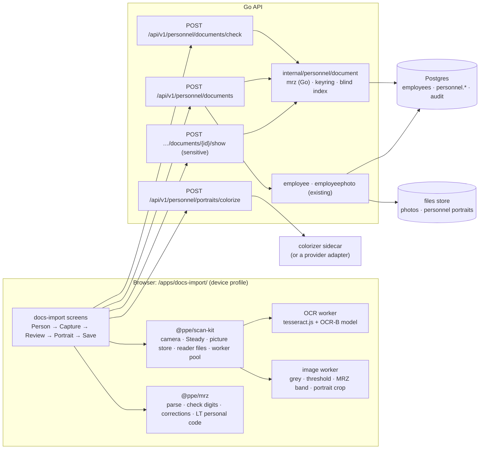

# docs-import: requirements and plan

- **Date:** 2026-11-05
- **Status:** proposal. It becomes ADR 0007 (Personnel files: identity documents) and a spec
  `docs/specs/personnel-service.md` once the [open decisions](#11-open-decisions) are made.
- **Builds on:** [Scan SIMs review](sim-scan-review.md), [ADR 0001](../architecture/adr/0001-modular-monolith-with-bounded-contexts.md)
  and the [context map](../architecture/context-map.md) (People, Personnel files),
  [ADR 0005](../architecture/adr/0005-sim-codes-and-scan-sims-trial.md) (sealed values, the device
  profile), [ADR 0006](../architecture/adr/0006-app-launcher.md) (published apps)

## 1. Goal

A phone-first published app, **Import Documents** (slug `docs-import`), that:

1. reads a **passport or identity card** with the phone's camera or from a photo;
2. takes the person's data from it **without AI**, using the machine-readable zone (MRZ) and its
   check digits, the same way Scan SIMs uses the barcode and Luhn;
3. saves the data to the person (today's `employees`, the future People context), and keeps
   the document's identifiers sealed in **Personnel files**;
4. crops the portrait from the document and, **optionally and with AI**, produces a colour
   photo of the person, saved as one of their photos and clearly marked as AI-made.

It should use the same technologies as Scan SIMs, and the reading kit should be shared rather
than copied.

### What "without AI" means here

| Step | Technique | AI? |
| --- | --- | --- |
| Find and read the MRZ | Image thresholding plus Tesseract LSTM OCR with an OCR-B model and a strict character list | Classic OCR, the same engine as Scan SIMs. No generative or cloud AI |
| Check what was read | ICAO 9303 check digits (7-3-1), the Lithuanian personal code checksum, date logic | No: deterministic |
| Correct misreads | Swap look-alike characters (O↔0, I↔1, B↔8, S↔5, Z↔2, K↔<) only where a check digit then passes | No: deterministic |
| Find the portrait | Its position relative to the MRZ (ICAO layouts), and the user can adjust the crop | No (an ML face detector is an optional later step) |
| **Colour the portrait** | An image colourisation model | **Yes**, opt-in and clearly labelled (section 6) |

## 2. What the documents give us

### 2.1 The MRZ (ICAO Doc 9303)

| Format | Used on | Lines × characters | Where |
| --- | --- | --- | --- |
| **TD3** | passports | 2 × 44 | bottom of the data page, with the portrait on the same page |
| **TD1** | ID cards and EU residence permits (ID-1 card size) | 3 × 30 | the back. The portrait is on the **front**, so it takes two photos, like a SIM carrier |
| TD2 | older ID cards, some visas | 2 × 36 | rare; supported by the same parser |

Fields in every format: document type, issuing state, **surname and given names**,
**document number** (with check digit), **nationality**, **date of birth** (with check digit),
**sex**, **date of expiry** (with check digit), optional data (often the **personal number**),
and a composite check digit over the line(s).

The check digit uses weights 7, 3, 1 repeating, with `<` = 0 and `A`–`Z` = 10–35. Each check
digit protects its field, and the composite digit protects all of them. This is the
counterpart of Luhn in Scan SIMs: a read that passes every digit is almost certainly right.

### 2.2 What the MRZ does *not* give

- **Diacritics and the national spelling of names.** The MRZ is in Latin capitals and
  transliterated: `ŽUKAUSKAITĖ` is `ZUKAUSKAITE`, and Cyrillic names are transliterated. Long
  names are cut short.
- **Date of issue, issuing authority, place of birth.** These are printed in the visual
  inspection zone (VIZ) only.
- **Full century of dates.** `YYMMDD` needs a rule: birth dates are in the past, and expiry
  dates are within about 10–20 years.

So the names on the person must be the **printed** names (with diacritics). The app gets
them in one of two ways: (a) the user types the diacritics on the review screen, guided by the
MRZ form, or (b) later, OCR of the VIZ name lines. The VIZ result is accepted **only if
removing its diacritics gives exactly the MRZ name** (section 5.3). That keeps step (b)
deterministic.

### 2.3 The chip (NFC)

Passports and EU ID cards have a chip with the data and a colour portrait (DG2), signed by the
issuing state. **A web app cannot read it.** Web NFC (Chrome on Android only) reads NDEF tags,
not the ISO 14443 / BAC / PACE exchange a document chip needs, and iOS has no Web NFC. Reading
the chip would need a native app. It is out of scope, but worth remembering: a native reader
would give a real colour portrait without any AI.

### 2.4 Lithuanian personal code (asmens kodas)

`G YYMMDD NNN K`, 11 digits. `G` gives the century and sex (3/4 for 1900s male/female, 5/6 for
2000s). `K` is a check digit: weights 1–9,1 mod 11, and if the result is 10, weights 3–9,1,2,3,
and if that is 10 again, 0. When the document carries the code (Lithuanian documents put it in
the MRZ's optional data, to confirm on specimens), it must match the MRZ's birth date and sex.
That is a third independent check.

## 3. Where the data goes

The request was "save it into the person table". Today that table is `employees`, which holds
names, a code, language, sizes and photos. The architecture already decides where identity
documents belong (context map, ADR 0001):

> **Personnel files** — identity documents and ID numbers… **special care**. Nothing depends
> on Personnel files… Other contexts may learn *that* a document exists and is valid
> ("ID document valid until 2029-04"), never its number or file.

The plan follows that split:

| Data | Goes to | Stored as | Why |
| --- | --- | --- | --- |
| First and last name (printed form, with diacritics) | `employees` (People) | plain, audited as today (`employee.updated`) | Everyone needs names |
| Date of birth, nationality, sex | `employees` (People): new nullable columns | plain | Ordinary personal data, used for checks and reports. **Decision D2**: keep or drop each one |
| Document kind, issuing state, **expiry date** | `personnel.identity_documents` | plain | Needed for "valid until" and expiry reminders without opening anything |
| **Document number, personal code**, the MRZ text | `personnel.identity_documents` | **sealed** (sealbox), plus a **blind index** for lookups | Special care. Never in plain text in the database, backups, events or logs |
| Portrait **as cropped from the document** | files store, `personnel/…` | encrypted object, with a retention period | It is a copy of part of an ID. **Decision D3**: keep it, or keep only the derived photo |
| Colour photo (AI) | `employee_photos` (existing), use `profile` | as other photos, plus `ai_generated = true` | Shown as the avatar. Labelled as AI-made everywhere it appears |
| The whole document image | **not kept** (default) | | Data minimisation. Lithuanian practice treats copies of ID documents as excessive unless a law requires them. Confirm with the DPO (D3) |

**Blind index.** `HMAC-SHA256(API_PERSONNEL_INDEX_KEY, normalised value)` of the document
number and the personal code. It answers "is this person or document already on file?"
without decrypting anything. The index key is separate from the sealing key.

**Per-person keys (crypto-shredding).** The context map promises documents "encrypted with keys
Personnel files can destroy". Each employee gets a data key (32 random bytes) that is sealed
by the master key (`API_PERSONNEL_KEY`) and kept in `personnel.subject_keys`. Their document
fields and portrait are sealed with that key. Destroying the row when retention ends makes
every copy unreadable, including copies in backups. `sealbox` already has the right format
(version byte, context binding). What it needs is a small **keyring**, which also fixes Scan
SIMs' F12.

## 4. Requirements

Priorities: **M** must (v1), **S** should (v1 if possible), **C** could (later).

### 4.1 Functional

| ID | Pri | Requirement |
| --- | --- | --- |
| FR-1 | M | The user chooses the person: search existing employees (name or code), or **New employee from document** (D6) |
| FR-2 | M | Capture with the **live camera**, with a guide frame shaped like the document (ID-1 card 85.6 × 54 mm, passport page 125 × 88 mm) and an MRZ band near its bottom, or with **Take Photo** (`capture="environment"`) or **Choose Photo** |
| FR-3 | M | Supports TD3 passports and TD1 ID cards and residence permits. TD2 is parsed but not tested in v1. A TD1 card needs its back (MRZ) and front (portrait). The side is detected (MRZ found = back), and the photos are paired in either order, as `pairPhotos` does |
| FR-4 | M | The MRZ is read in the browser. A live reading is accepted once **every check digit passes** and the same result has been read in **two frames in a row** (`Steady`). A photo is read once |
| FR-5 | M | **Deterministic correction:** inside fields that must be digits or letters, look-alikes are swapped and every combination is tried, up to a small limit (≤ 64 per field). A correction is taken only if it makes that field's check digit **and** the composite check digit pass. The fields that were corrected are shown |
| FR-6 | M | Cross-checks: dates are valid (birth in the past, expiry after birth); the personal code's checksum, birth date and sex agree with the MRZ when there is a code; an **expired** document is a warning, not a stop |
| FR-7 | M | The **review screen** shows the MRZ lines in a monospaced, editable field, with each field underlined in place. The parsed fields are below, with marks: problem (stops Save) or note. Editing the MRZ re-parses it. Names are a separate field, pre-filled from the MRZ, where the user types the diacritics (`Ž`, `Ė`, …). Their diacritic-free form must equal the MRZ name, or a note says that it does not |
| FR-8 | M | The review compares the result with the chosen person's current data and shows only the differences (name, birth date…). The user chooses, field by field, to take the document's value or keep the current one |
| FR-9 | M | The **check** call (server) reports: problems, a document already on file (same number), **another employee** with the same personal code or document number (blind index), and, for a new employee, possible duplicates by name and birth date |
| FR-10 | M | **Save** is all or none, in one transaction: employee created or updated, identity document recorded (an earlier document of the same kind is marked superseded), events. Nothing is written before Save |
| FR-11 | M | **Portrait crop:** the portrait is found from its position relative to the MRZ (TD3: left of the data page above the MRZ; TD1: left of the front). The user can move and resize the crop box (touch and keyboard). Output is about 600 × 800 px JPEG |
| FR-12 | S | **AI colour photo:** Make Colour Photo (AI) sends the cropped portrait to the API, which returns a colour version. Before and after are shown side by side. The user may Use it, Try Again or Discard. It is saved as an employee photo with `ai_generated`, the use `profile`, and the default if the person has none. It is never offered without the Settings switch (D4) and the person's consent being recorded (PR-6) |
| FR-13 | S | Save the plain (grey) portrait as a photo instead, without AI |
| FR-14 | S | **Show document number** for someone with `personnel.documents.read`: needs a recent sign-in, is audited, `no-store`, and hides again after 60 s or when the tab is hidden (the pattern from Show PIN and PUK) |
| FR-15 | S | The employee page in the staff app shows "ID card · LTU · valid until 2029-04-12" (never the number) and the AI label on AI photos |
| FR-16 | C | VIZ OCR of the name lines (Lithuanian and Russian data), accepted only when it folds to the MRZ name (section 5.3). Also date of issue and place of birth if D2 asks for them |
| FR-17 | C | Expiry reminders (Overview item 60 days before), once the outbox and jobs exist |
| FR-18 | C | A native companion to read the chip (DG1, and DG2 for a real colour portrait) |

### 4.2 Non-functional

| ID | Pri | Requirement |
| --- | --- | --- |
| NFR-1 | M | **Same stack as Scan SIMs:** React 19, TypeScript, Vite, Tailwind, `@ppe/ui`, `@ppe/app-shell`, `@ppe/launcher` (`SignedIn`, `AppFrame`), `@ppe/i18n`, published with the **device** profile. No new CSP directive: colouring goes through the API, so `connect-src 'self'` is enough |
| NFR-2 | M | Readers come from the app's own files (`readers/`), loaded on first use. No CDN |
| NFR-3 | M | Image work (thresholding, zxing if used) and OCR run **in workers**. The camera preview stays smooth (fixes Scan SIMs F2 for both) |
| NFR-4 | M | Speed on a mid-range Android phone (to be benchmarked in phase 1): first MRZ read ≤ 1.5 s from a photo, live attempts ≥ 3 per second, first-use download ≤ 6 MB |
| NFR-5 | M | Accuracy on the test set (phase 1): ≥ 98 % of good photos read with every check digit passing, **0 %** accepted with a wrong value (the check digits guarantee this; tests prove it) |
| NFR-6 | M | EN / LT / RU from typed dictionaries; mobile first; 44 px touch targets; no sideways scroll at the e2e widths; WCAG 2.1 AA (status texts announced, crop box usable with the keyboard) |
| NFR-7 | M | Server rules mirrored: the Go API re-parses the MRZ and re-checks every digit and the personal code. A shared test-vector file (`testdata/mrz/*.json`) is read by both the TS and Go test suites, so the two parsers cannot drift apart |
| NFR-8 | S | Telemetry without personal data: counts of reads, check-digit failures, corrections and time to read, per version, for App Launcher's Trials page |

### 4.3 Privacy, security and legal

| ID | Pri | Requirement |
| --- | --- | --- |
| PR-1 | M | Images, MRZ text and fields live **only in the screen's memory**, never in any browser storage. Blob URLs are revoked on leave and after Save. Leaving, including in-app navigation, asks first (fixes Scan SIMs F1) |
| PR-2 | M | No read value ever goes into an `Error`, a log line, an audit event or System's error list. A Go test runs a scan through the service and asserts that the number and personal code appear in no event or log (as the SIM codes tests do) |
| PR-3 | M | The document number, personal code and MRZ text are sealed per person (section 3). Plain columns hold only kind, issuing state and expiry |
| PR-4 | M | New permissions (D7): `personnel.documents.manage` (scan and save; needs `employees.manage`), `personnel.documents.read` (show the number; recent sign-in), and `personnel.portraits.colorize` (use AI colouring). Listed in `permissions.ts`, `routes_test.go` and the built-in roles |
| PR-5 | M | Audit events: `personnel.document_recorded`, `personnel.document_superseded`, `personnel.document_shown`, `personnel.document_removed` (kind, issuing state, expiry, never the number), and `employee.photo_added` with `ai_generated: true`. Reads of the number are audited (the context map's "read events" for Personnel files) |
| PR-6 | M | **AI colouring needs a recorded legal basis.** The default is the person's consent, recorded with the photo (who, when, how), and the person may refuse. If they refuse, only the grey portrait or a fresh camera photo is used |
| PR-7 | M | **Label AI images.** "AI-coloured" is shown on the photo in every app. The JPEG carries a metadata note, and the record has `ai_generated`. An AI photo is never used where a true likeness is required (ID badges: the `id_badge` use is refused for an AI photo). The EU AI Act's transparency duties for generated or manipulated images apply from 2 August 2026, so confirm the exact form with the DPO |
| PR-8 | M | Retention: identity documents are kept while the person is employed plus a period set by D3. When it ends, crypto-shredding destroys the data (section 3). The soft-delete-forever default does not apply to Personnel files |
| PR-9 | S | If an external AI provider is chosen (D4): a processor agreement, EU processing, no training on our data, no retention by the provider. Only the cropped portrait is sent, never the document |
| PR-10 | S | A DPIA for the whole feature before go-live (identity data and photos of employees) |

## 5. Architecture

### 5.1 Overview



### 5.2 Reading pipeline (browser, no AI)

1. **Frame and crop.** The guide frame matches the chosen document (the user picks Passport or
   ID card, or it is guessed from the first MRZ found). `guideCrop` (from Scan SIMs) maps it
   onto the video.
2. **Find the MRZ band** (image worker): grey scale, then a horizontal projection profile of
   dark pixels. The MRZ is the bottom-most group of 2 or 3 evenly spaced text rows with the
   tell-tale `<` runs. For photos this runs over the whole image. In live mode the band's
   expected place inside the guide is tried first.
3. **Prepare it:** straighten (the angle comes from the baseline of the rows, within ±10°),
   scale so characters are ~32 px tall, and apply Sauvola adaptive threshold (OCR-B on
   guilloche backgrounds needs a local threshold, not a global one). All of this is plain
   TypeScript on `ImageData`, with no OpenCV, which would add ~8 MB.
4. **OCR** (OCR worker): tesseract.js with an **OCR-B model**, `PSM.SINGLE_BLOCK`, whitelist
   `ABCDEFGHIJKLMNOPQRSTUVWXYZ0123456789<`. Model choice is decided in phase 1: a community
   OCR-B / MRZ traineddata (check its licence), or one trained by us with `tesstrain` from
   synthetic MRZ lines in a free OCR-B font, which is reproducible and has a known licence.
5. **Normalise lines:** pick the 2 or 3 lines of the expected length and pad or trim the `<`s.
   Common misreads such as `«`, `K` inside filler runs, and spaces are fixed before parsing.
6. **Parse and correct** (`@ppe/mrz`, pure): format by line count and length, then fields,
   check digits and FR-5's corrections.
7. **Accept:** every check digit passes, the result is the same in two frames (live), and the
   FR-6 cross-checks pass.

The **portrait** comes from the MRZ geometry. Once the MRZ band's corners are known, the
document's size and angle follow from the ICAO layout, and the portrait zone is a fixed
rectangle in document coordinates (TD3: left part of the data page above the MRZ; TD1 front:
left part of the card). It is cut out with the same straightening and then adjusted by the
user (FR-11). An in-browser face detector (MediaPipe-style, ~1 MB model, an ML model but not
generative) could refine it later; it is not needed for v1.

### 5.3 Names with diacritics (deterministic)

`fold(s)` maps a printed name to its MRZ form: capitals, Lithuanian and Latvian letters without
diacritics (`Ą Č Ę Ė Į Š Ų Ū Ž` → `A C E E I S U U Z`), German `Ä Ö Ü` → `AE OE UE` or `A O U`
(both forms tried), spaces and hyphens → `<`. Cyrillic goes through the ICAO 9303 Part 3
transliteration table. A name the user types, or later one from VIZ OCR, is accepted with
no note if `fold(name) == MRZ name`, allowing for the MRZ's truncation. Otherwise the review
shows "The name differs from the document's code".

### 5.4 Colour photo (AI)

The **API** owns colouring, behind an interface declared by the personnel domain:

```go
// Colorizer turns a grey portrait into a colour one. Implementations live in cmd/api.
type Colorizer interface {
    Colorize(ctx context.Context, gray image.Image) (image.Image, error)
}
```

**Recommended:** a **self-hosted sidecar** (`colorizer` compose service on the internal network
only) that runs an open colourisation model such as DDColor or DeOldify (check the licence of
the exact weights) with ONNX Runtime on CPU. The portrait never leaves our server. Running time
and memory on the droplet are measured in phase 4. If they are too high, the sidecar runs on a
small separate host, or the provider adapter is used.

**Alternative:** a hosted image API through the same interface (PR-9). General image-editing
models can **change facial features**, which is unacceptable for a photo of a real person. So
whatever produces the colour, the API applies a **luminance lock**:

> Convert the original grey portrait to the L channel of CIELAB, take only the a\*b\* (colour)
> channels from the model's output (resized to match), and recombine them. The result's
> structure (every edge, every feature) is exactly the document's. The model can only add
> colour; it cannot redraw the face. A Go test asserts that the output's L channel equals the
> input within a small tolerance.

Further rules: the colour is a guess (eye, hair and skin colour may be wrong), so the before
and after view and "AI-coloured" labels are required (PR-7); there is a rate limit per user; the
endpoint returns the image with `no-store` and does not store it (Save stores it through the
existing photo route); and colouring is off until a Settings switch is turned on (D4).

A cheaper alternative to AI that also gives a true colour photo is to **take a photo of the
person** with the same app's camera (FR-13's sibling). It may be the better default; AI
colouring is then for people who are not present.

### 5.5 API

| Route | Permission | Behaviour |
| --- | --- | --- |
| `POST /api/v1/personnel/documents/check` | `personnel.documents.manage` | `{employee_id?, mrz: [lines], names, …}` → re-parse and re-check; returns `{problems, document_on_file?, other_employee?, possible_duplicates[]}`. Writes nothing |
| `POST /api/v1/personnel/documents` | `personnel.documents.manage` | `{employee: {id} or {new: Params}, employee_changes, mrz, names, portrait_upload_id?}` → one transaction: employee create/update, document (sealed), supersede the earlier one, events |
| `GET /api/v1/personnel/documents/by-employee/{id}` | `personnel.documents.manage` or `.read` | kind, issuing state, expiry, status. Never the number |
| `POST /api/v1/personnel/documents/{id}/show` | `personnel.documents.read` + `sensitive` | number and personal code; audited first; `no-store` |
| `DELETE /api/v1/personnel/documents/{id}` | `personnel.documents.manage` | removes it, recorded, sealed content destroyed |
| `POST /api/v1/personnel/portraits/colorize` | `personnel.portraits.colorize` | a JPEG (≤ 2 MB) → a colour JPEG; `no-store`; rate-limited; usage counted, not stored |
| existing `POST /api/v1/employee-photos/{employee}` | `employees.manage` | gains an `ai_generated` flag; `id_badge` refused for AI photos |

Every new route goes into `routes_test.go`'s policy table and every new error into
`errorStatuses`. `@ppe/api-client` gains `personnel.*`. The app sends `X-PPE-App: docs-import`.

### 5.6 Database (sketch)

```sql
CREATE SCHEMA personnel;                       -- ADR 0001: one schema per context

CREATE TABLE personnel.subject_keys (          -- one data key per person (crypto-shredding)
  employee_id uuid PRIMARY KEY REFERENCES employees(id),
  sealed_key  bytea NOT NULL,                  -- the data key, sealed by API_PERSONNEL_KEY
  key_id      smallint NOT NULL,
  created_at  timestamptz NOT NULL
);

CREATE TABLE personnel.identity_documents (
  id               uuid PRIMARY KEY,
  employee_id      uuid NOT NULL REFERENCES employees(id),
  kind             text NOT NULL CHECK (kind IN ('passport','id_card','residence_permit')),
  issuing_state    char(3) NOT NULL,           -- ICAO code, e.g. LTU
  expires_on       date NOT NULL,
  sealed           bytea NOT NULL,             -- {number, personal_code, mrz} sealed with the subject key
  number_index     bytea NOT NULL,             -- HMAC blind index
  personal_index   bytea,                      -- HMAC blind index, when there is a code
  superseded_at    timestamptz,
  created_at …, created_by_user_id …, deleted_at …, deleted_by_user_id …
);
CREATE UNIQUE INDEX ON personnel.identity_documents (number_index, issuing_state) WHERE deleted_at IS NULL;

ALTER TABLE employees ADD COLUMN birth_date date, ADD COLUMN nationality char(3), ADD COLUMN sex char(1);  -- per D2
ALTER TABLE employee_photos ADD COLUMN ai_generated boolean NOT NULL DEFAULT false,
                            ADD COLUMN consent jsonb;                                            -- PR-6
```

`grants.sql`: `ppe_app` gets DML on `personnel.*`. A later step gives Personnel files its own
role (ADR 0001 §3). `TRUNCATE` lists in tests gain the new tables.

### 5.7 Configuration

| Setting | Purpose |
| --- | --- |
| `API_PERSONNEL_KEY` | master key that seals the per-person keys (64 hex). Required once the feature is on. Kept offline like `API_SIM_CODES_KEY` |
| `API_PERSONNEL_INDEX_KEY` | HMAC key for blind indexes (64 hex) |
| `API_COLORIZER_URL` | the sidecar's or provider adapter's address. Empty means colouring is off |
| Settings → **AI colour photos** | an administrator's switch (D4), shown on Settings and recorded |

Each is read in `loadConfig` and checked in `validate` (`TestLoadConfigDefaults`).

## 6. Reuse: what comes from Scan SIMs

The reusable half of `@ppe/sim-scan` moves to a new package **`@ppe/scan-kit`**. Scan SIMs then
depends on it, and its behaviour does not change.

| Scan SIMs piece | In docs-import | Action |
| --- | --- | --- |
| `camera.ts` (`startCamera`, `guideCrop`, `eachFrame`, `beep`) | as is | move to `scan-kit` and add a test for `guideCrop` |
| `Steady` | as is (key = the parsed MRZ) | move |
| `canvasOf`, `imageDataOf` | plus thresholding, band finding, straightening | move; the new image ops go in `scan-kit/image` and run in a worker |
| `readers.ts` tesseract singleton | different model and settings | turn into a factory: `createTextReader({ lang, whitelist, psm, langPath })` |
| `barcodesIn` (zxing) | not needed in v1 (C: PDF417 or QR on some documents) | move, with `formats` as a parameter, run in a worker (F2) |
| `reader-files.ts` Vite plugin | a different file list (OCR-B model) | generalise: `serveReaderFiles({ 'ocrb.traineddata.gz': path, … })`. Each app lists its own files |
| `pairPhotos` / `sideOf` | TD1 front and back | generalise with a `sideOf` function as a parameter |
| `Thumb`, the photo slot button, `CardFields`' layout | review and portrait screens | move `Thumb` and a `PhotoSlot` component |
| picture `Map` in a ref with `redraw` (F4) | needed for document photos | replace with `usePictureStore()` in `scan-kit`, which owns the blob URLs |
| leave guard (F1) | needed | `useLeaveGuard(when)` in `scan-kit`, which covers `beforeunload` and in-app navigation (a hook in `@ppe/app-shell`'s router) |
| `rowMarks` / `blocks` (problem or note) | MRZ field marks | the same pattern; problem codes shared with Go |
| check → commit API pattern | `documents/check` → `documents` | same pattern |
| `sealbox` | document fields | reuse, and add a **keyring** (key id → key) and per-subject data keys |
| `sensitive()` + recent sign-in + audit before answer + `no-store` | Show document number | reuse unchanged |
| `internal/files`, `employeephoto` | portraits and photos | reuse; add `ai_generated` and consent |
| device profile, `csp.test.ts`, `TestPublishedPoliciesMatchCaddy` | same profile | reuse; no new directive |
| `make new-app`, `ppe-app.json`, channels, Trials | the new app | `make new-app SLUG=docs-import NAME='Import Documents' NAME_LT='Dokumentų importas' NAME_RU='Импорт документов'` |
| synthetic fixtures (`fixtures/sim-cards/make.ts`) | synthetic specimen documents | the same approach: generated MRZ (valid and with planted errors), a made-up portrait, never a real document in the repository |

Nothing is copied. Whatever both apps use is in a package. When docs-import merges into the
staff app, it takes `@ppe/scan-kit` and `@ppe/mrz` with it, as Scan SIMs will take
`@ppe/sim-scan`.

## 7. Delivery plan

| Phase | Content | Done when |
| --- | --- | --- |
| **0. Shared kit** | Extract `@ppe/scan-kit` from `@ppe/sim-scan`. Fix Scan SIMs F1–F4 there (worker for zxing, picture store, leave guard, cancelled checks). Add a keyring to `sealbox` (F12) | Scan SIMs' unit and e2e tests pass unchanged; the camera preview is smooth on a phone |
| **1. Reading spike** | `@ppe/mrz` (TS) with ICAO test vectors; band finding and threshold; choose the OCR-B model; a bare test page in the app reading specimens. Measure on synthetic specimens and on the team's **own** documents (read locally, never committed) | NFR-4 and NFR-5 numbers recorded; model and licence chosen. **Go / no-go gate** |
| **2. Personnel backend** | ADR 0007; `internal/personnel/document` (five-file layout), Go MRZ parser on the shared vectors, keyring and subject keys, blind index, migrations, permissions, routes, audit events, `api-client` | Go service and Postgres tests pass, including PR-2's no-leak test; `routes_test.go` policy |
| **3. docs-import app** | `make new-app`; Person → Capture → Review → Save, without the portrait | e2e: synthetic passport and ID card read from photos, checked, saved; the employee shows "valid until" |
| **4. Portrait** | crop from MRZ geometry, adjust, save the grey portrait as a photo | e2e with a specimen portrait; crop usable with keyboard and touch |
| **5. AI colour** | colorizer sidecar or adapter, luminance lock, consent, labels, Settings switch, `ai_generated` | Go test of the luminance lock; labels shown in both apps; DPIA done (PR-10) |
| **6. Trial** | publish to Preview, then Beta for testers, then Stable. Watch the Trials page (reads, check failures, errors) | Decide to merge into the staff app or keep it as its own app |
| later | VIZ names (FR-16), expiry reminders (FR-17), native chip reader (FR-18) | |

Phases 0 and 1 can run in parallel. Phase 2 can start once D1–D3 are decided.

## 8. Testing

- **Unit (TS, `@ppe/mrz`):** ICAO 9303 specimen MRZs (TD1, TD2, TD3); every check digit;
  corrections that must succeed and corrections that must **not** be taken (two errors that
  balance each other inside one field are caught by the composite check); century rules;
  Lithuanian personal codes (valid, both weight rounds, the 0 case, a mismatch with the MRZ);
  `fold` for LT, DE and Cyrillic names.
- **Shared vectors:** `testdata/mrz/*.json` is read by Vitest and by `go test`, so the two
  parsers stay equal.
- **Image ops:** threshold and band finding on generated images, with a known band position
  and angle.
- **Go:** service tests with a fake repository (sealed fields never in events, a supersede
  on a second document, `other_employee` through the blind index), Postgres tests (schema,
  grants, crypto-shredding: after deleting a subject key the document no longer opens), the
  route policy, and the luminance-lock test.
- **e2e:** generated specimens (`fixtures/documents/make.ts`): a passport and an ID card front
  and back, one with a misread planted in the image, and one expired. Read from photos, review,
  save, portrait, show number with Confirm your password, and the AI photo path with a fake
  colouriser.
- **Field test (phase 1 and 6):** at least 30 real documents of the kinds employees have, read
  on two phones (iPhone Safari and a mid-range Android). Only counts are recorded, never the
  data.

## 9. Risks

| Risk | Effect | Mitigation |
| --- | --- | --- |
| OCR-B accuracy on phone photos (glare from laminate, holograms, guilloche) | slow or failed reads | adaptive threshold, the two-frame rule, correction by check digits, guidance text ("tilt to remove glare"), and typing the MRZ by hand as the last resort |
| Keeping ID copies breaks data-protection rules | legal | keep only what D2 and D3 allow; seal it; crypto-shredding; DPIA |
| AI changes the person's likeness | misleading photo | luminance lock, before and after view, labels, refusing the photo for ID badges, a live photo as the alternative |
| An external AI provider sees employees' faces | GDPR transfer | a self-hosted sidecar by default; otherwise a processor agreement, EU only, no retention |
| Two parsers drift apart | the client accepts what the server refuses | the shared test vectors |
| The colouring model is too heavy for the droplet | slow or out of memory | measure in phase 5; a separate host or the adapter |
| Diacritics typed wrongly | wrong names | `fold` check against the MRZ; VIZ OCR later |

## 10. Words to add to the glossary

`docs/ubiquitous-language.md` needs these before the UI uses them (EN / LT / RU):
**Identity Document** (Asmens dokumentas / Документ личности), **MRZ** (machine-readable zone),
**Portrait**, **AI-coloured photo**, **Import Document**, **Show Document Number**,
**Expires on**.

## 11. Open decisions

| # | Decision | Recommendation |
| --- | --- | --- |
| D1 | Identity data in a new **Personnel files** context (schema `personnel`, sealed), or new columns on `employees` | **Personnel files**, as the context map already plans. Names go to `employees` |
| D2 | Which fields to keep: names (yes); date of birth, nationality and sex; document number; personal code; issue date and place of birth | Keep only what a process needs. Is the personal code needed (payroll, contracts)? If not, read it only to cross-check and do not store it |
| D3 | Keep the document's portrait crop and/or the full image, and for how long | Keep neither the full image nor the crop by default; keep the derived photo. Retention for document data: employment + N months, set with the DPO |
| D4 | AI colouring: self-hosted sidecar, hosted provider, or not at all for now | Self-hosted with the luminance lock, off by default. Consider a live camera photo as the main path |
| D5 | Documents in v1 | TD3 passports (any state) and TD1 ID cards and residence permits (EU). Russian internal passports and driving licences are out of scope |
| D6 | Can the app create **new** employees, or only update existing ones? | Both. New employees need `employees.manage` too |
| D7 | Who uses it | A new built-in role **Personnel Documents** with `personnel.documents.manage` and `.read`. Administrators do not get it by default (like Equipment Assignments) |
| D8 | Its own app forever, or merge into the staff app after the trial | Trial first, as Scan SIMs did; decide in phase 6 |
