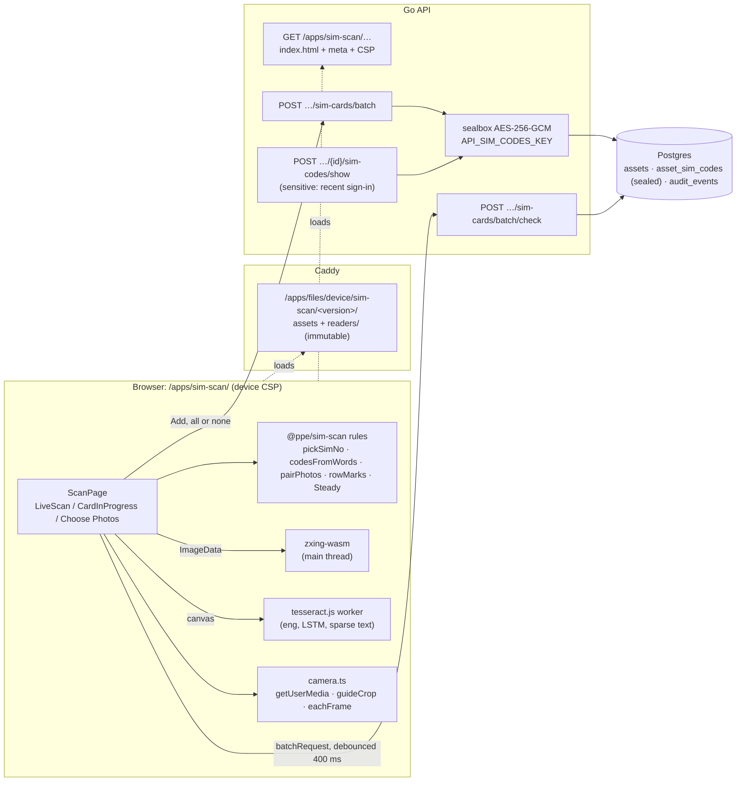

# Scan SIMs: technical documentation and review

- **Date:** 2026-11-05
- **Scope:** `web/apps/sim-scan`, `web/packages/sim-scan`, the API it uses
  (`internal/domain/asset/sim_scan.go`, `internal/sealbox`, `cmd/api/asset-routes.go`) and how it
  is published (`cmd/api/published-app-routes.go`, `deploy/Caddyfile`)
- **Rules:** [ADR 0005](../architecture/adr/0005-sim-codes-and-scan-sims-trial.md),
  [ADR 0006](../architecture/adr/0006-app-launcher.md), `docs/specs/asset-service.md` ("Scan SIM
  cards", "PIN and PUK")
- **Checked:** `go test ./internal/sealbox ./internal/domain/asset` passes; `@ppe/sim-scan`
  19 tests and `@ppe/sim-scan-app` 10 tests pass; both typecheck; a production build was measured
  (section 9). The e2e steps were not run for this review.
- **Companion:** [docs-import plan](docs-import-plan.md), which reuses most of what is described here.

## 1. Verdict

Scan SIMs is a small, well-designed trial app. Its architecture is sound. The rules are pure
functions, the API checks every rule again, the PIN and PUK are sealed so the database never
holds them in plain text, and the security policy is pinned by tests. The code is easy to
read and well commented. The problems are local: one screen file is too big, there are a few
state-handling slips in it, the barcode reader runs on the UI thread, and some docs are out of
date. None of them blocks the trial. Several should be fixed before the reading code is shared
with docs-import.

| Area | Grade | In one line |
| --- | --- | --- |
| Architecture and boundaries | **A** | Rules in a package, readers loaded only when needed, the API is final, and the app is built to merge into the staff app |
| Security and privacy | **A** | Codes sealed with AES-GCM bound to the card's id, never in events or errors, a recent sign-in to show them, CSP pinned by tests |
| Domain correctness | **A−** | Luhn and the ICCID rules exist in TS and Go, the batch is all or none, the filler F is handled; inventory numbers are read outside the transaction |
| Frontend code quality | **B** | Clean package; `routes/scan.tsx` is 719 lines with four components and a lot of loose state |
| Robustness of reading | **B** | Good guards (two matching frames, check digit), but the barcode is read on the main thread and the PIN/PUK rule fits one carrier layout only |
| Tests | **B+** | The rules are well tested and there are e2e steps with synthetic carriers; the screen's state logic and the readers have no unit tests |
| Documentation | **B** | Thorough, but the ADR and spec still describe the old `/sim-scan/` address and the `workwear` source |

## 2. What it does

Newly received SIM cards come on plastic carriers. The front has the SIM No. (ICCID) as a
barcode and the back has the PIN and PUK. Scan SIMs reads them in the browser and adds them
in one batch. A second screen finds a SIM and shows its PIN and PUK.

| Screen | Address | Permission | What it does |
| --- | --- | --- | --- |
| **Scan** | `/apps/sim-scan/` | `assets.manage` | What the batch shares (For every SIM), one card at a time (desktop and tablet), live camera, Choose Photos, the review list, and Add N SIMs |
| **PIN and PUK** | `/apps/sim-scan/find` | `sim_codes.read` | Find a SIM by part of its number, Show PIN and PUK (audited, recent sign-in), Add PIN and PUK |

A user who has neither permission sees "Scan SIMs is for those who manage Company Assets"
(`app.tsx` `NotForYou`).

## 3. Where the code lives

```
web/apps/sim-scan/                 the published app (slug sim-scan, profile device)
  public/ppe-app.json              { slug, profile: "device", devPort: 5184 }
  vite.config.ts                   base './' in build, reader files plugin, optional https for phones
  index.html                       the staff app's theme script byte for byte (CSP hash)
  src/main.tsx                     ApiProvider app="sim-scan" (X-PPE-App)
  src/app.tsx                      SignedIn + AppFrame, two tabs gated by permission
  src/lib/router.ts                two addresses: / and /find
  src/lib/readers.ts               lazy import of @ppe/sim-scan/readers, configured with filesBase
  src/routes/scan.tsx              ScanPage, LiveScan, CardInProgress, BatchCard (719 lines; split
                                   in step 3 into src/routes/scan/: scan-page, scan-list (reducer),
                                   picture-store, live-scan, card-in-progress, batch-card)
  src/routes/find.tsx              FindPage, SimRow, Code
  src/csp.test.ts                  the device policy = staff policy + wasm + worker, nothing else
web/packages/sim-scan/             everything that moves into the staff app later
  src/sim-scan.ts                  the rules: SIM No., Luhn, codesFromWords, pairPhotos, rowMarks, Steady…
  src/readers.ts                   zxing-wasm + tesseract.js, readPhoto
  src/camera.ts                    getUserMedia, guideCrop, eachFrame, beep
  src/reader-files.ts              Vite plugin: serves/emits the readers' wasm, worker, model
  src/review-list.tsx              ReviewList, CardFields, Thumb, message
  src/text.ts                      EN / LT / RU words
internal/domain/asset/sim_scan.go  CheckSIMs, AddSIMs, Show/Set/ClearSIMCodes, problems
internal/domain/asset/import.go    registerSIMs, writeSIMs (shared with the go-live CSV import)
internal/sealbox/sealbox.go        AES-256-GCM seal/open with context binding
cmd/api/asset-routes.go            the five routes (batch/check, batch, sim-codes show/put/delete)
cmd/api/published-app-routes.go    serves a published version's index.html with its profile's CSP
```

The split is a good one. Everything that would move into the staff app (rules, readers, words,
review list) is already in `@ppe/sim-scan`, and the app only wires screens. The package has
separate entry points (`.`, `./readers`, `./camera`, `./reader-files`, `./review-list`), so a
screen pulls in the megabytes of readers only when it scans.

## 4. Runtime architecture



### 4.1 Publishing and delivery

Scan SIMs was the first **published app** (ADR 0006, phase 3). It is built with `base: './'`,
so the build is relative, and is published as an immutable version
(`YYYY.MM.DD-<commit>`) into the `published` volume. Caddy serves its files from
`/apps/files/device/sim-scan/<version>/` with `Cache-Control: immutable`. The API serves only
the page (`GET /apps/{slug}/{rest...}`). It rewrites the links and adds `ppe-mount`,
`ppe-files`, `ppe-version` and `ppe-channel` meta tags, which `@ppe/routing`'s `basePath` and
`filesBase` read. It also sends the **device** profile's policy:

- `script-src 'self' 'wasm-unsafe-eval' 'sha256-…'`: WebAssembly can compile, but `eval` is still not allowed
- `worker-src 'self'`: the tesseract worker comes from the app's own files
- `Permissions-Policy: camera=(self)`

Every other directive is the staff app's, word for word. Three tests keep this true: the
app's `csp.test.ts`, the Go `TestPublishedPoliciesMatchCaddy`, and the e2e run behind the real
Caddyfile. Channels (Stable, Beta, Preview) and per-user version choice come from the
launcher, and the `ChannelStripe` shows when someone is off Stable.

The reader files (`zxing_reader.wasm`, `worker.min.js`, three tesseract cores, and
`eng.traineddata.gz`) are emitted by `serveReaderFiles()` into `readers/` beside the build. They
are never loaded from a CDN. The browser downloads only the core it can run (relaxed-SIMD, SIMD,
or plain).

### 4.2 Reading pipeline

**Front (SIM No.)**

1. Draw the picture to a canvas no bigger than 2000 px on its longest side (`canvasOf`). For
   the live camera, crop it first to the guide frame (`guideCrop`, which maps the on-screen
   frame through `object-fit: cover`).
2. `readBarcodes` (zxing-wasm) runs on Code 128, ITF and Code 39, with `tryHarder` and at most
   4 symbols.
3. `pickSimNo` takes the first value that matches `^89\d{17}F?$` and passes the Luhn check.
   The carrier's EAN-13 product code is never in the format list, so it can never be taken.

**Back (PIN and PUK)**

1. One tesseract.js worker, started on first use and kept for later. It uses English LSTM
   (`4.0.0_best_int`), `PSM.SPARSE_TEXT`, and a whitelist of `PINUK0123456789 `.
2. `codesFromWords` finds the label words (`P[I1l|]N` and `P[UV]K`, which allow for common
   misreads). It then takes the nearest number to the **right of the label on the same line**:
   the word's vertical middle must be within 0.8 × the label's height. That is how it skips the
   customer-service number printed lower down.
3. PIN `^\d{4,8}$`, PUK `^\d{8}$`.

**Accepting a reading.** A live reading is taken only when it matches the previous frame
(`Steady`, two in a row). A photo is read once. Every value is checked again in the review list
and again by the API.

### 4.3 Three ways to capture

| Mode | Where | How a card is made |
| --- | --- | --- |
| **A card at a time** (`CardInProgress`) | ≥ 768 px only (`max-md:hidden`) | Two photo slots. A photo fills whichever side was read on it (`withPhoto`). The card moves to the list on its own once `cardComplete`, or with **Next SIM** after typing |
| **Camera** (`LiveScan`) | any device with `getUserMedia` on https | A state machine: read the front, beep, then the back. A front already in the list is refused, and **No Back** adds the card without codes |
| **Choose Photos** | any | Read every photo in turn, then `pairPhotos`. The first photo with something read sets the order (front then back, or back then front). An unread photo becomes its own row |

### 4.4 Review list and the shared rules

`rowMarks(cards, apiProblems)` gives each row its marks:

- **Problems**, which stop Add: `not_sim_no`, `check_digit`, `duplicate` (within the batch),
  `registered` (from the API only, with `existing_id`), `codes_incomplete`, `pin`, `puk`
- **Notes**, which do not: `no_back` and `no_front`

The same problem codes come from `asset.CheckSIMs` in Go. The client and the server word them
the same way, and the client words the server's codes. This "check, then commit" pattern works
well: the list shows marks at once, and the API remains the authority.

### 4.5 API

| Route | Permission | Behaviour |
| --- | --- | --- |
| `POST /api/v1/assets/sim-cards/batch/check` | `assets.manage` | `checkBatch` (shared fields, 1–100 cards, normalises them), then each card's own problems, duplicates within the batch, and `SIMOwners` for cards already registered. Writes nothing |
| `POST /api/v1/assets/sim-cards/batch` | `assets.manage` | `AddSIMs`: re-checks everything and returns `ImportRowError{Index}` for the first bad card. `registerSIMs` numbers the cards from the SIM counter, seals the codes and builds the `asset.registered` events (with `"sim_codes":"set"`). `ImportSIMs` writes them all in **one transaction**, all or none |
| `POST /api/v1/assets/{id}/sim-codes/show` | `sim_codes.read` + `sensitive` | Needs a recent sign-in and the permission checked against the user's roles now. Records `asset.sim_codes_shown` (SIM No. only) **before** it answers, with `no-store` |
| `PUT` / `DELETE /api/v1/assets/{id}/sim-codes` | `assets.manage` | Seal or forget the codes. Records `asset.sim_codes_changed` with `set` or `cleared` |

**Sealing** (`internal/sealbox`). A sealed value is
`version(1) ‖ nonce(12) ‖ AES-256-GCM(ciphertext ‖ tag)`, and the additional data is
`"ppe.asset_sim_codes.v1|" + asset id`. A sealed value copied to another card's row does not
open there. The key is 64 hex characters in `API_SIM_CODES_KEY`, and the API does not start
without it. Each row stores a `key_id` (always 1 today), so a second key can be added later. The
plaintext is `"PIN PUK"`. That is safe because both have been checked to be digits only.

### 4.6 Security model

- **Data minimisation in the browser.** Pictures and codes are kept only in component memory,
  as blob URLs that are revoked when no longer needed. Nothing is kept in local storage, session
  storage or IndexedDB. A comment rule ensures that no read value is ever put into an `Error`,
  because browser errors go to System's error list.
- **No third parties.** Reading happens in the browser from the app's own files.
  `connect-src 'self'`.
- **Defence in depth.** The client checks first, but every rule is enforced on the server.
- **Audit without secrets.** Events record *that* codes were set or shown, never what they were.
- **Blast radius.** Only the device profile allows WebAssembly. The staff app and
  Administration stay on the strict policy, and a test asserts that `wasm-unsafe-eval` is
  absent from it.

## 5. Strengths worth keeping (and copying for docs-import)

1. **Pure rules, mirrored in Go.** `sim-scan.ts` has no DOM and is easy to test. The Go side
   checks the same rules with the same problem codes.
2. **Lazy, self-hosted readers.** A dynamic `import()` behind `loadReaders()` resets itself on
   failure. The Vite plugin serves the reader files in development and emits them in a build,
   and they are never loaded from a CDN.
3. **Guarded acceptance.** A reading must appear in two matching frames and pass a check digit,
   and the product code is excluded by design. The check digit plays the same role here that it
   will play for passports.
4. **Check, then commit, all or none.** The review list never disagrees with the server, and a
   batch can never be half written.
5. **Secrets handled properly.** Values are sealed with their context, the key is kept out of
   the database and backups, reads are audited, a recent sign-in is required, and responses are
   `no-store`.
6. **Published-app platform.** The profile-based CSP, immutable versions, channels and the
   `make new-app` template mean docs-import starts from scaffolding that already works.
7. **i18n done properly.** Typed dictionaries, `plural()` with Lithuanian and Russian plural
   forms, and a test that no text is left untranslated or empty.

## 6. Findings

Severity: **M** medium (fix before the merge or before sharing the code), **L** low (tidy-up).
**Fixed in step 1** (2026-11-05): F3, F5, F6, F7, F8, F11; **step 2**: F1; **step 3**: F4, F14 in part; **step 4**: F2 (marked ✅ below).
Line numbers in `scan.tsx` are as reviewed; that file is now `src/routes/scan/`.

| # | Sev | Finding | Where | Suggested fix |
| --- | --- | --- | --- | --- |
| F1 ✅ | M | **The scanned list is lost without a warning when the user switches to the PIN and PUK tab.** `beforeunload` only covers leaving the page. The tab change is in-app navigation, which unmounts `ScanPage` and with it every card and picture | `app.tsx:48`, `scan.tsx:104-109` | Keep both screens mounted (hide the inactive one), or keep the list in a context above the router, or ask before navigating when `cards.length > 0` (a guard in `useAddressRouter`, which docs-import needs too) |
| F2 ✅ | M | **The barcode is decoded on the main thread on every live frame,** with `tryHarder` on frames up to 2000 px. On mid-range phones this makes the video and the UI stutter. Tesseract already runs in a worker | `readers.ts:23`, `scan.tsx:334` | Run zxing in a dedicated worker (`zxing-wasm` works in workers) and send it an `ImageBitmap` (transferable). Read live frames at ~1280 px and keep 2000 px for photos. *Done: `barcode.worker.ts`, the image's pixels transferred, the main thread only if no worker starts; live fronts at 1280 px. Measured on a Mac (12 frames read in a row): before, 1 frame of ~11 painted, a 183 ms freeze; after, every frame painted, at most 17 ms between them; 10 ms a read at 1280 px against 16 ms at 1690 px* |
| F3 ✅ | M | **The API check can return out of order.** The debounced `checkSimCards` has no cancellation and no sequence number, so a slow earlier answer can overwrite a later one. Its `index` values then mark the wrong rows, for example after a removal | `scan.tsx:111-119` | Use an `AbortController` per request, or keep a request counter and ignore stale answers |
| F4 ✅ | M | **`routes/scan.tsx` is 719 lines** with four components. `ScanPage` alone has ten `useState`s, a ref-held `Map` of pictures, and a `redraw` counter to force renders when the map changes | `scan.tsx:47-287`, `:54` | Split into `scan/` files. Put the list's state (cards, pictures, API problems) in a `useReducer` or a small store with `add/remove/clear` that owns the blob URLs (`usePictureStore`). docs-import needs the same thing, so it belongs in the shared kit (see the plan) |
| F5 ✅ | L | **Photos beyond the limit are dropped without a message, and their blob URLs leak.** `choosePhotos` keeps up to 200 files and then cuts the cards to 100 overall. The dropped photos' URLs stay until the screen unmounts | `scan.tsx:127`, `:144` | Tell the user ("Only the first N were read") and `forget` the pictures of dropped cards |
| F6 ✅ | L | The error title `SIM ${n}` is hard-coded English | `scan.tsx:289-291` | Use `t.currentCard(n)` |
| F7 ✅ | L | Live-scan keys are `c${Date.now()}f/b`, while the rest of the screen uses `newKey()`. Two cards within the same millisecond would collide. That is unlikely, but the two styles are inconsistent | `scan.tsx:353-354`, `:387` | Use `newKey()` |
| F8 ✅ | L | Show PIN and PUK: a search error stays on screen after the query changes, and the shown codes stay in the DOM until Hide is pressed, even when the tab goes into the background | `find.tsx:23-38`, `SimRow` | Clear the error on each search. Hide the codes on `visibilitychange` or after ~60 s |
| F9 | L | **The PIN and PUK rule fits one carrier layout:** a label with its value to the right on the same line. A provider that prints the value under the label reads as "nothing read" and has to be typed | `sim-scan.ts:105-120` | Fine for the trial. If another provider is added, use a per-provider layout hint (Settings already has providers), or allow "value below the label" as a fallback |
| F10 | L | Inventory numbers are read (`LastNumber`) **outside** the write transaction. Two batches added at the same moment get the same numbers, and the second fails on a unique index as a row error. Data stays correct (all or none), but the error is confusing | `import.go:103`, `postgres.go:498` | Assign numbers inside the transaction (`UPDATE asset_number_counters … RETURNING`), or retry once on that conflict |
| F11 ✅ | L | **Docs are out of date:** ADR 0005 §3–4 and the spec still say `/sim-scan/readers/` and "reports as `workwear`". The app now lives at `/apps/sim-scan/` and sends `X-PPE-App: sim-scan` (`main.tsx`). `@ppe/sim-scan`'s `package.json` and the header of `text.ts` still say `/sim-scan/` | ADR 0005 l. 54, 61; `asset-service.md:200, 224`; `packages/sim-scan/package.json:6` | Update the text and note the change in the ADR's status line |
| F12 | L | Only one sealing key, and no re-seal tool (already listed in the ADR's consequences) | `sim_scan.go:25` | Add a keyring (key id → key) and an `api -reseal` command before docs-import adds more sealed data (see the plan) |
| F13 | L | The main chunk is 542 kB (178 kB gzipped) for two screens. Vite warns about it | build | Split routes with `React.lazy` (Find is rarely opened) or set `manualChunks` for `@ppe/ui`. Low priority, because the build is cached immutably |
| F14 ✅ in part | L | The screen's state logic (`withPhoto` → `cardComplete` → `finish`, the live state machine) is tested only through e2e. `readers.ts` and `camera.ts` have no unit tests (`guideCrop` is pure maths) | | Add a test for `guideCrop`. When F4 is done, a reducer gives a pure function to test. *Done: `camera.test.ts`, `scan-list.test.ts`, `picture-store.test.ts`; the live state machine is still e2e only* |

Things checked and found **correct**: Luhn in both languages; `simKey` ignoring the filler F
(it matches the unique index from migration 0041); duplicates counted once in `CheckSIMs`
(`continue` before `seen`), and `registered` marked only on the first occurrence; `Steady`
resetting on `null`; `guideCrop` maths for `object-fit: cover`; camera tracks stopped on
unmount and when an unmount happens before the camera started (`alive`); the tesseract worker
being re-creatable after a failure; `workerBlobURL: false` (required by `worker-src 'self'`);
`stopReaders` existing (though it is not called; the worker lives as long as the page);
problems never containing codes (`problemText`); and the API's 404 for a card without codes
recording nothing.

## 7. How a scan becomes data

```mermaid
sequenceDiagram
  participant U as User
  participant S as ScanPage
  participant R as Readers (zxing / tesseract)
  participant A as API
  participant D as Postgres
  U->>S: photo or camera frame
  S->>R: canvasOf → barcodesIn / codesIn
  R-->>S: SIM No. / PIN, PUK
  S->>S: withPhoto / pairPhotos / Steady → ScanCard
  S->>S: rowMarks (instant)
  S->>A: POST batch/check (debounced)
  A->>D: SIMOwners(keys)
  A-->>S: problems [{index, field, code, existing_id}]
  U->>S: Add N SIMs
  S->>A: POST batch
  A->>A: checkBatch, problems, registerSIMs (seal codes, events)
  A->>D: BEGIN; insert assets + numbers + sealed codes + audit; COMMIT
  A-->>S: [{id, inventory_no, sim_no}]
  S->>S: clearAll (revoke blob URLs)
```

## 8. Tests

| Layer | What is covered |
| --- | --- |
| `packages/sim-scan/src/sim-scan.test.ts` (19) | SIM No. check digit and problems, compaction and F, `pickSimNo` never taking the product code, `codesFromWords` (labels, P1N, customer-service number), `pairPhotos` orders, `rowMarks` with API marks, the card being scanned, `batchRequest`, `Steady`, every dictionary complete |
| `apps/sim-scan` (10) | the router, i18n, the CSP equal to the staff app's plus two directives, the inline script's hash, Tailwind `@source` lines |
| `internal/domain/asset/sim_scan_test.go` | `validSIMNo`, `CheckSIMs` returning every problem, `AddSIMs` (all or none, events without codes), Show/Set/Clear |
| `internal/sealbox` | round trip, wrong key/context/byte/format refused, a fresh nonce each time, key parsing |
| `cmd/api/routes_test.go` | the five routes' permissions per built-in role |
| e2e `order-lifecycle.spec.ts:3427`, `:3534` | synthetic carriers (`fixtures/sim-cards/make.ts`, made-up numbers) read from photos, checked, added, Show PIN and PUK; publishing a new version to Beta and promoting it |

## 9. Measured build

| File | Size | Loaded |
| --- | --- | --- |
| `assets/index-*.js` | 542 kB (178 kB gz) | always |
| `assets/readers-*.js` | 54 kB (20 kB gz) | on the first scan |
| `readers/zxing_reader.wasm` | 967 kB (422 kB gz) | on the first scan |
| `readers/tesseract-core-*-lstm.wasm.js` | 3.9 MB each, **one** is loaded | on the first back read |
| `readers/eng.traineddata.gz` | 2.9 MB | on the first back read |
| `readers/worker.min.js` | 111 kB | on the first back read |

The first back read costs about 7 MB, which matches the ADR's "about 5 MB". After that the
files are cached for good, because version folders are immutable.

## 10. Before merging into the staff app, and before docs-import shares the code

1. Fix **F1–F4**. F2 and F4 are also what docs-import needs, so do them as the extraction of
   `@ppe/scan-kit` (see the plan, phase 0).
2. Fix the docs (**F11**).
3. Add a keyring to `sealbox` (**F12**) before a second kind of sealed data arrives.
4. The merge steps in ADR 0005 §5 still apply: the staff app takes on the device directives,
   and the trial's route and policy line are removed. App Launcher's Trials page has the usage
   and error figures for deciding when the trial has passed.
