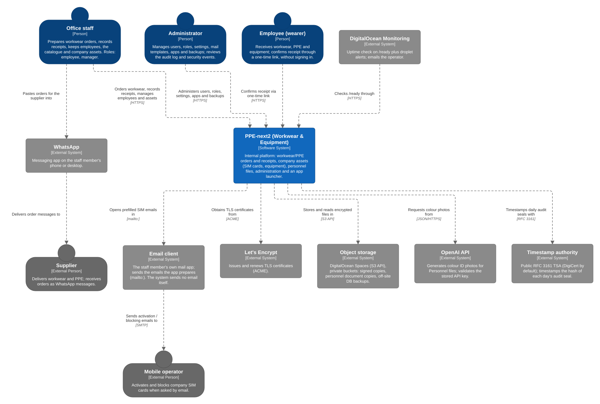
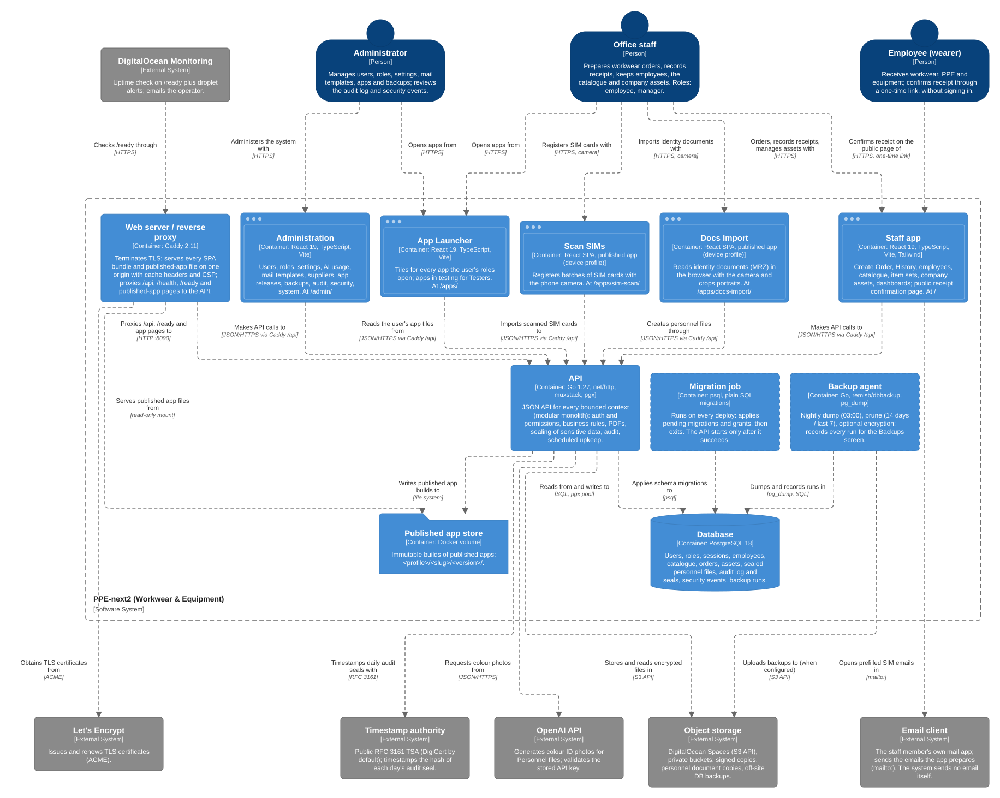

# C4 model

The system drawn at four levels of the [C4 model](https://c4model.com): who uses PPE-next2 and
what it depends on, its containers, the API's components, and production deployment. Open
[`c4/out/index.html`](c4/out/index.html) for every view with zoom and pan, the element
catalogue and the Structurizr DSL; the SVGs below are the same drawings.

Analysed at commit `a3d5a9f` (2026-11-15), generated 2026-11-16.

| View | What it shows |
| --- | --- |
| [1 · System Context](c4/out/context.svg) | People, PPE-next2 and the outside systems (OpenAI, the timestamp authority, Spaces, monitoring, Let's Encrypt, WhatsApp, the staff's mail app). The system sends no email or WhatsApp itself. |
| [2 · Containers](c4/out/containers.svg) | Caddy, the five SPAs (staff app, Administration, App Launcher, Scan SIMs, Docs Import), the Go API, PostgreSQL, the migration job, the backup agent and the published-app volume. |
| [3a · Components: API contexts](c4/out/components.svg) | Router and access policy, health, and the bounded contexts (ADR 0001), with the cross-context adapters in `cmd/api/checkers.go`. |
| [3b · Components: API platform](c4/out/platform.svg) | Audit and its sealed, timestamped days, Sealbox, the file store, AI usage, PDF rendering and the upkeep jobs. |
| [4 · Deployment](c4/out/deployment.svg) | One droplet, one compose project (`docker-compose.prod.yml`); only Caddy publishes ports. |





## Files

| File | Role |
| --- | --- |
| `c4/model.mjs` | **The source of truth.** Elements, relationships, the production deployment and the views. Edit this, nothing else. |
| `c4/build.mjs` | Generator: lays each view out with ELK (`elkjs`, layered, orthogonal edges), renders SVG in C4 notation, writes the Structurizr DSL and the HTML page. |
| `c4/page.html` | Template of the HTML page (tabs, zoom, pan, catalogue, DSL, upkeep notes). |
| `c4/out/` | Generated: `index.html`, one `<view>.svg` per view and `workspace.dsl`. Never edit by hand; commit it with the model change. |

## How it was produced

1. **Read the code at one commit.** The model was written from these sources, each element and
   relationship traced to one of them:
   - `docker-compose.prod.yml` and `deploy/*` — the containers, their images, ports, volumes and
     start order (db → migrate → api → caddy, plus backup).
   - `deploy/Caddyfile` — what Caddy serves itself (the SPA bundles, published-app files) and
     what it proxies to the API (`/api`, `/health`, `/ready`, published-app pages).
   - `cmd/api/` (`main.go`, `config.go`, `router.go`, `checkers.go`, `jobs.go`, the route files) —
     the components, external endpoints (`API_OPENAI_BASE_URL`, `API_AUDIT_TSA_URL`,
     `API_FILES_TARGET`) and the composition root.
   - `internal/*` — one component per bounded context or platform service, named as in the
     context map.
   - `web/apps/*` — the SPAs and where each is mounted.
   - `docs/architecture/context-map.md`, the ADRs and `docs/monitoring.md` / `docs/backups.md`
     — names, responsibilities and the outside systems.
2. **Write the model** (`model.mjs`) following the C4 rules below: every element with name,
   type, technology and one-sentence responsibility; every relationship one-directional with a
   verb phrase and its protocol; each relationship at the **lowest level that is true**
   (component or container).
3. **Generate** with `build.mjs`. Higher views get **implied relationships** from the lower ones,
   as Structurizr does: a component → database link shows as API → Database on the container
   view unless an explicit relationship between the visible elements exists. The deployment view
   draws browser → Caddy instead of SPA → API, because on the wire every request goes to Caddy.
4. **Check** each SVG by eye (overlaps, unreadable labels, missing arrows) and compare the
   generated `workspace.dsl` with the model; it can be opened in
   [Structurizr](https://structurizr.com/dsl) for a second, independent rendering.

### C4 conventions applied

- Every diagram has a title naming its type and scope, a short description and a key.
- People dark blue, the system blue, containers mid-blue, components light blue; anything
  outside PPE-next2 grey. The system or container in scope is a dashed boundary.
- Shapes carry meaning beyond colour: cylinder = database, browser window = SPA, folder = file
  store, dashed border = batch job.
- Relationship labels read in the arrow's direction: "Staff app → *Makes API calls to* → API
  [JSON/HTTPS via Caddy /api]".

## Regenerating

```bash
cd docs/architecture/c4
npm install          # once; elkjs is its only dependency
# edit model.mjs (and meta.commit / commitDate / generated)
npm run build        # writes out/index.html, out/<view>.svg, out/workspace.dsl
```

Update the model in the same change as anything that alters it: a new or removed container,
compose service, published app, external system, bounded context, cross-context dependency or
ADR. Re-check against the sources in step 1, set `meta.commit` to the commit analysed, rebuild
and commit `out/` with the model.

## Not modelled yet

- The planned contexts of ADR 0001 (People split, Competence, Projects & crew, Timesheets,
  Reporting, outbox worker).
- Build-time systems: GitHub Actions CI, and the private `remisb/dbbackup` and `remisb/pdf-mini`
  modules fetched during image builds.
- The development setup (Vite dev servers on 5180–5189, Postgres on 5442).
- Dynamic diagrams, such as the order lifecycle (Create → ORDERED → confirmation link → GIVEN);
  see [Order state machine](order-state-machine.md) for now.
