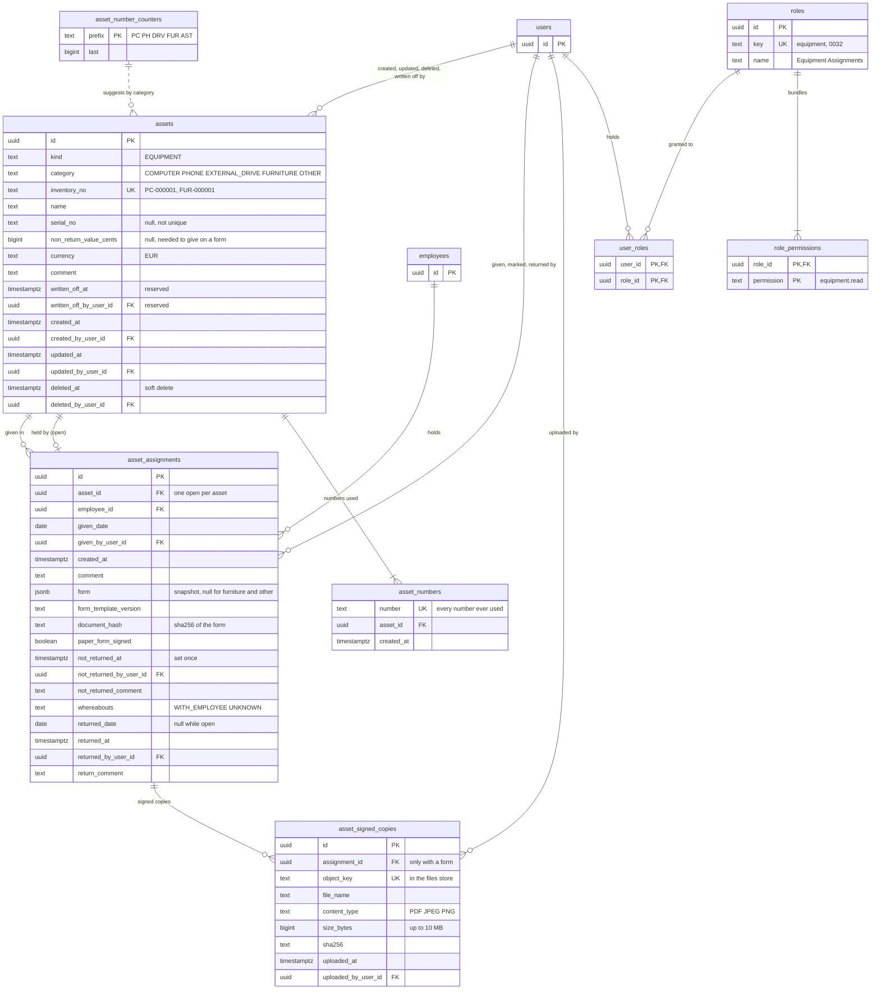

# Equipment ER diagram

The tables behind Equipment & Furniture in Company Assets (`internal/domain/asset`, ADR
0004): the item, its assignments and their signed copies, its inventory numbers, and the
role that lets a user see it. An item is an `assets` row with `kind = 'EQUIPMENT'`; SIM
cards share the tables ([sim-card-er-diagram.md](sim-card-er-diagram.md)). Built from
migrations `0029_company_assets`, `0030_asset_signed_copies` and
`0032_equipment_assignments_role`. The rules behind the columns are in
[asset-service.md](../specs/asset-service.md) ("Equipment & Furniture"); the same diagram as a
page is [equipment-er-diagram.html](equipment-er-diagram.html).

Only the columns an item uses are shown: the SIM card's `sim_no`, `phone_no`, `provider`,
`plan`, `connection_status` and `received_date` are always null for one, so equipment has no
status. `employees` and `users` are shown by their keys only. Location, the holder and Days
Held are not columns: they are derived from the open assignment. An item's Changes are
`audit_events` rows with `entity_type = 'asset'` and its id, which no foreign key ties to it.

## Diagram

## Rules the diagram does not show

| Table | Rule | Enforced by |
| --- | --- | --- |
| `assets` | an item has `category` and `name`, and none of a SIM card's columns | CHECK `assets_kind_fields` |
| `assets` | `inventory_no` is unique over every asset, case aside, deleted ones included | UNIQUE index `assets_inventory_no_idx` |
| `assets` | `deleted_at` and `deleted_by_user_id` are set together, as are `written_off_at` and `written_off_by_user_id`; reads leave both out. No route deletes or writes off an asset yet | CHECKs `assets_deleted`, `assets_written_off`, queries |
| `assets` | `currency` is `EUR`; `non_return_value_cents` is not negative | CHECKs |
| `assets` | Computer, Phone and External Drive need a form, and so a value, to be given; Furniture and Other do not | service (`Asset.NeedsForm`, `Give`) |
| `assets` | only a user whose roles grant `equipment.read` sees an item: the register and Add Asset are 403 by kind, a single item 404, and search and the employee's assets leave it out | `cmd/api` (`asset.Sight`, `Service.Seen`) |
| `asset_numbers` | a number used once is never used again, even after a correction | UNIQUE index `asset_numbers_number_idx`; `ppe_app` has no UPDATE or DELETE |
| `asset_number_counters` | one counter per category's prefix: `PC` Computer, `PH` Phone, `DRV` External Drive, `FUR` Furniture, `AST` Other; taking `PREFIX-NNNNNN` by hand raises `last` to it | CHECK, service (`Create`) |
| `asset_assignments` | at most one open assignment per item | partial UNIQUE index `asset_assignments_open_idx` (`WHERE returned_date IS NULL`) |
| `asset_assignments` | never deleted; the giving's columns never change; the Not Returned mark is set once; a returned assignment is closed | trigger `asset_assignments_guard`; `ppe_app` has no DELETE |
| `asset_assignments` | `form`, `form_template_version` and `document_hash` are set together, and only with `paper_form_signed` | CHECK `asset_assignments_form` |
| `asset_assignments` | an item needing a form is given with one and `paper_form_signed`; one needing none with neither | service (`Give`) |
| `asset_assignments` | the printed form's hash must equal the form built at Give | service (`Give`, `ErrFormChanged`) |
| `asset_assignments` | the Not Returned fields and `whereabouts` are set together | CHECK `asset_assignments_not_returned` |
| `asset_assignments` | the return fields are set together and `returned_date >= given_date` | CHECK `asset_assignments_returned` |
| `asset_assignments` | neither date is in the future in the organisation timezone | service |
| `asset_signed_copies` | only an assignment with a form takes one (furniture's is `ErrNoForm`) | service |
| `asset_signed_copies` | never changed or deleted: uploading again adds a row, the newest shown | trigger `asset_signed_copies_guard`; `ppe_app` has no UPDATE or DELETE |
| `asset_signed_copies` | a PDF, JPEG or PNG of 1 byte to 10 MB, with a 64-hex SHA-256 | CHECKs; the type read from the file's first bytes by the service |
| `roles` | Equipment Assignments is built in (fixed id, key `equipment`) and the only role granting `equipment.read`, which Administrator does not have | migration 0032, `role.builtinRoles` |
| `employees` | an employee holding an item cannot be deleted | service (`employee.ErrHoldsAssets`) |

Indexes for reading: `assets_kind_idx` on `kind, upper(inventory_no)` for live assets,
`asset_assignments_asset_idx` on `asset_id, given_date DESC` (an item's assignments, newest
first), `asset_assignments_employee_idx` on `employee_id`, `asset_signed_copies_assignment_idx`
on `assignment_id, uploaded_at DESC`, and `user_roles_role_idx` on `role_id`.
