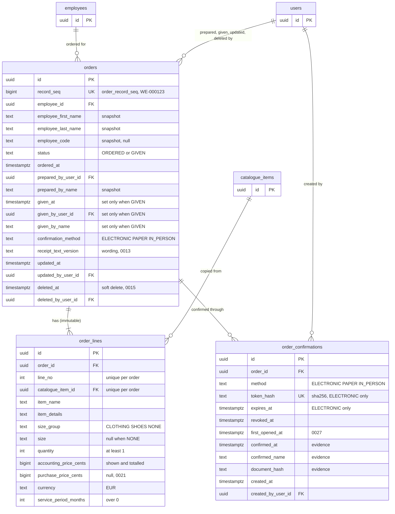

# Order ER diagram

The tables of the Order aggregate (`internal/domain/order`): the order, its immutable
snapshot lines and its confirmations, with the live tables they point at. Built from
migrations `0006_orders`, `0007_order_confirmations`, `0009_in_person_confirmation`,
`0013_receipt_text_version`, `0015_order_soft_delete`, `0021_purchase_price` and
`0027_usage`. The rules behind the columns are in
[order-service.md](../specs/order-service.md); the same diagram as a page is
[order-er-diagram.html](order-er-diagram.html).

`employees`, `catalogue_items` and `users` are shown by their keys only. Nothing an order
or its record shows is read from them: names, prices and sizes are copied in at Mark as
Ordered.

## Diagram

## Rules the diagram does not show

| Table | Rule | Enforced by |
| --- | --- | --- |
| `orders` | `status` is `ORDERED` or `GIVEN`; there is no draft row | CHECK |
| `orders` | `given_at`, `given_by_user_id`, `given_by_name` and `confirmation_method` are all set exactly when `status = 'GIVEN'` | CHECK `orders_given_fields` |
| `orders` | `deleted_at` and `deleted_by_user_id` are set together; every read filters `deleted_at IS NULL` | CHECK `orders_deleted_fields`, queries |
| `orders` | `record_seq` comes from `order_record_seq`; a rolled-back or deleted order leaves a gap, never reused | sequence, UNIQUE |
| `order_lines` | never updated, deleted or truncated | triggers `order_lines_no_update_delete`, `order_lines_no_truncate` (0026) |
| `order_lines` | one line per catalogue item and one per line number in an order | UNIQUE `(order_id, catalogue_item_id)`, `(order_id, line_no)` |
| `order_lines` | `size` is null exactly when `size_group = 'NONE'` | CHECK `order_lines_size_matches_group` |
| `order_lines` | `catalogue_item_id` is for reporting only; every displayed value is copied | service (`MarkAsOrdered`) |
| `order_confirmations` | `ELECTRONIC` has `token_hash` and `expires_at`; `PAPER` and `IN_PERSON` have neither | CHECK `order_confirmations_token_shape` |
| `order_confirmations` | `confirmed_at`, `confirmed_name` and `document_hash` are set together | CHECK `order_confirmations_evidence` |
| `order_confirmations` | at most one confirmation per order carries evidence | partial UNIQUE index `order_confirmations_one_confirmed_idx` |
| `order_confirmations` | only the SHA-256 of a link's token is stored | service (`HashToken`) |

Indexes for reading: `orders_activity_idx` on `coalesce(given_at, ordered_at) DESC, id`
(newest activity first), `orders_employee_idx` on `employee_id`, and
`order_confirmations_order_idx` on `order_id`.
