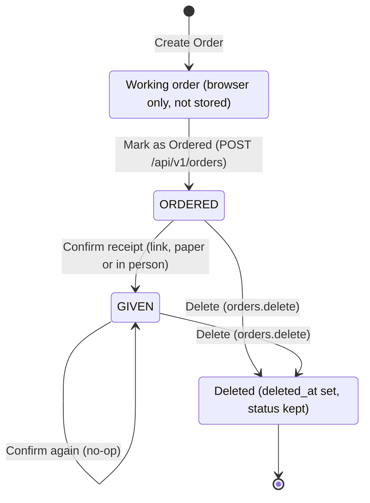
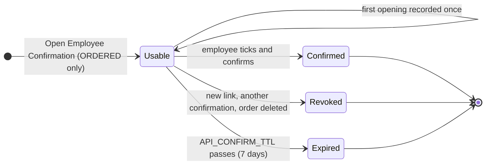

# Order state machine

The states an order goes through, and the lifecycle of the confirmation link that moves it
from ORDERED to GIVEN. Built from `internal/domain/order` (`service.go`, `confirmation.go`);
the rules behind each step are in [order-service.md](../specs/order-service.md), the tables
in [order-er-diagram.md](order-er-diagram.md). The same diagrams as a page are
[order-state-machine.html](order-state-machine.html).

## Order

| From | To | Trigger | Route | Notes |
| --- | --- | --- | --- | --- |
| — | Working order | Create Order | none | Client state (`working-order.ts`, a draft per user in localStorage); there is no draft row |
| Working order | ORDERED | Mark as Ordered | `POST /api/v1/orders` | One transaction: locks the employee and items, takes the record number, copies every value into the order and its lines, writes `order.ordered`. Refused (409) for an inactive item or one without a price or service period |
| ORDERED | GIVEN | Employee confirms by link | `POST /api/v1/confirmations/confirm` | Method `ELECTRONIC`; giver = the user who created the link; no actor on the event |
| ORDERED | GIVEN | Signed paper record | `POST /api/v1/orders/{id}/confirm-paper` | Method `PAPER`; the actor is the giver |
| ORDERED | GIVEN | Hand-over mode | `POST /api/v1/orders/{id}/confirm-in-person` | Method `IN_PERSON`; the actor is the giver |
| GIVEN | GIVEN | Any confirmation again | the three above | No-op: returns the existing record and writes nothing |
| ORDERED or GIVEN | Deleted | Delete | `DELETE /api/v1/orders/{id}` | Needs `orders.delete`. Soft delete: the status stays, `deleted_at` is set, unused links are revoked, `order.deleted` is written; every read then skips the order |

`ORDERED` and `GIVEN` are the only stored statuses (a CHECK). Deleted is not a status but
`deleted_at`. Nothing moves an order back from GIVEN, and nothing changes its lines.

Every move to GIVEN runs in one transaction under the order's row lock: the status and
`given_*` fields, the confirmation evidence (employee name and the receipt's document hash),
the revocation of the order's other unused links and the `order.given` event. A partial
unique index allows one confirmation with evidence per order, so two concurrent
confirmations cannot both succeed.

## Confirmation link

| State | Stored as | What the public routes answer |
| --- | --- | --- |
| Usable | `revoked_at`, `confirmed_at` null and `expires_at` in the future (`Confirmation.Usable`) | The locked record; the first view sets `first_opened_at` and writes `order.confirmation_link_opened` |
| Confirmed | `confirmed_at`, `confirmed_name`, `document_hash` set | The final record |
| Revoked | `revoked_at` set | 410 "request a new link" while the order is ORDERED; the final record once it is GIVEN |
| Expired | `expires_at` past (derived, nothing written) | As Revoked |

A link is created only for an ORDERED order (409 otherwise), and creating one revokes the
order's earlier unused links, so at most one is usable. Only `sha256(token)` is stored; the
token is shown once. A link to a deleted order, even a used one, answers 410.
