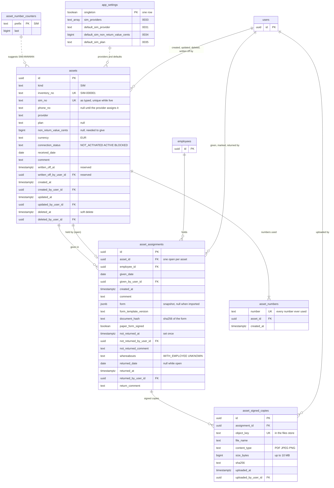

# SIM Card ER diagram

The tables behind a SIM card in Company Assets (`internal/domain/asset`, ADR 0004): the
card, its assignments and their signed copies, its inventory numbers, and the Settings
columns Add SIM and Give SIM fill in from. A SIM card is an `assets` row with
`kind = 'SIM'`; Equipment & Furniture share the tables
([equipment-er-diagram.md](equipment-er-diagram.md)). Built from migrations
`0029_company_assets`, `0030_asset_signed_copies`, `0031_default_sim_provider`,
`0033_sim_providers`, `0034_default_sim_non_return_value` and `0035_default_sim_plan`. The
rules behind the columns are in [asset-service.md](../specs/asset-service.md); the same
diagram as a page is [sim-card-er-diagram.html](sim-card-er-diagram.html).

Only the columns a SIM card uses are shown: `category`, `name` and `serial_no` are always
null for one. `employees` and `users` are shown by their keys only. Location, the holder and
Days Held are not columns: they are derived from the open assignment. A card's Changes are
`audit_events` rows with `entity_type = 'asset'` and its id, which no foreign key ties to it.

## Diagram

## Rules the diagram does not show

| Table | Rule | Enforced by |
| --- | --- | --- |
| `assets` | a SIM card has `sim_no`, `provider`, `connection_status` and `received_date`, and no `category`, `name` or `serial_no` | CHECK `assets_kind_fields` |
| `assets` | `inventory_no` is unique over every asset, case aside, deleted ones included | UNIQUE index `assets_inventory_no_idx` |
| `assets` | `sim_no` is unique among live cards, spaces and case aside; it is stored as typed, leading zeros included | partial UNIQUE index `assets_sim_no_live_idx` |
| `assets` | `deleted_at` and `deleted_by_user_id` are set together, as are `written_off_at` and `written_off_by_user_id`; reads leave both out. No route deletes or writes off an asset yet | CHECKs `assets_deleted`, `assets_written_off`, queries |
| `assets` | `currency` is `EUR`; `non_return_value_cents` is not negative | CHECKs |
| `assets` | a card is given only when `ACTIVE`, with a value; the phone number and plan may be blank on the form | service (`Give`) |
| `assets` | Change Status never moves a card, and giving or returning never changes its status | service |
| `asset_numbers` | a number used once is never used again, even after a correction | UNIQUE index `asset_numbers_number_idx`; `ppe_app` has no UPDATE or DELETE |
| `asset_number_counters` | the prefix of a SIM card is `SIM`; taking `SIM-NNNNNN` by hand raises `last` to it | CHECK, service (`Create`) |
| `asset_assignments` | at most one open assignment per card, so two people giving it at once cannot both succeed | partial UNIQUE index `asset_assignments_open_idx` (`WHERE returned_date IS NULL`) |
| `asset_assignments` | never deleted; the giving's columns never change; the Not Returned mark is set once; a returned assignment is closed | trigger `asset_assignments_guard`; `ppe_app` has no DELETE |
| `asset_assignments` | `form`, `form_template_version` and `document_hash` are set together, and only with `paper_form_signed` | CHECK `asset_assignments_form` |
| `asset_assignments` | a SIM card's giving has a form, except a card brought in by the go-live import (`api -import-sims`) | service (`Give`, `ImportSIMs`) |
| `asset_assignments` | the printed form's hash must equal the form built at Give | service (`Give`, `ErrFormChanged`) |
| `asset_assignments` | the Not Returned fields and `whereabouts` are set together | CHECK `asset_assignments_not_returned` |
| `asset_assignments` | the return fields are set together and `returned_date >= given_date` | CHECK `asset_assignments_returned` |
| `asset_assignments` | neither date is in the future in the organisation timezone | service |
| `asset_signed_copies` | never changed or deleted: uploading again adds a row, the newest shown | trigger `asset_signed_copies_guard`; `ppe_app` has no UPDATE or DELETE |
| `asset_signed_copies` | a PDF, JPEG or PNG of 1 byte to 10 MB, with a 64-hex SHA-256 | CHECKs; the type read from the file's first bytes by the service |
| `app_settings` | `default_sim_provider` is empty or one of `sim_providers` | CHECK `app_settings_default_sim_provider_listed` |
| `employees` | an employee holding a card cannot be deleted | service (`employee.ErrHoldsAssets`) |

Indexes for reading: `assets_kind_idx` on `kind, upper(inventory_no)` for live assets,
`asset_assignments_asset_idx` on `asset_id, given_date DESC` (an asset's assignments, newest
first), `asset_assignments_employee_idx` on `employee_id` (Given SIM on the employee page),
and `asset_signed_copies_assignment_idx` on `assignment_id, uploaded_at DESC`.
