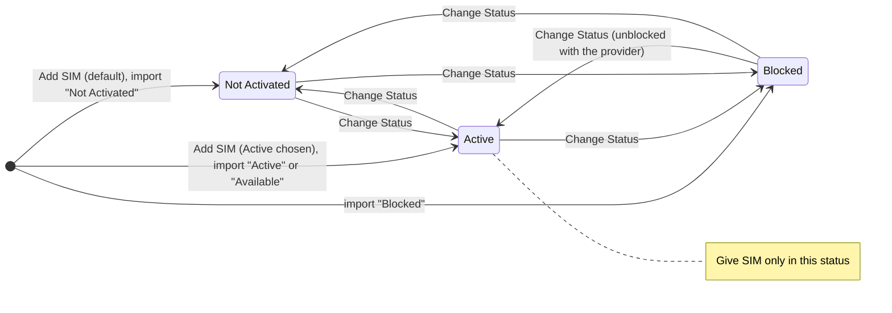
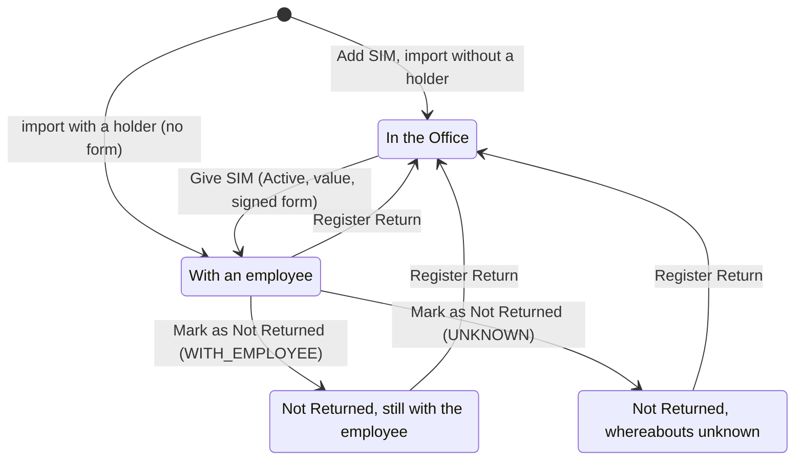
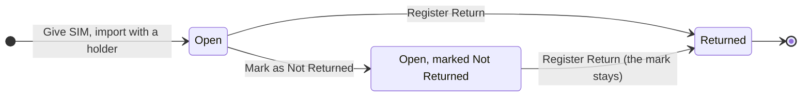
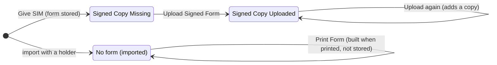

# SIM card state machine

The states a SIM card goes through in Company Assets. A card has two facts that change
independently (asset-service.md, rule 2): its **connection status**, which is stored, and
**where it is and who holds it**, which is derived from its open assignment. No action
changes one as a side effect of the other: Change Status never moves a card, and giving or
returning never changes its status. Each assignment then has a lifecycle of its own, and a
signed copy may be added to it. Built from `internal/domain/asset` (`service.go`,
`import.go`) and `cmd/api/import-sims.go`; the rules behind each step are in
[asset-service.md](../specs/asset-service.md), the tables in
[sim-card-er-diagram.md](sim-card-er-diagram.md). The same diagrams as a page are
[sim-card-state-machine.html](sim-card-state-machine.html).

## Connection status

| From | To | Trigger | Route | Notes |
| --- | --- | --- | --- | --- |
| — | Not Activated | Add SIM | `POST /api/v1/assets` | The default; `asset.registered` |
| — | Active | Add SIM with Active chosen | `POST /api/v1/assets` | For a card that arrives already active |
| — | any of the three | Go-live import | `api -import-sims` | Active and Available read as Active; Available with a holder is refused |
| any | any other | Change Status | `PUT /api/v1/assets/{id}/status` | `assets.manage`; saved at once with no confirmation step; `asset.status_changed` with the old and new status |
| any | the same | Change Status | as above | No-op: writes nothing |

`connection_status` is stored on `assets` and limited to the three values by a CHECK. There
is no final state: write-off is reserved (`written_off_at`) and not built, and no route
deletes a card. The status never stops a card being returned or marked Not Returned; it
matters only to Give SIM, which refuses anything but Active (409 `ErrNotActive`). A card
marked Not Returned is usually then blocked: Prepare Blocking Email prepares the provider's
email from its mail template, and the user sets Blocked by hand once the provider confirms. A returned blocked card
must be unblocked and set Active before it can be given again.

## Where the card is

| From | To | Trigger | Route | Notes |
| --- | --- | --- | --- | --- |
| — | In the Office | Add SIM, or import with no holder | `POST /api/v1/assets`, `api -import-sims` | No assignment |
| — | With an employee | Import with a holder | `api -import-sims` | Given on the import's day with no form; `asset.registered` and `asset.given` with no document hash |
| In the Office | With an employee | Give SIM | `POST /api/v1/assets/{id}/assignments` | See the checks below; `asset.given`, and `asset.updated` first when a missing plan or value was filled in |
| With an employee | Not Returned, with the employee or unknown | Mark as Not Returned | `POST /api/v1/assets/{id}/not-returned` | The card stays with its holder and out of office stock; `asset.marked_not_returned` |
| any held state | In the Office | Register Return | `POST /api/v1/assets/{id}/return` | Return date not before the given date or in the future; `asset.returned`. The status, the Not Returned mark, the form and the signed copies stay |

Location is derived, never stored: **Office** with no open assignment, **With Employee**
with one, **Unknown** when that one is marked Not Returned with whereabouts `UNKNOWN`. The
holder is the open assignment's employee, in every held state. Only Register Return brings a
card back: not an employee leaving, not the Not Returned mark, not Blocked.

Give SIM runs in one transaction with the card locked `FOR UPDATE` and the employee
`FOR SHARE`, and answers the first check that fails:

| Check | Answer |
| --- | --- |
| The card is live | 404 |
| The employee is live | 404 `ErrEmployeeNotFound` |
| No open assignment | 409 `ErrAlreadyGiven` |
| Status Active | 409 `ErrNotActive` |
| A Non-return Value (the phone number and plan may be blank) | 400 |
| Given date not in the future | 400 |
| Paper Form Signed ticked | 400 |
| The printed form's hash equals the form built now | 409 `ErrFormChanged` |

Refused moves: Give SIM on a held card is 409 `ErrAlreadyGiven`; Register Return or Mark as
Not Returned on a card in the Office is 409 `ErrNotGiven`; marking a card already marked is
409 `ErrAlreadyMarked`, so whereabouts cannot be changed (open decision 7). A partial unique
index allows one open assignment per card, so two people giving it at once cannot both
succeed.

## Assignment

| State | Stored as |
| --- | --- |
| Open | `returned_date` null, `not_returned_at` null |
| Open, marked Not Returned | `returned_date` null; `not_returned_at`, `not_returned_by_user_id`, `not_returned_comment` and `whereabouts` set |
| Returned | `returned_date`, `returned_at`, `returned_by_user_id` and `return_comment` set |

An assignment is never deleted, its giving (employee, date, form, hash) never changes, the
mark is set once and a returned assignment is closed: the trigger `asset_assignments_guard`
refuses anything else, and `ppe_app` has no DELETE on the table. A card's earlier
assignments are its history; a new giving is a new assignment.

## Signed copy

| From | To | Trigger | Route | Notes |
| --- | --- | --- | --- | --- |
| Signed Copy Missing | Signed Copy Uploaded | Upload Signed Form | `POST /api/v1/assets/{id}/assignments/{assignmentID}/signed-copies` | PDF, JPEG or PNG up to 10 MB; `asset.signed_copy_uploaded`. Allowed while open and after the return |
| Signed Copy Uploaded | Signed Copy Uploaded | Upload again | as above | Adds a row; the newest is shown, the earlier ones stay (`asset_signed_copies` is append-only) |
| No form | No form | Print Form, while the card is still held | `GET …/assignments/{assignmentID}/form`, recorded by `POST …/assignments/{assignmentID}/form-printed` | A form built from the card and holder as they are then, dated `asset.ImportedFormDate` and never stored; `asset.form_printed`. Needs the Non-return Value. No signed copy can be uploaded (404 `ErrNoForm`) |

The register's Documents column and its `signed_copy=missing` filter show the first two
states for the cards held on a form. Printing a form, again or for the first time, is
recorded (`asset.form_printed`) but changes no state, and so is Prepare Blocking Email
(`asset.blocking_email_prepared`).
