# Workwear & Equipment: User guide

English · [Lietuvių](user-guide.lt.md) · [Русский](user-guide.ru.md)

The app records workwear and safety equipment given to employees. You prepare an order and mark it as ordered. After the employee receives the items, they confirm receipt, and the app keeps a locked record in English and Russian. It also keeps track of the company's SIMs, equipment and furniture, and who holds each one.

## 1. Sign in

1. Open **workwear.gavort.nl** and sign in with your email and password.
2. Your first screen depends on your role:
   - Administrators start on the **Dashboard**.
   - Managers start on the **Manager Dashboard**.
   - The employee role starts on the **Employee Dashboard**.

The sidebar holds every section and **Search…** (`⌘K`). **Orders**, **Item Catalogue** and **Item Sets** are listed under **Workwear**. Choose **Workwear** to hide or show them; while they are hidden, it shows the number of orders waiting for confirmation. **Help**, **Keyboard shortcuts**, your account and **Sign out** are at its foot.

With **Keep me signed in** ticked, you stay signed in on this device after closing the app or restarting the device, for up to 30 days, or until you have not used it for 14 days. On a shared computer, untick it: you are signed out when the browser closes, and after 12 hours at the latest.

**Sign out** ends your sign-in on this device. When you change your password, your other devices are signed out. When an administrator resets your password or deactivates your account, you are signed out everywhere.

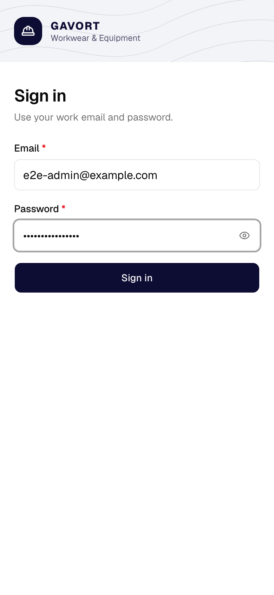
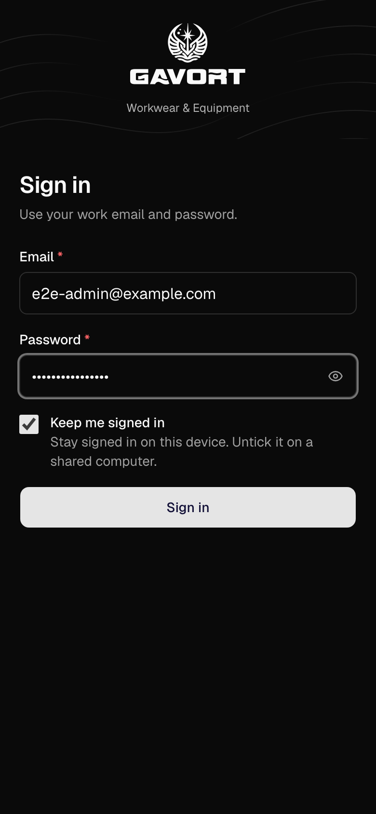

## 2. Dashboard

*Administrators only:*

The figures at the top show the orders awaiting confirmation, this month's spending and the replacements due.

**Needs you** lists what to do next, most urgent first. Each line has a button for its task:

- An overdue item: **Reorder**.
- An unconfirmed order: **Send link**.
- A missing size: **Add sizes**.
- An item without a price: **Fix**.

The **Backups** card says whether the database is backed up. Choose it to open **Backups** in **Administration**.

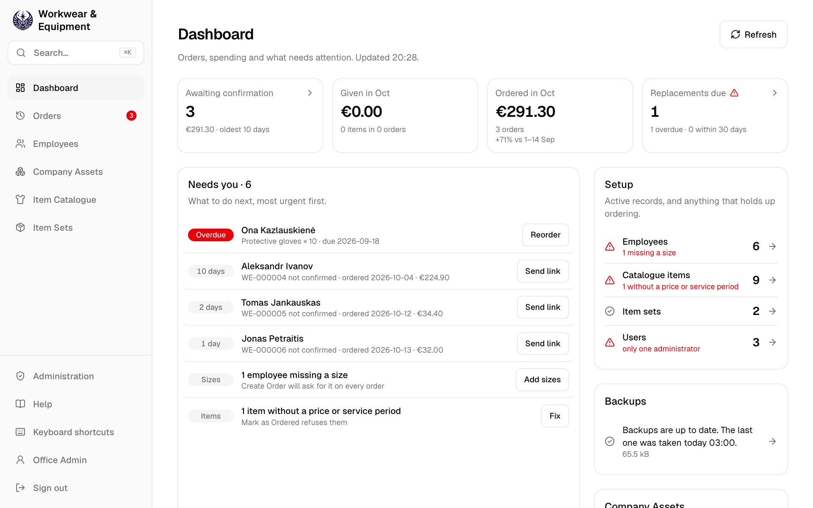

*Managers only:*

The **Manager Dashboard** covers items, prices and purchasing: what is on order, spending by item, the replacements that will need buying, recent price changes, what holds up ordering in the catalogue and item sets, and the sizes to stock.

*The employee role only:*

The **Employee Dashboard** starts with what needs doing: your orders still waiting for the employee's confirmation (**Send link**), items due for replacement and employees missing a size. Below are your orders by month and those given recently.

## 3. Create an order

1. On **Orders**, choose **Create Order** at the top.
2. In **Assigned to**, type part of the employee's name. For someone new, choose **+ Add New Employee**.
3. Add the items:
   - **Item Set** adds a whole kit in one tap.
   - **Add Item** adds one item. Press `/` to jump to it.
4. Check each line's size and quantity:
   - Sizes come from the employee's saved sizes. Clothing is picked by letter, for example `S (44–46)`.
   - You can't order until every missing size is chosen.
   - If you choose a size other than the employee's saved one, you're asked **Different size selected. Save it to employee profile?** **Save** keeps it for their future orders; **Skip size update** uses it on this order only.
5. Choose **Review and mark as ordered** in the panel on the right, or press `⌘/Ctrl` `Enter`.

This device keeps a draft of the order while you work; **Clear order** at the top empties it, after asking. **Copy for WhatsApp**, for the supplier's message, is in the review.

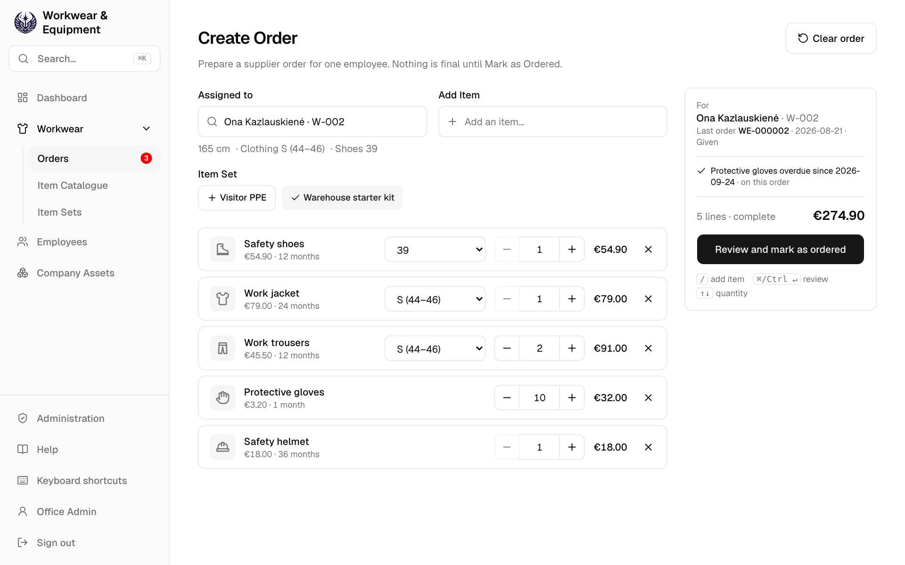

## 4. Review and Mark as Ordered

1. Check the lines and the total.
2. Choose **Mark as Ordered**. The order is now **Ordered**, and you can no longer edit it. The app also creates the employee's confirmation link.
3. Send the employee the link with **Share link via WhatsApp** or **Copy link**. The link is valid for 7 days, and the app shows it only once.

If the employee will sign on paper, choose **Print Record** instead.

**Copy for WhatsApp**, in the review, copies the message for the supplier. When an administrator has set the supplier's WhatsApp group in **Administration**, on **Settings**, it then offers to open that group: paste the message there.

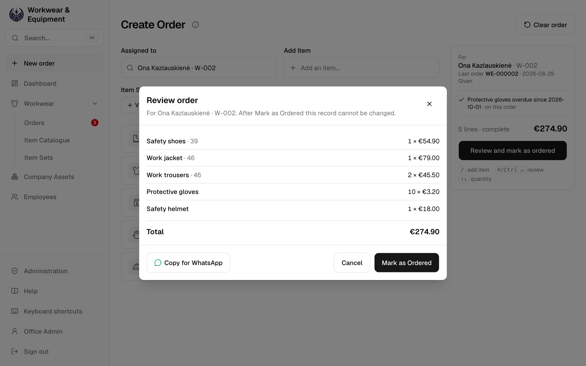
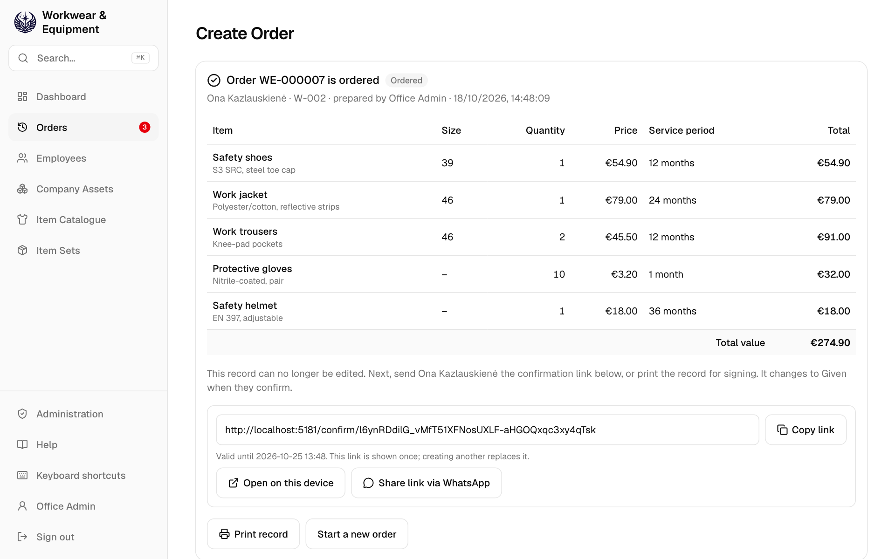

## 5. The employee confirms

1. The employee opens the link. They don't need an account.
2. They check the items, their prices and the total, in English or Russian (**EN / RU**). The page opens in their preferred language when it is English or Russian.
3. They tick the statement and tap **Confirm receipt**. The order becomes **Given**.

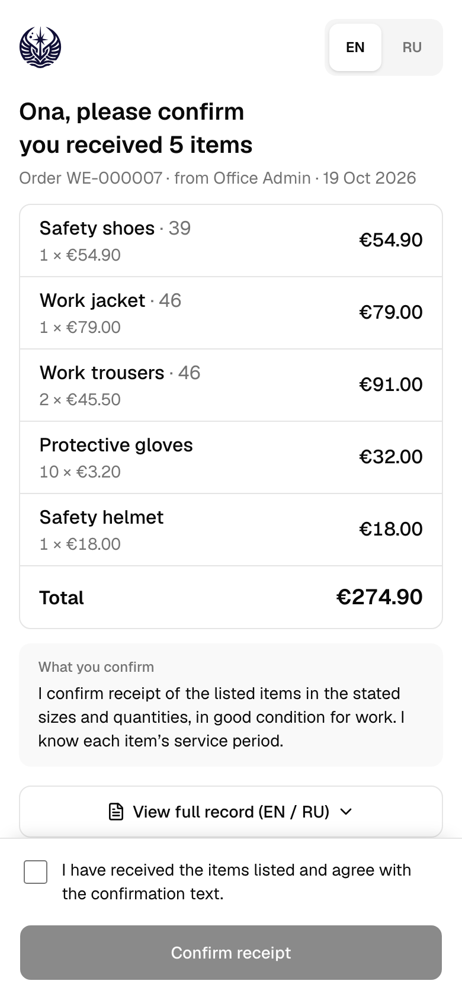

## 6. Orders

**Orders** lists every order placed. **Create Order**, at the top, starts a new one.

**All**, **Ordered** and **Given** filter the orders by status; point at one to see what it counts. You can also filter by employee and date. Click a record number to open the order beside the list. `J` and `K` move between orders, and `Esc` closes the order.

**Date** shows **All dates** at first; choose **Last 7 days**, **This month** or **Previous month** instead. **Custom range…** opens **From** and **To** in its place: **Apply** makes that range the choice shown, such as **2026-09-01 – 2026-09-30**, and **Cancel** leaves the filter as it was. Choose **Custom range…** again to change it.

Every date field, here and elsewhere, takes a date as your language writes it: **2026-10-15**. Type the digits and the separators are added for you. In an empty field the current year comes first as you start typing; to use another year, type it over. Or choose the calendar beside the field and pick a day: days you cannot choose, such as a **To** before **From**, are greyed out. A date that does not exist is refused, and **Apply** waits until it is put right.

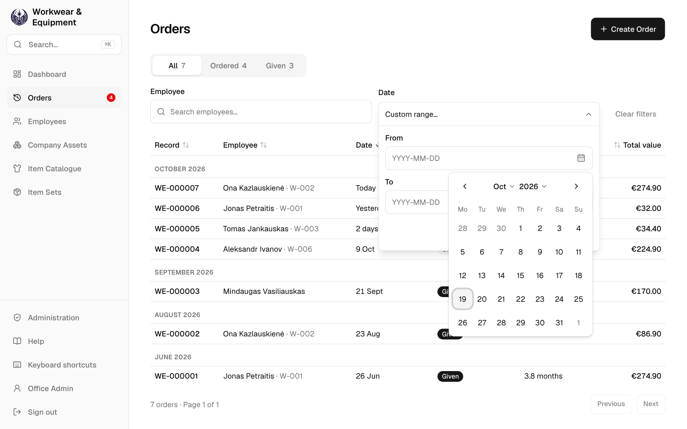

An **Ordered** order has these actions:

- **Create confirmation link** makes a new link for the employee and shows it below, with **Copy link** and **Share link via WhatsApp**. The button then becomes **Confirmation link**, which hides and shows that link. Once you leave the order the link is no longer shown; a new one replaces it.
- **Print Order** prints the order's record for the employee to sign.
- **Mark as Signed & Given** records that the employee signed the printed record. The app asks first; the order is then **Given**, with a green **Signed** badge beside its status.

*Managers only:*

**⋯ → Delete order…** removes an order, such as a test order, after asking.

An order's **Changes** list what happened to it and who did it: ordered, a link made or opened, given. They are closed at first; choose **Changes** to open them.

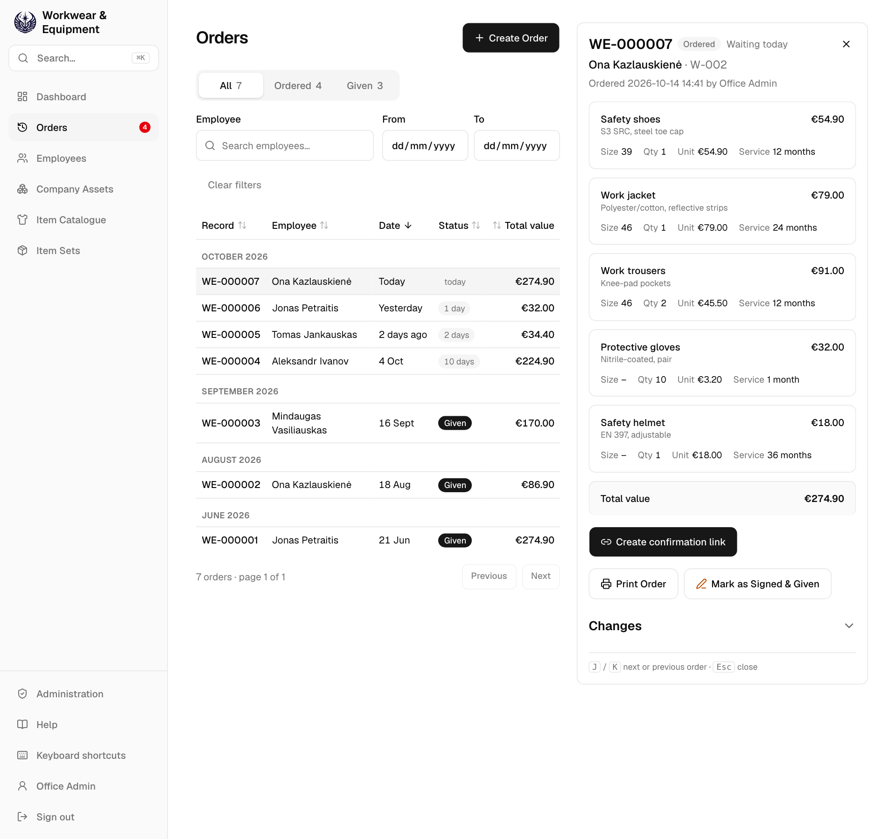

## 7. Items Given Record

A **Given** order has a locked record in English and Russian. Open it with **View Order**.

- **Print Record** prints it on one A4 page; **Print Order** on the order does the same.
- **Share via WhatsApp** sends it.

Dates on the record, and on the printed and PDF assignment forms of Company Assets, are written **2026 10 15**, the same in every language.

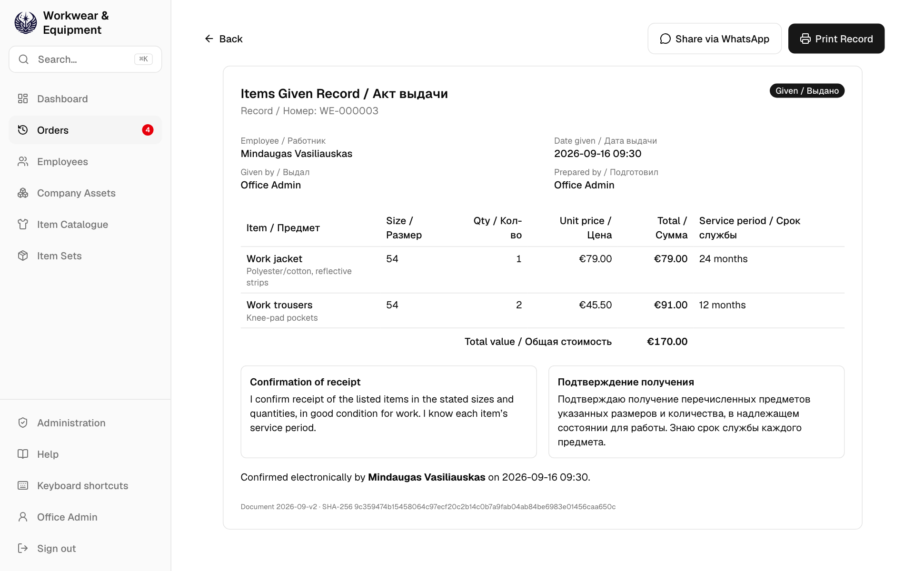

## 8. Employees

The list shows each employee's sizes and note, and marks anyone missing a size. A long note is cut to one line; point at it to read it all, or open the employee. When someone is missing a size, **All** and **Missing a size** above the list choose who is shown; point at one to see what it lists.

Each employee's page shows:

- **Sizes** and **Preferred language**, each with its own **Edit**;
- **Items given**: every item given, with its usage time and replacement date;
- **Ordered, not yet given**: orders not yet given;
- the company assets they hold, and held before: **Given SIM** and **Equipment**;
- **Changes**: who changed their details or sizes, and when.

The sections below the sizes are closed at first, each title counting what it holds; choose a title to open or close it.

**Edit** beside **Sizes** turns them into their fields right there: **Save** keeps them for future orders, **Cancel** leaves them as they were. A red **Missing** opens that size's field. The preferred language is changed the same way. **New order** starts an order for them.

*Administrators and managers only:*

An employee who still holds a company asset cannot be deleted: leaving never returns it. Register its return first.

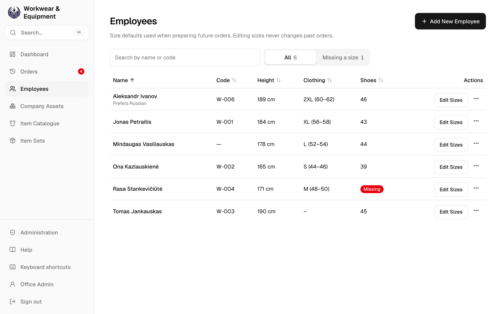
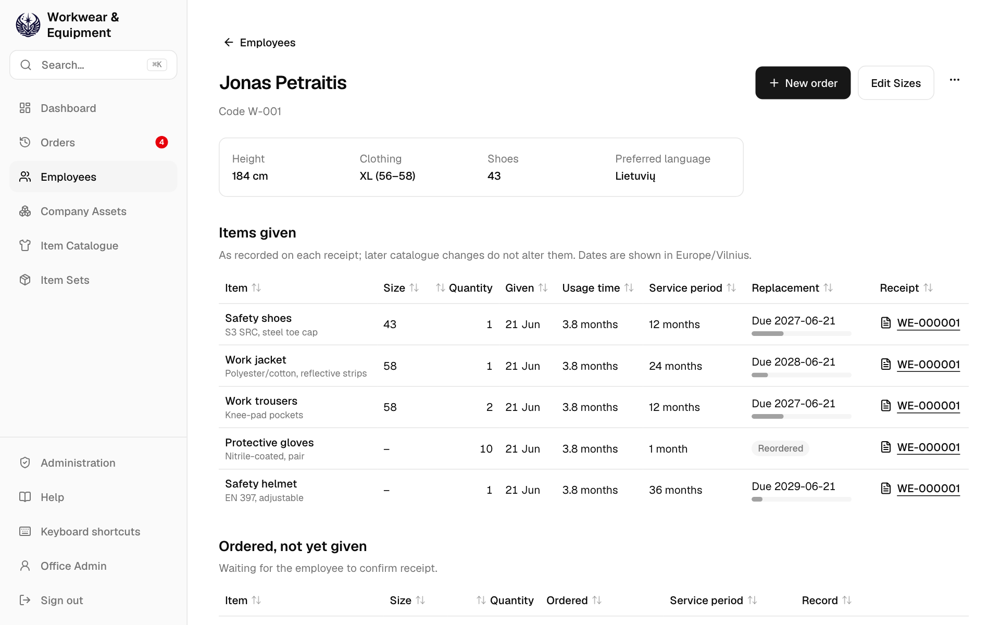

## 9. Item Catalogue and Item Sets

Each catalogue item has a price, a service period and a size group. Orders show and total the price. You can't order an item without a price or service period. Changing a price never alters existing orders.

An item can also have a **Purchase price**: what we pay the supplier. It is optional, never needed to order, and orders don't show it. An open item shows both prices and how they changed, and its **Changes**, closed at first, list who changed the item, and when.

Click an item to open it beside the list. `J` and `K` move between items, and `Esc` closes it. An item without a price or service period is marked **Incomplete**; point at the mark to see which is missing.

An item set is a kit of items with default quantities. You apply it on Create Order in one tap.

*Administrators and managers only:*

You add and change items in **Item Catalogue**, and kits in **Item Sets**.

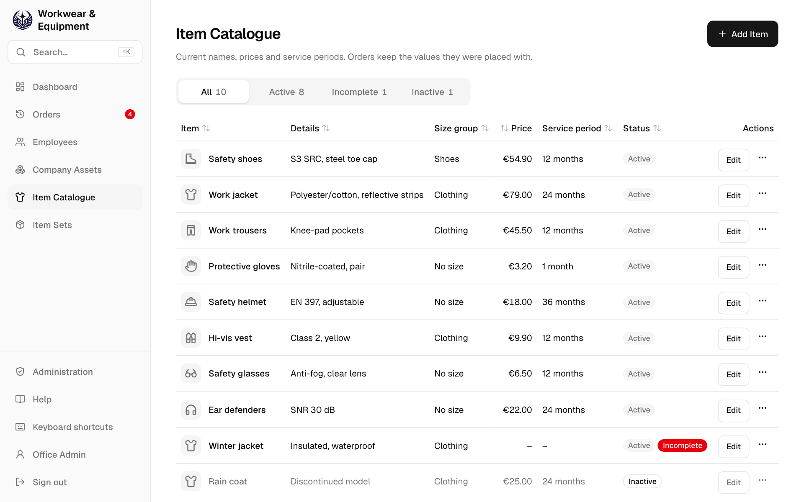
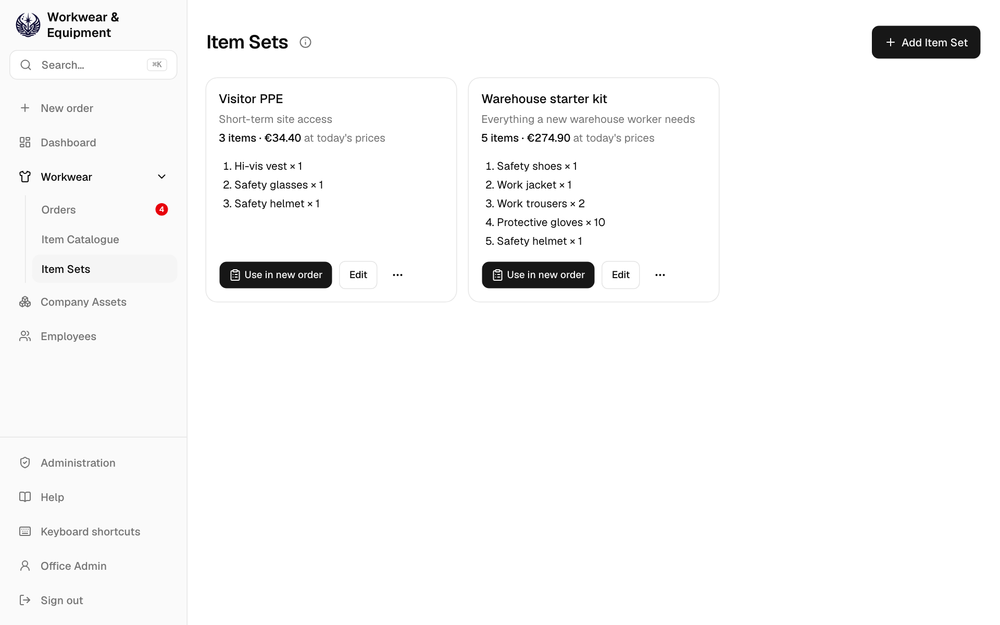

## 10. Company Assets

**Company Assets** records the SIMs, equipment and furniture the company gives employees: where each one is, who holds it, and the signed form for each giving. It has two screens: **SIM Cards**, and **Equipment**, for equipment and furniture alike, which only those given the **Equipment Assignments** role see. Each item is one record with its own inventory number, so three identical laptops are three assets.

Open it from the sidebar, or press `G` then `A`. If you also see **Equipment**, it and **SIM Cards** are listed under **Company Assets**: choose one to open it. Choosing **Company Assets** hides or shows them.

*Administrators and managers only:*

The **Company Assets** card on the Dashboard shows the same figures. Choose one to open that screen on its tab.

The tabs above the list count the SIMs: **All**, **In Office** and **With Employees**. **Equipment** adds **Not Returned**; its counts overlap, since an item not returned is still with an employee. Search by number or employee, and filter by location, provider and documents, or by category for equipment. A SIM or an item you choose opens beside the list, or in its place on a narrower screen.

A SIM's **Status** is what the provider confirms: **Not Activated**, **Active** or **Blocked**. It is separate from where the card is and who holds it: blocking a card does not return it, and returning it does not change its status.

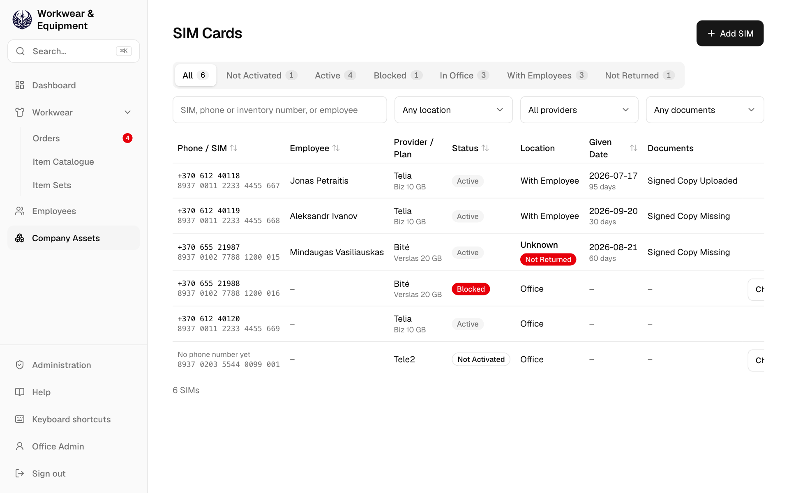

**Preview PDF** on **SIM Cards** shows the list as a PDF to print: every SIM the tabs, search and filters keep, not only the first page, in the list's order. Each page names the list, the date and time it was printed, the filters and the order. It is in the **Language** chosen on your account, and dates are written **2026 10 15**. From the preview, **Print** prints it, **Download PDF** saves it and **Open in New Tab** opens it in your browser's own viewer. Where the browser cannot show a PDF in the app, as on many phones, it offers the last two.

*Administrators and managers only:*

**Add SIM** registers a card as it arrives from the provider. Its SIM No., provider and inventory number, the next one suggested, are needed now; the phone number, plan and non-return value can wait until it is given. The provider is chosen from the list an administrator keeps in **Administration**, on **Settings**, with the default one already chosen; while that list is empty, you type it. The non-return value set there is filled in, and you can change or clear it. On **Equipment**, **Add Asset** registers one item: its name and category, which suggests its number, such as `PC-000003`.

**Change Status** records the status the provider confirmed. It does not activate or block the card: email the provider for that.

To give a SIM or an item, follow the three steps on **Give SIM** or **Give Asset**:

1. Open it and choose **Give SIM** or **Give Asset**. On an employee's page, the same button beside **Given SIM** or **Equipment** starts from the employee and lists what is in the office.
2. **Who and when**: choose the employee and the given date, today or earlier. A SIM's plan is optional; its non-return value is on the form, so it is needed.
3. **Print the form and have it signed**: **Print Form** prints the assignment form from this page, with no new tab, and **Download PDF** saves the same form as a file. Have the employee sign the paper, then tick **The employee has signed the printed form**.
4. **Hand over the SIM** or **Hand over the item**: choose **Give SIM** or **Give Asset**. It records the holder, the location and the signed form at once.

Each step opens when the one before it is done, and the line beside the button says what is left. Once the form is printed, the employee and date fold into one line; **Change** opens them again. Only an **Active** card in the office, with a phone number, can be given. If the form changes after printing, the tick is cleared: print it again and have it signed. Closed or reloaded after printing, Give SIM opens again with the details and the printed form. Furniture and other items are given without a form, in two steps.

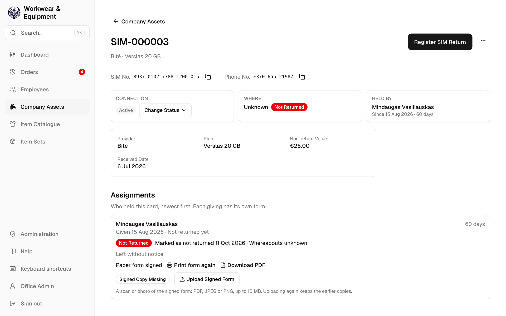
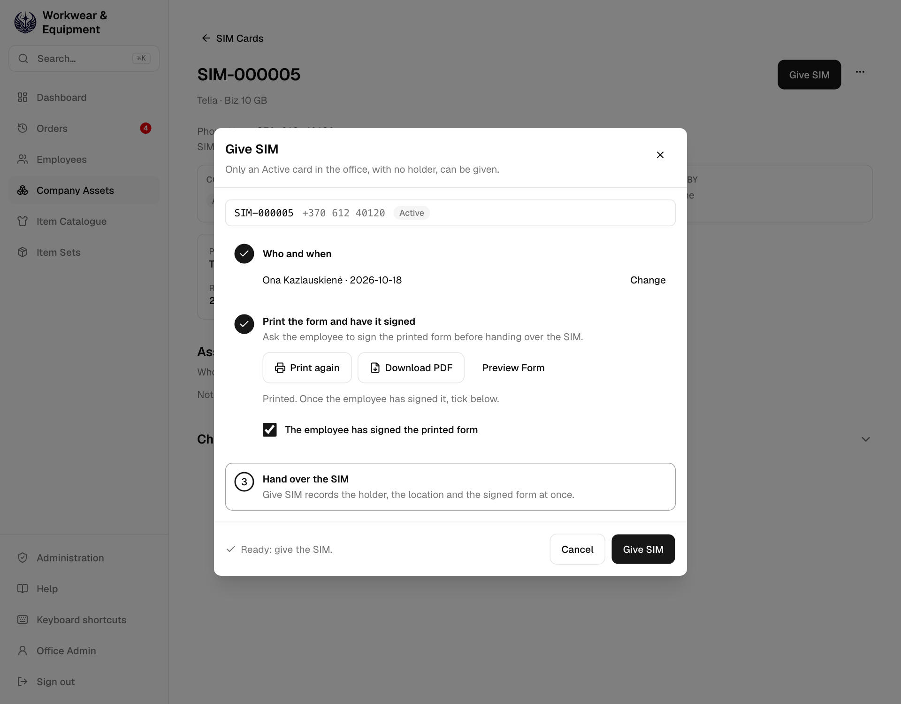

*The employee role only:*

On an assignment with a form, the card's page says **Signed Copy Uploaded**, with the scan to download, or **Signed Copy Missing**. The **Documents** filter finds the missing ones.

*Administrators and managers only:*

Once the employee has signed, scan or photograph the form and choose **Upload Signed Form** under its assignment: a PDF, JPEG or PNG of up to 10 MB. A photo's location and camera details are removed. Uploading again keeps the earlier copies, under the newest.

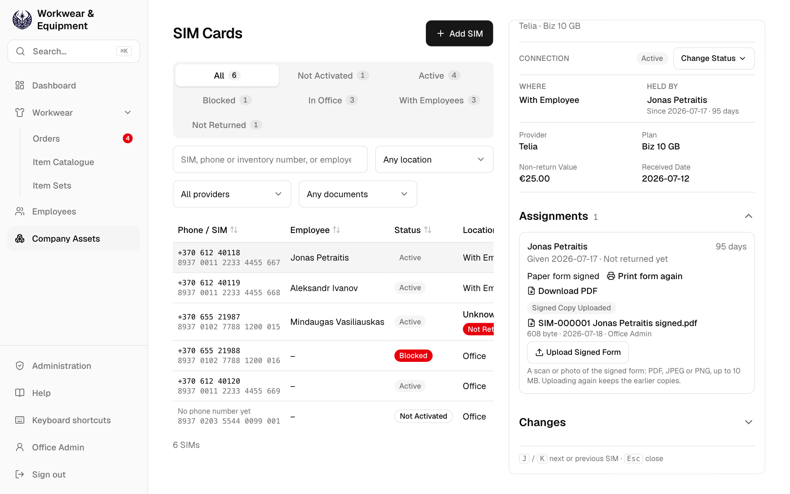

*Administrators and managers only:*

When it is physically back in the office, **Register SIM Return** or **Register Asset Return** puts it there. Each giving and return stays on its page under **Assignments**, with **Print form again** and **Download PDF** for its form. Printing, each PDF downloaded and the blocking email are recorded in its **Changes**, closed at first; choose **Changes** to open them.

Leaving never returns anything. When an employee does not give a card back, **Mark as Not Returned** records where it is: still with them, or unknown. It stays theirs until it comes back. **Prepare Blocking Email** then gives the text to copy into your own email to the provider; once they confirm, choose **Blocked** in **Change Status**.

Search finds a SIM by its SIM, phone or inventory number, and an item by its inventory number.

## 11. Administration

*Administrators only.*

**Administration** is where you manage who may use the app and what they may do, watch over how it runs, and keep the organisation's settings. It opens on **Overview**. Its other screens are **Users**, **Roles & permissions**, **Audit log**, **Security**, **System**, **Usage** and **Settings**.

Open it with **Administration** at the foot of the sidebar. It has a sidebar of its own; **Workwear & Equipment**, at its foot, takes you back.

You are signed in to both at once, and **Sign out** in either signs you out of both. Anyone whose roles let them manage users, roles or settings, or read the Audit log, Security, System, Usage or the backups, sees **Administration**, with only the screens their roles open.

## 12. Overview

*Administrators only.*

**Overview** answers the question: is anything wrong? **Needs attention** lists what to look at, the most urgent first, each with a link to where it is put right. When all is well, it says **Nothing needs your attention.**

- A backup failed, or backups have stopped.
- A copied sign-in was used, or many sign-ins failed.
- Requests are failing, or a new kind of error appeared.
- The access review is due. Review access every 90 days.
- The Audit log does not match its seals: someone changed it behind the app.
- Seals are not being timestamped: the timestamp service has not answered for a day.

**Figures**, below, show active users, who is signed in now, sign-ins today, the last 24 hours of requests, the database and the last backup.

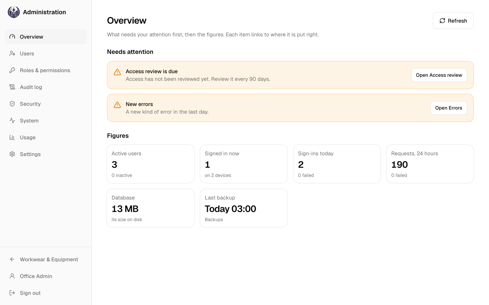

## 13. Users

*Administrators only.*

- Add, edit or deactivate accounts. Give each account one or more roles: a user may do what any of their roles allows. **Roles & permissions** says what each role allows.
- A role change reaches the user within minutes, without signing in again. A deactivated user is signed out on every device.
- To reset a password, use **⋯ → Reset password…**.
- You can't deactivate your own account, or take from yourself the role that lets you manage users or roles. Someone active always holds **Administrator**.
- If you signed in more than 12 hours ago, the app asks you to **Confirm your password** before saving the change.

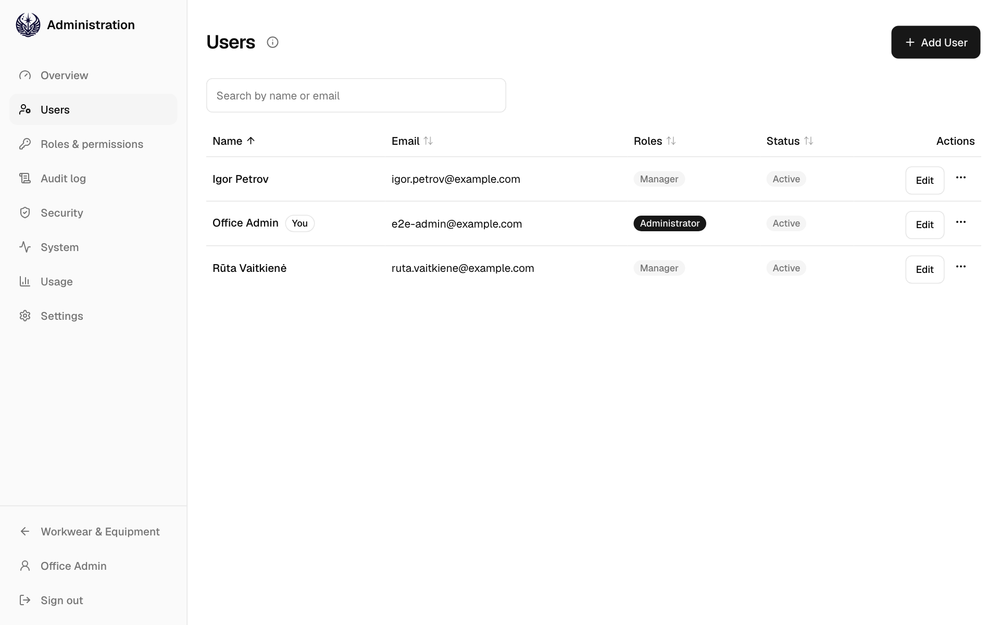

## 14. Roles & permissions

*Administrators only.*

**Roles & permissions** lists each role, what it allows and how many users hold it. A role is a set of permissions, such as **Manage Item Catalogue** or **Delete employees**. You give roles to users on **Users**.

- **Administrator**, **Manager** and **Employee** are built in. **Administrator** can do everything and cannot be changed: **View** shows what it allows. You can change what **Manager** and **Employee** allow, but not their names or descriptions, and you cannot delete them.
- **Add Role** makes a new one: a name, what it is for, and its permissions. Some permissions need another, which is ticked with them: **Manage users** needs **See users**.
- A change reaches the users who hold the role within minutes.
- **⋯ → Delete role…** deletes a role that no user holds. Take it from its users on **Users** first.
- If you signed in more than 12 hours ago, the app asks you to **Confirm your password** before saving the change.

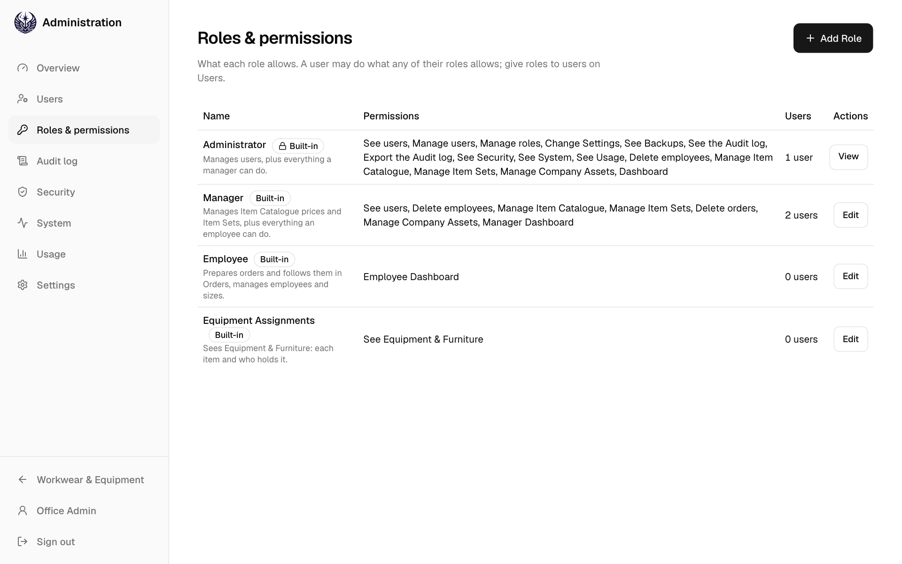
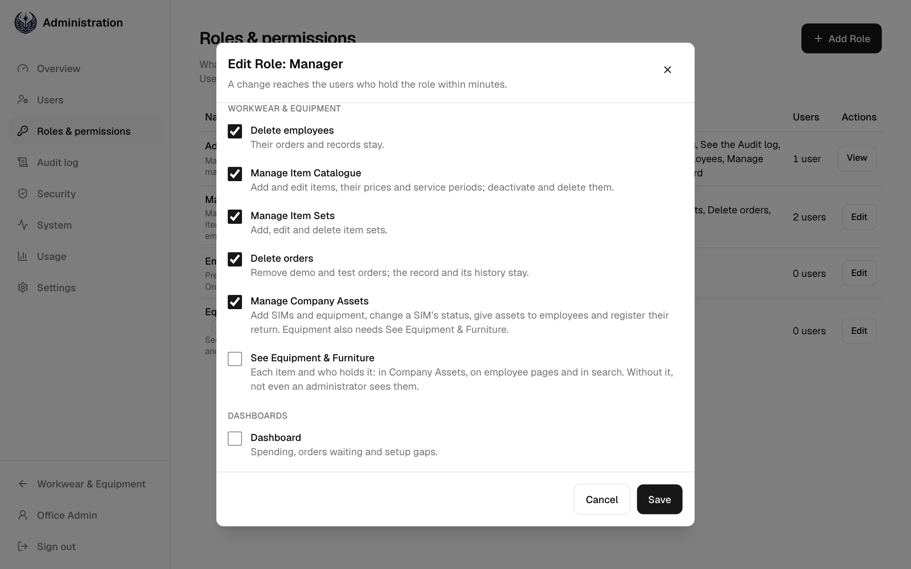

## 15. Audit log

*Administrators only.*

**Audit log** lists every recorded change: what changed, who made it, when, and where. A change is made in **Workwear & Equipment**, in **Administration**, through an employee's **Confirmation link**, or by the **System** itself.

Filter by **Area**, **Change**, **Person** and dates. Click a change to open it beside the list. It shows each field before and after, and **Open in Workwear & Equipment** opens the record. **All changes to this record** narrows the list to it.

- **Seals**, at the top: each day's changes are sealed an hour after the day ends, with a hash that also covers the day before, so a change altered, added or removed afterwards shows. **Verify** checks every seal again; the app also checks them every hour.
- Each seal also gets a timestamp: a public timestamp service signs the seal with the time. A seal made again later cannot get the original time, so not even someone with access to the server can rewrite the log unnoticed. The panel says through which day the seals are timestamped.
- If a sealed day does not match, or its timestamp is wrong, late or missing, the Overview says so. Tell whoever runs the server, and keep the backups from before that day.
- **Export** downloads the changes the filters select, between two days at most a year apart, as **CSV, for a spreadsheet** or **JSON lines, for an archive**. The export is itself recorded on the Audit log.
- Changes are kept for years (10, unless the server is set otherwise), then deleted a day at a time.

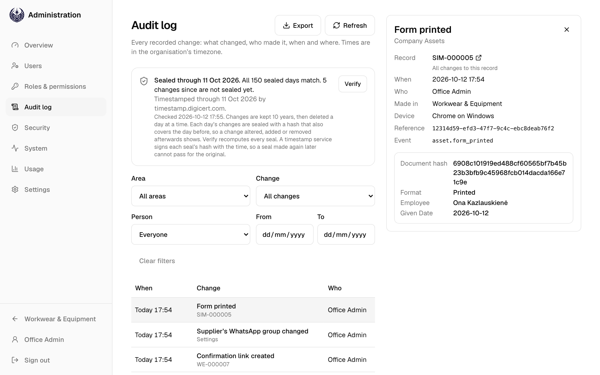

## 16. Security

*Administrators only.*

**Security** has three tabs:

- **Sign-ins**: every sign-in, failed attempt, confirmed password and sign-out, with the account, the address it came from and the device. Filter by event, person and dates. A failed attempt says why, such as **Wrong password**. Sign-in records are kept 180 days.
- **Signed-in devices**: every browser someone is signed in on now. **Sign out** a device that is lost or not recognised: that person must sign in again there, with their password.
- **Access review**: every user with their roles, what those allow, and their last sign-in. Administrators, and accounts not used for 90 days, are marked. Check that each still needs their access, change it on **Users**, then choose **Mark as reviewed**. Do it every 90 days: the Overview reminds you.

**Copied sign-in stopped** means someone used an old copy of a sign-in, so it was ended on every device that held it. Ask the user whether it was them. If not, have them change their password.

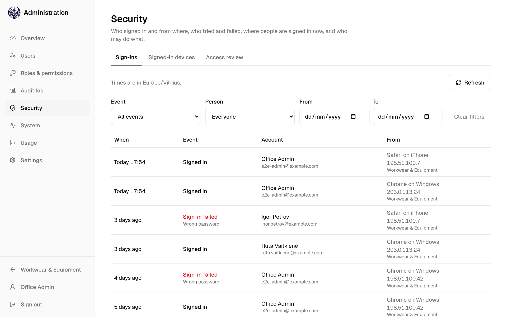
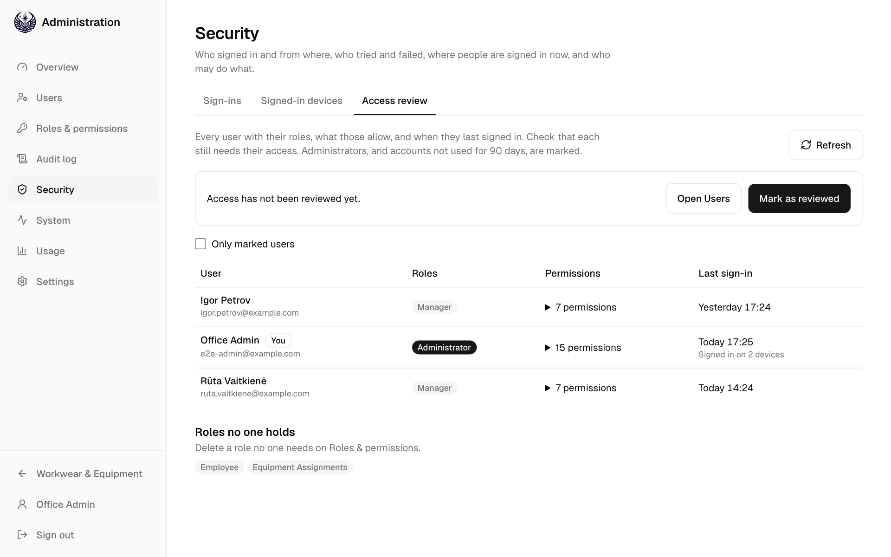

## 17. System

*Administrators only.*

**System** shows how the app is running. It has three tabs: **Status**, **Errors** and **Backups**.

- **Status**: whether the app is **Ready**, its version and when it started; the last 24 hours of requests, how many failed and how long they took; the database's size and latest migration; and how long sign-ins, errors and changes are kept.
- **Errors**: what went wrong, on the server or in someone's browser, with how many times and when last. Open one to see who met it, where and on what device. Errors are kept 30 days.
- **Backups**: below.

When something goes wrong, the app shows a **Reference**, such as `9f2c1a7e`. The error on **Errors** shows the same reference. Pass it on to whoever runs the server: it finds the error in the server's log.

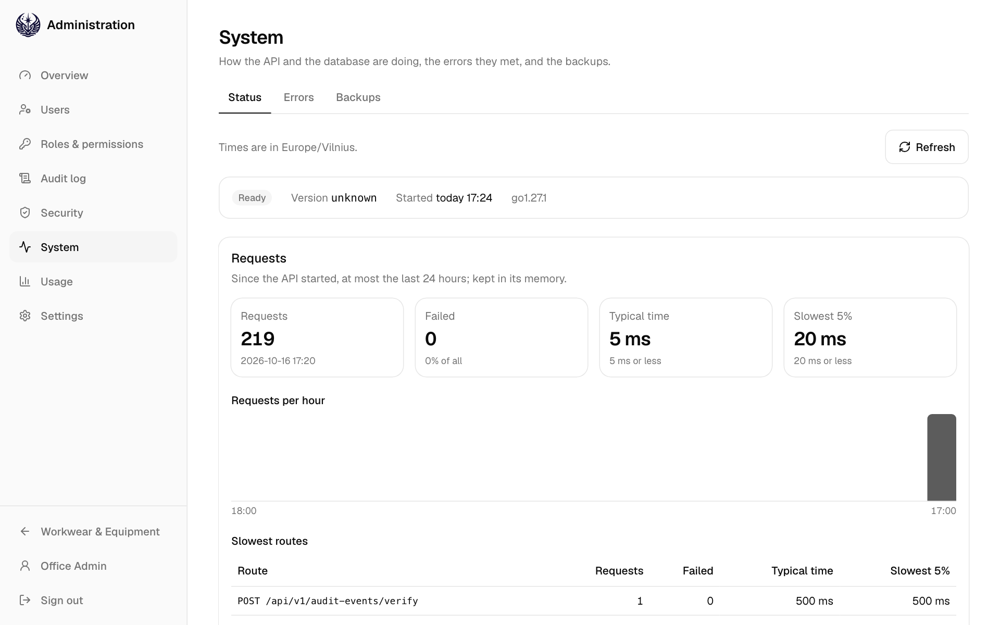
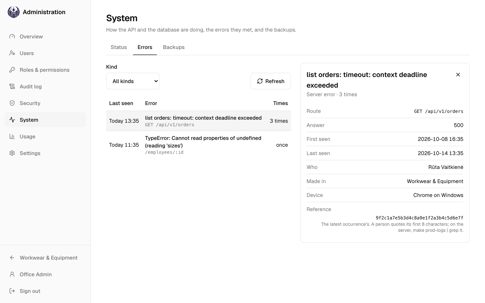

## 18. Backups

*Administrators only.*

**System → Backups** shows whether the database is backed up. The backup service on the server copies the whole database on a schedule, every night unless set otherwise, and deletes old copies after the retention period.

The line at the top says whether all is well. It turns red when the last backup failed, when a scheduled one is overdue, or when the service has stopped reporting. Tell whoever runs the server.

A second warning shows while the backups are kept only on the server itself, because they would be lost with it.

- **Last backup** and **Next backup**: when, with the last one's size and how long it took.
- **Stored** and **Total size**: the backups kept now.
- **Recent backups**: every attempt, newest first, with the error of a failed one.
- **Settings**: the schedule, where backups are saved, how long they are kept and whether they are encrypted.

The settings are made on the server, and a backup is restored there too: the app only shows them.

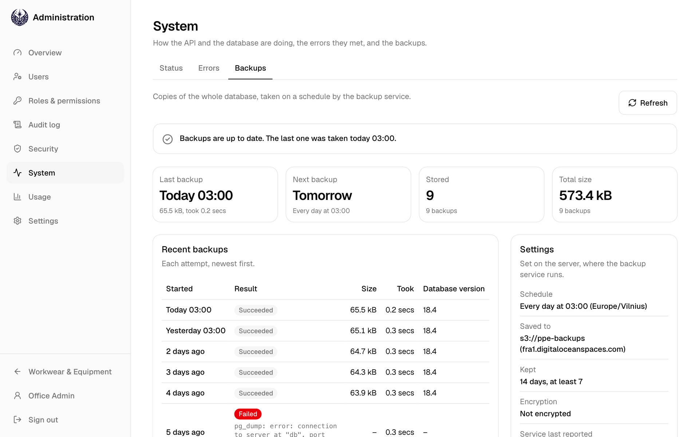

## 19. Usage

*Administrators only.*

**Usage** shows how the apps are used. No page is tracked: everything comes from what the app records anyway.

- At the top: the people active today, in the last 7 and in the last 30 days, out of the active accounts, and today's sign-ins.
- **Active people per day**, by app, with a line for each role. **Sign-ins per day**, with the failed ones.
- **Confirmation links, last 90 days**: how many links employees were sent, opened and confirmed, and how many are still waiting, expired or were replaced.
- **Changes per week**, by area, darker for more, and the people who made the most.
- **Devices, last 30 days** and **Languages**: phones, tablets and computers with their systems and browsers, and the languages of users and employees.
- **Data quality, last 90 days**: employees without sizes, and items without a price or service period. Fewer is better.

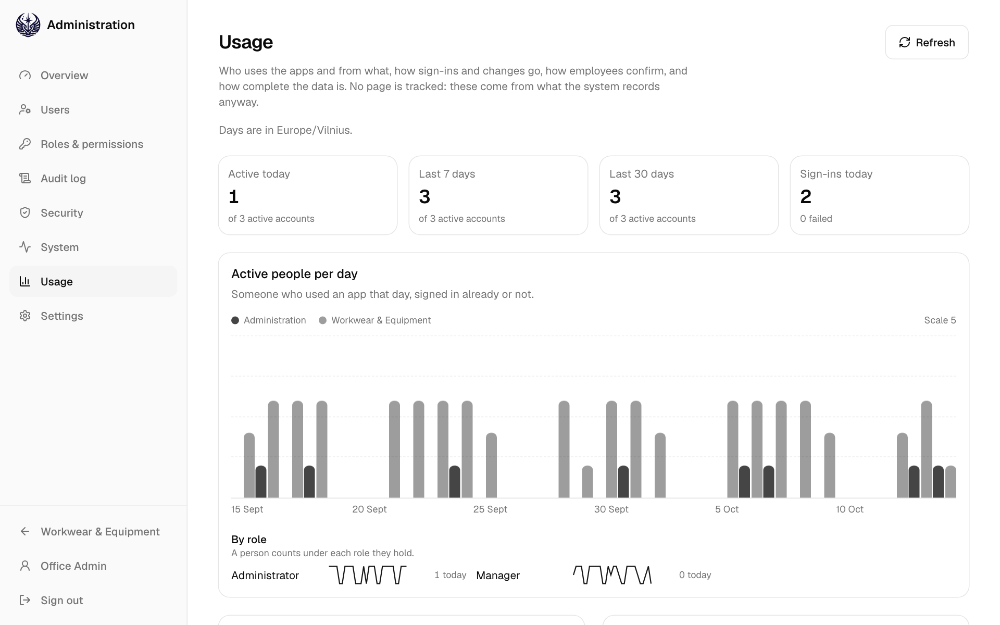

## 20. Settings

*Administrators only.*

**Supplier's WhatsApp group**: enter the group's name and its invite link. In WhatsApp, open the group, tap its name, then **Invite via link** and **Copy link**.

**Copy for WhatsApp** then offers to open that group, where you paste the order message. WhatsApp cannot open a group with the message already typed in. **Remove the group** goes back to opening WhatsApp without a chat chosen.

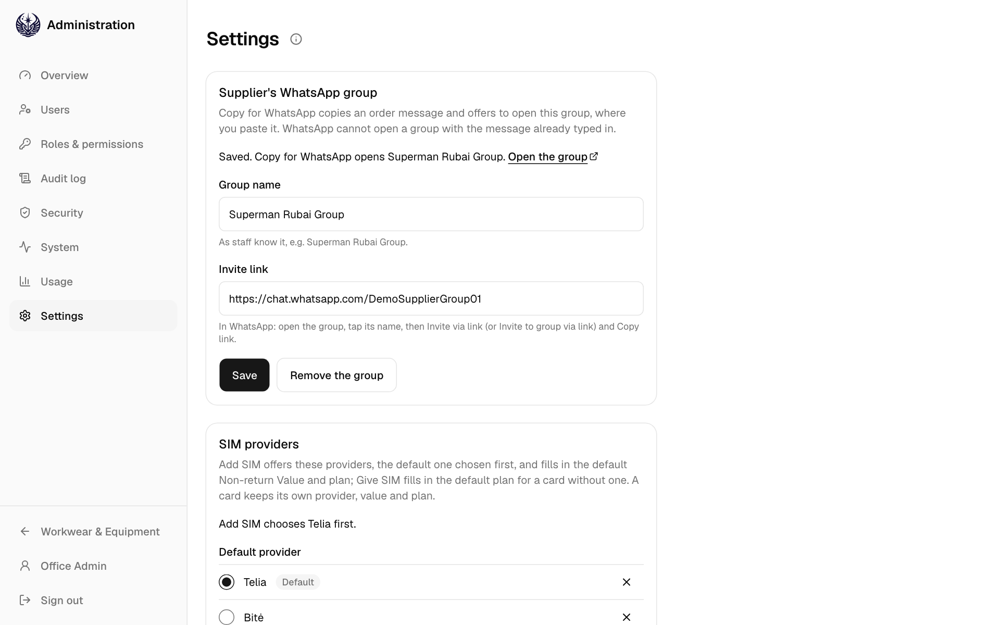

**SIM providers**: the providers **Add SIM** offers. Type a name and choose **Add**. Mark one as the **Default provider**, which Add SIM chooses first, or choose **No default**; the cross beside a name removes it. **Default Non-return Value (€)** is the amount Add SIM fills in for a new card, such as `25.00`; leave it empty for none. Nothing changes until you choose **Save**.

A card already registered keeps its provider, even one you remove from the list, and its non-return value.

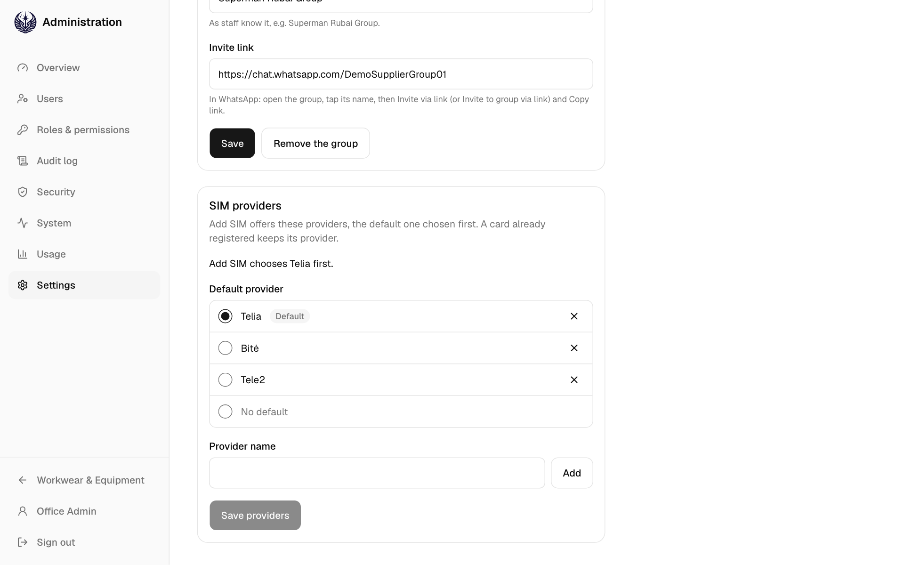

## 21. Your account

- **Language**: English, Lietuvių or Русский. The choice is saved on your account, so every device you sign in on uses it. The employee's confirmation page and the record stay in English and Russian. Dates follow your language: 2026-10-15 in English, 2026.10.15 in Lithuanian, 15.10.2026 in Russian.
- **Theme**: **Light**, **Dark** or **System**, which follows the device. It is kept on this device, and the sign-in page uses it too.
- **Change password**: your other devices are signed out, and this one stays signed in.
- **Signed-in devices**: every browser you are signed in on, with when it was last used. **This device** comes first. Sign out a device you no longer use or do not recognise, or choose **Sign out all other devices**.
- **Table rows**: **Compact** fits more rows on the screen.

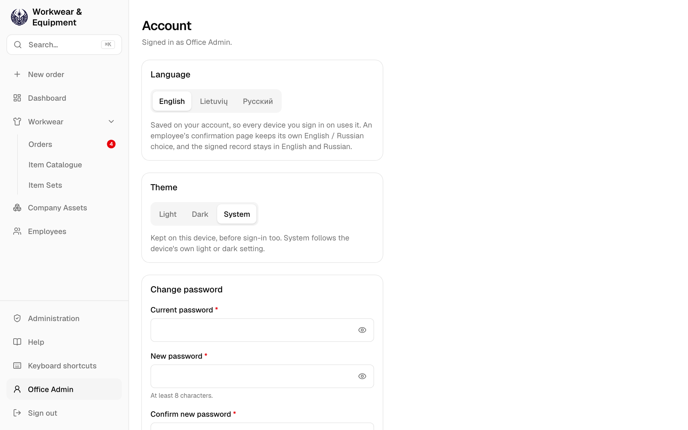
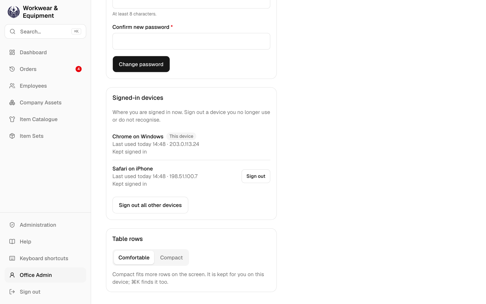

## 22. Search and shortcuts

| Key | Does |
| --- | --- |
| `⌘K` / `Ctrl K` | Search record numbers, employees, items, company assets and screens. For example, type a name, then choose **New order for …**. |
| `/` | Go to the search or Add Item field. |
| `G` then `D` `O` `H` `E` `A` `C` `S` `U` | Go to Dashboard, Create Order, Orders, Employees, Company Assets, Catalogue, Item Sets or Users (in Administration). |
| `J` / `K`, `Esc` | Move through Orders, SIM Cards, Equipment or the Item Catalogue, or close the one open. |
| `⌘/Ctrl` `Enter` | On Create Order, review the order. |
| `?` | Show all shortcuts. |

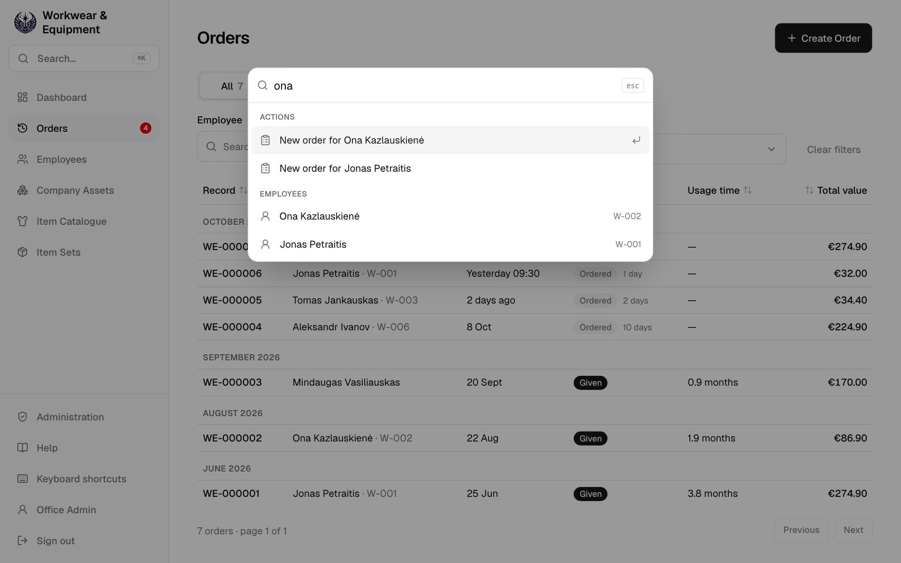

The screenshots show demo data. Item names are data, so they show as entered.
